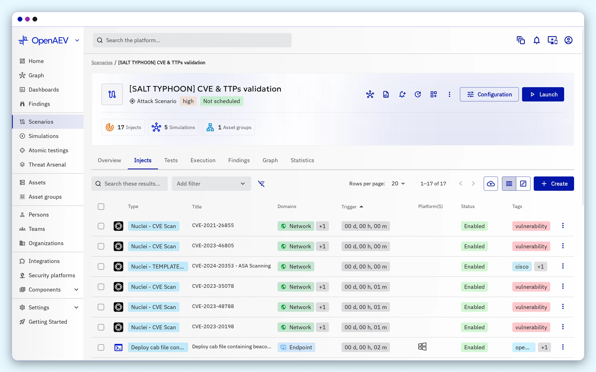
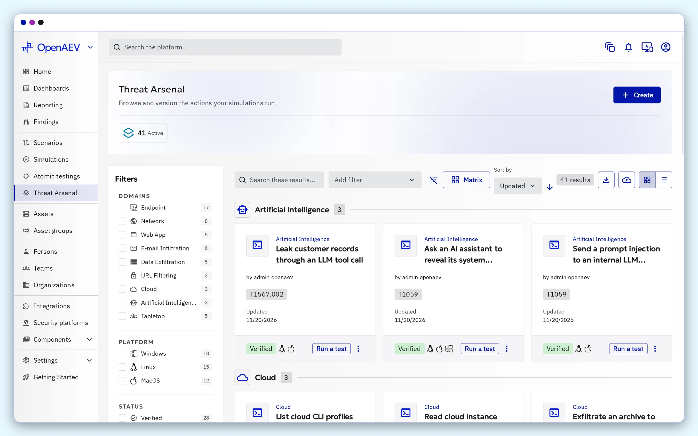
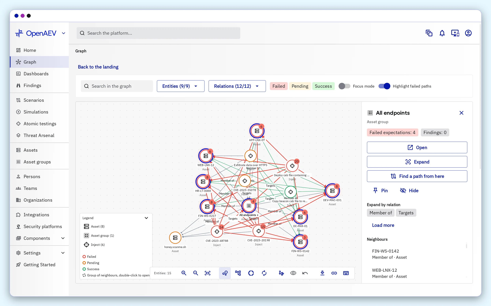
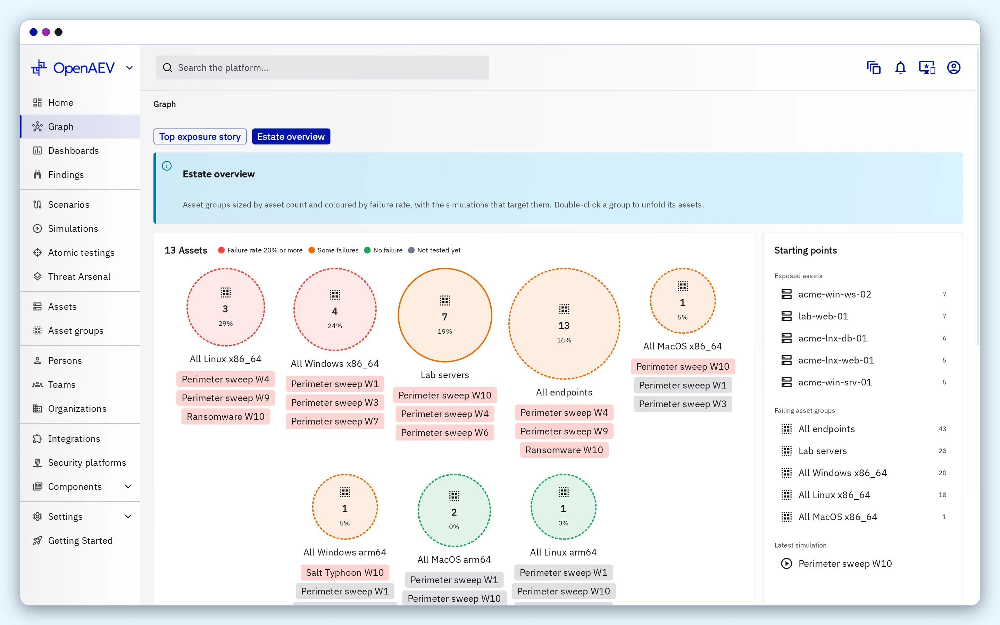
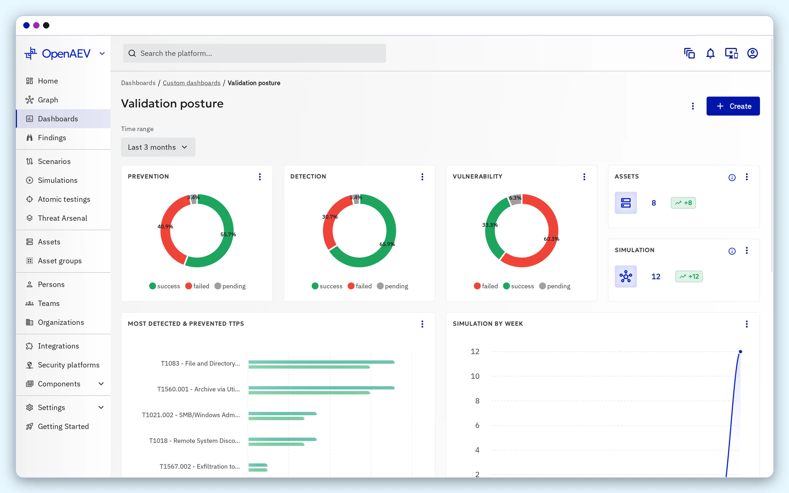
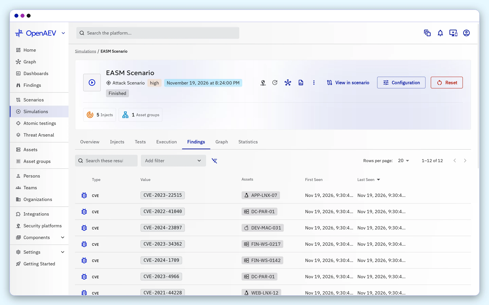
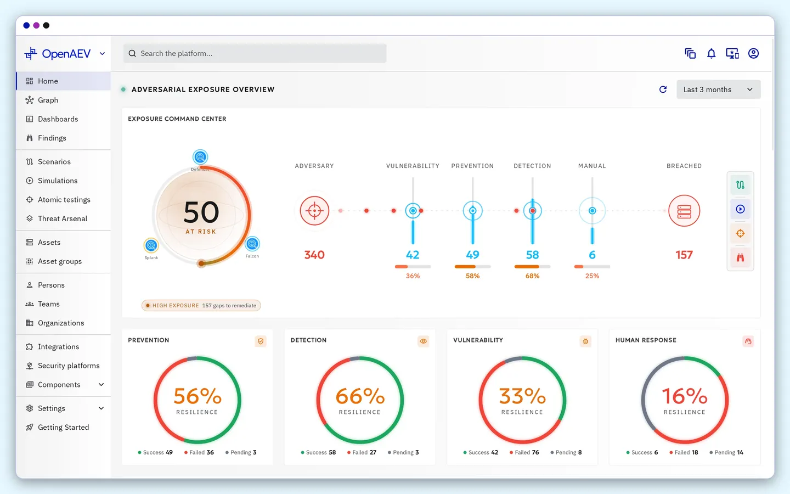
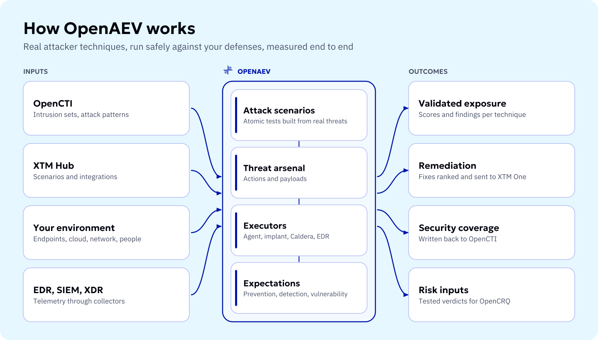
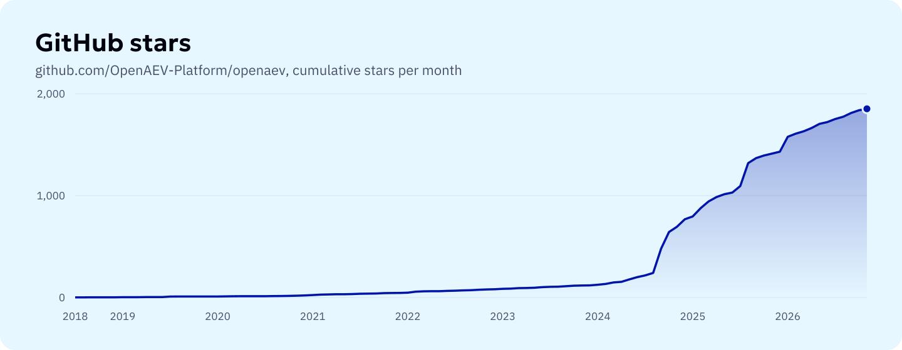

<a href="https://filigran.io/products/openaev"></a>

<p align="center">
  <a href="https://github.com/OpenAEV-Platform/openaev/stargazers"></a>
  <a href="https://github.com/OpenAEV-Platform/openaev/releases/latest"></a>
  <a href="https://hub.docker.com/r/openaev/platform"></a>
  <a href="LICENSE"></a>
  <a href="https://github.com/OpenAEV-Platform/openaev/actions/workflows/core-ci.yml"></a>
  <a href="https://docs.openaev.io"></a>
  <a href="https://community.filigran.io"></a>
</p>

> **Community workshop:** Join us as Taylor Walton (of SOCFortress) walks through his working SOC stack: OpenCTI → OpenAEV → Wazuh → Velociraptor. Taylor will be joined by OpenAEV's product owner to cover what's coming next for OpenCTI and OpenAEV.
>
> [Register](https://events.filigran.io/register/e751635a-9aec-49f5-801c-40cfded49c87?utm_medium=community&utm_source=github&utm_campaign=Dec-2026-Community-Workshop) · Dec 10 at 10 AM ET/4PM CET
>
> Join us on the
> [Filigran Community Slack](https://community.filigran.io/?utm_medium=community&utm_source=github).

<p align="center"><b>The open source adversarial exposure validation platform: prove which threats get through your defenses.</b></p>

OpenAEV turns threat intelligence from [OpenCTI](https://github.com/OpenCTI-Platform/opencti) into attack scenarios, runs them against your real endpoints, cloud and security stack, and tells you which techniques were prevented, which were detected and which got through. It is the validation stage of CTEM in the XTM Platform: validated exposure is priced by [OpenCRQ](https://github.com/OpenCRQ-Platform/opencrq) and taken to a verified fix by [XTM One](https://github.com/XTM-One-Platform/xtm-one).

<p align="center">If OpenAEV helps your security program, <a href="https://github.com/OpenAEV-Platform/openaev/stargazers">give it a star</a>: it is how the project grows.</p>

<picture>
  <source media="(prefers-color-scheme: dark)" srcset="./.github/img/readme/hero-dark.webp">
  <source media="(prefers-color-scheme: light)" srcset="./.github/img/readme/hero-light.webp">
  
</picture>

## Table of contents

- [Why OpenAEV](#why-openaev)
- [Capabilities](#capabilities)
- [Gallery](#gallery)
- [How it works](#how-it-works)
- [Part of the XTM Platform](#part-of-the-xtm-platform)
- [Use cases by security role](#use-cases-by-security-role)
- [Quick start](#quick-start)
- [Editions](#editions)
- [Integrations and ecosystem](#integrations-and-ecosystem)
- [Community](#community)
- [Contributing](#contributing)
- [Security](#security)
- [License](#license)
- [About Filigran](#about-filigran)

## Why OpenAEV

Most security teams know their vulnerabilities and their threat landscape. Few can say, with evidence, whether their controls stop the techniques the adversaries that target them use.

- **Threat-informed.** Scenarios come from the intrusion sets, campaigns, reports and attack patterns in OpenCTI, not from a generic checklist.
- **Real execution, safe by design.** Payloads run through agents and implants on your own endpoints, inside the scope you define, and every action expects a prevention and a detection.
- **Exposure you can act on.** Results become findings and gaps with detection and remediation guidance, tracked from one run to the next.

## Capabilities

| CTEM stage | What OpenAEV gives your team |
|---|---|
| **Scoping** | Assets, asset groups and endpoints in scope, and the threats from OpenCTI security coverage that the scenarios test. |
| **Discovery** | CVEs, open ports, credentials, shares and Active Directory weaknesses extracted from execution output, deduplicated across runs and enriched with CVSS. |
| **Prioritization** | The exploration graph and attack path map show which findings an attacker chains to reach what matters, chokepoints first. |
| **Validation** | Breach and attack simulation, atomic tests and attack chaining on Windows, Linux and macOS, with prevention and detection expectations scored by collectors. |
| **Mobilization** | Detection and remediation guidance on every gap, results written back to OpenCTI as security coverage, and dashboards for each audience. |

## Gallery

<table>
  <tr>
    <td width="50%" valign="top">
      <picture>
        <source media="(prefers-color-scheme: dark)" srcset="./.github/img/readme/g1-dark.webp">
        <source media="(prefers-color-scheme: light)" srcset="./.github/img/readme/g1-light.webp">
        
      </picture>
      <p><b>Scenarios.</b> Injects on network and endpoints, built from the techniques and CVEs of a threat.</p>
    </td>
    <td width="50%" valign="top">
      <picture>
        <source media="(prefers-color-scheme: dark)" srcset="./.github/img/readme/g2-dark.webp">
        <source media="(prefers-color-scheme: light)" srcset="./.github/img/readme/g2-light.webp">
        
      </picture>
      <p><b>Threat arsenal.</b> MITRE ATT&CK mapped actions by domain and platform, ready to run as a test.</p>
    </td>
  </tr>
  <tr>
    <td width="50%" valign="top">
      <picture>
        <source media="(prefers-color-scheme: dark)" srcset="./.github/img/readme/g3-dark.webp">
        <source media="(prefers-color-scheme: light)" srcset="./.github/img/readme/g3-light.webp">
        
      </picture>
      <p><b>Exploration graph.</b> Every asset, finding and technique of a run, and how they connect.</p>
    </td>
    <td width="50%" valign="top">
      <picture>
        <source media="(prefers-color-scheme: dark)" srcset="./.github/img/readme/g4-dark.webp">
        <source media="(prefers-color-scheme: light)" srcset="./.github/img/readme/g4-light.webp">
        
      </picture>
      <p><b>Estate overview.</b> Every asset group of the estate, sized and coloured by how often attacks got through.</p>
    </td>
  </tr>
  <tr>
    <td width="50%" valign="top">
      <picture>
        <source media="(prefers-color-scheme: dark)" srcset="./.github/img/readme/g5-dark.webp">
        <source media="(prefers-color-scheme: light)" srcset="./.github/img/readme/g5-light.webp">
        
      </picture>
      <p><b>Custom dashboards.</b> Widgets over simulations, findings and coverage, for each audience.</p>
    </td>
    <td width="50%" valign="top">
      <picture>
        <source media="(prefers-color-scheme: dark)" srcset="./.github/img/readme/g6-dark.webp">
        <source media="(prefers-color-scheme: light)" srcset="./.github/img/readme/g6-light.webp">
        
      </picture>
      <p><b>Findings.</b> Every CVE and exposure a run surfaced, tied to the asset it was found on.</p>
    </td>
  </tr>
</table>

**Walkthrough.** From the exposure command center to a scenario, its execution and the findings it produced, in 15 seconds.

<picture>
  <source media="(prefers-color-scheme: dark)" srcset="./.github/img/readme/walkthrough-dark.webp">
  <source media="(prefers-color-scheme: light)" srcset="./.github/img/readme/walkthrough-light.webp">
  
</picture>

## How it works

OpenAEV builds scenarios from OpenCTI security coverage and the XTM Hub scenarios library, runs them through the OpenAEV agent and implant, Caldera or the EDR executors, and reaches network, cloud, web and email through injectors. Collectors read your EDR, SIEM and XDR to score each expectation; findings, scores and remediation go back to OpenCTI, OpenCRQ and XTM One.

<picture>
  <source media="(prefers-color-scheme: dark)" srcset="./.github/img/readme/flow-dark.svg">
  <source media="(prefers-color-scheme: light)" srcset="./.github/img/readme/flow-light.svg">
  
</picture>

## Part of the XTM Platform

OpenAEV is one of the five products of the [XTM Platform](https://filigran.io), the open platform for Agentic CTEM. Each product owns stages of the CTEM loop; XTM One runs the loop across them.

<picture>
  <source media="(prefers-color-scheme: dark)" srcset="./.github/img/readme/xtm-platform-ctem-dark.svg">
  <source media="(prefers-color-scheme: light)" srcset="./.github/img/readme/xtm-platform-ctem-light.svg">
  
</picture>

| | Product | Role in CTEM | Repository | Product page |
|---|---|---|---|---|
| <picture><source media="(prefers-color-scheme: dark)" srcset="./.github/img/readme/mark-xtm-one-dark.svg"></picture> | **XTM One** | Core and agentic layer: runs CTEM across the modules and gets the fix done | [XTM-One-Platform/xtm-one](https://github.com/XTM-One-Platform/xtm-one) | [filigran.io/products/xtm-one](https://filigran.io/products/xtm-one) |
| <picture><source media="(prefers-color-scheme: dark)" srcset="./.github/img/readme/mark-opencti-dark.svg"></picture> | **OpenCTI** | Scoping and Discovery: know the adversary and the threats that target you | [OpenCTI-Platform/opencti](https://github.com/OpenCTI-Platform/opencti) | [filigran.io/products/opencti](https://filigran.io/products/opencti) |
| <picture><source media="(prefers-color-scheme: dark)" srcset="./.github/img/readme/mark-opencrq-dark.svg"></picture> | **OpenCRQ** | Prioritization: turn exposure into financial risk | [OpenCRQ-Platform/opencrq](https://github.com/OpenCRQ-Platform/opencrq) | [filigran.io/products/opencrq](https://filigran.io/products/opencrq) |
| <picture><source media="(prefers-color-scheme: dark)" srcset="./.github/img/readme/mark-openaev-dark.svg"></picture> | **OpenAEV** | Validation: prove your defenses against real attacker techniques | [OpenAEV-Platform/openaev](https://github.com/OpenAEV-Platform/openaev) | [filigran.io/products/openaev](https://filigran.io/products/openaev) |
| <picture><source media="(prefers-color-scheme: dark)" srcset="./.github/img/readme/mark-xtm-hub-dark.svg"></picture> | **XTM Hub** | Tradecraft library and gateway: integrations, dashboards and scenarios for every product | [XTM-Hub/xtm-hub](https://github.com/XTM-Hub/xtm-hub) | [filigran.io/platforms/xtm-hub](https://filigran.io/platforms/xtm-hub/) |

## Use cases by security role

| Role | What OpenAEV does for it |
|---|---|
| **CTI** | Threat intelligence that becomes a test: intrusion sets, campaigns and reports from OpenCTI turned into scenarios, results written back as security coverage. |
| **SOC** | Proof of which techniques the EDR, SIEM and XDR detect, scored automatically by collectors after every run. |
| **Detection engineering** | Detection remediation on every undetected technique, so each gap comes with the rule that closes it. |
| **Red and purple team** | Atomic tests, attack chaining and the autonomous attack path orchestrator of XTM One against your authorized scope. |
| **Vulnerability and exposure management** | Findings from execution output with CVSS, and the attack path that shows which of them an attacker can chain. |
| **Risk and CISO** | Prevention, detection and vulnerability scores over time and the validated exposure OpenCRQ prices into expected loss. |

## Quick start

Requirements: Docker with Docker Compose.

```bash
git clone https://github.com/OpenAEV-Platform/docker.git openaev-docker && cd openaev-docker
cp .env.sample .env      # set the admin credentials, tokens and passwords
docker compose -p openaev -f docker-compose.yml up -d
```

Open the URL set by `OPENAEV_HOST` and `OPENAEV_PORT` in `.env`, install an agent on a test endpoint and launch your first atomic test. The stack also starts XTM One next to OpenAEV.

- **Docker**: [`openaev/platform`](https://hub.docker.com/r/openaev/platform), one tag per [release](https://github.com/OpenAEV-Platform/openaev/releases).
- **Helm**: the [installation guide](https://docs.openaev.io/latest/deployment/platform/installation/).
- **The whole XTM Platform**: [FiligranHQ/xtm-docker](https://github.com/FiligranHQ/xtm-docker).

## Editions

| | Community Edition | Enterprise Edition |
|---|---|---|
| License | [Apache 2.0](LICENSE) | [OpenAEV Enterprise Edition License](LICENSE) |
| Scenarios, simulations, atomic tests, findings, dashboards | Yes | Yes |
| Generative AI and the autonomous attack path | | Yes |
| Multi-tenancy | | Yes |

Enable the Enterprise Edition in **Settings > Filigran Experience** with a license; the [documentation](https://docs.openaev.io/latest/administration/enterprise/) lists what it adds.

## Integrations and ecosystem

- **XTM Platform:** OpenCTI threats in and security coverage back, validated exposure to OpenCRQ, remediation and the autonomous attack path with XTM One.
- **[XTM Hub](https://hub.filigran.io/cybersecurity-solutions/openaev-scenarios):** the OpenAEV scenarios library and integrations, deployed in one click.
- **Execution:** the OpenAEV [agent](https://github.com/OpenAEV-Platform/agent) and [implant](https://github.com/OpenAEV-Platform/implant), Caldera, CrowdStrike Falcon, SentinelOne, Microsoft Defender for Endpoint, Tanium and Palo Alto Cortex.
- **Scoring:** [collectors](https://github.com/OpenAEV-Platform/collectors) for your EDR, SIEM and XDR, and [injectors](https://github.com/OpenAEV-Platform/injectors) for network, cloud, web and email.

## Community

Star OpenAEV to follow it and to help other security teams find it.

<picture>
  <source media="(prefers-color-scheme: dark)" srcset="./.github/img/readme/stars-dark.svg">
  <source media="(prefers-color-scheme: light)" srcset="./.github/img/readme/stars-light.svg">
  
</picture>

- **Questions and discussion**: the Filigran [community Slack](https://community.filigran.io).
- **Bugs and feature requests**: [GitHub issues](https://github.com/OpenAEV-Platform/openaev/issues).
- **Learn**: free courses on [Filigran Academy](https://academy.filigran.io).

## Contributing

Read the [contributing guide](CONTRIBUTING.md) to set up a development environment and propose a change. OpenAEV has adopted a [Code of Conduct](CODE_OF_CONDUCT.md). First contribution: the [good first issues](https://github.com/OpenAEV-Platform/openaev/labels/good%20first%20issue).

## Security

Report vulnerabilities privately as described in [SECURITY.md](SECURITY.md), never in a public issue.

## License

OpenAEV is open source under the [Apache 2.0 license](LICENSE); the Enterprise Edition features are under the OpenAEV Enterprise Edition License, as stated in [LICENSE](LICENSE) and in each source file header.

## About Filigran

OpenAEV is designed and developed by [Filigran](https://filigran.io), the company behind the [XTM Platform](https://filigran.io) for Agentic CTEM.

<picture>
  <source media="(prefers-color-scheme: dark)" srcset="./.github/img/readme/filigran-dark.svg">
  <source media="(prefers-color-scheme: light)" srcset="./.github/img/readme/filigran-light.svg">
  
</picture>
