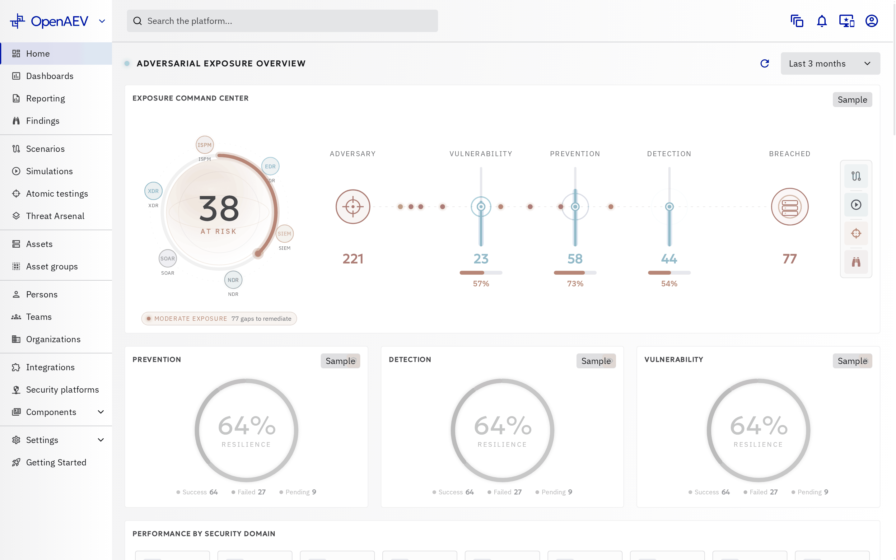
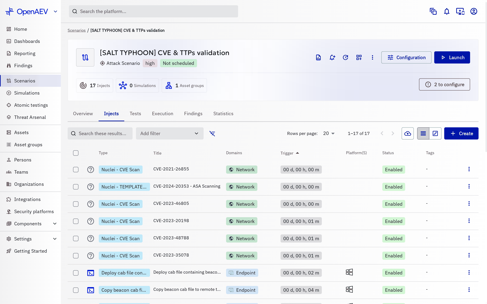
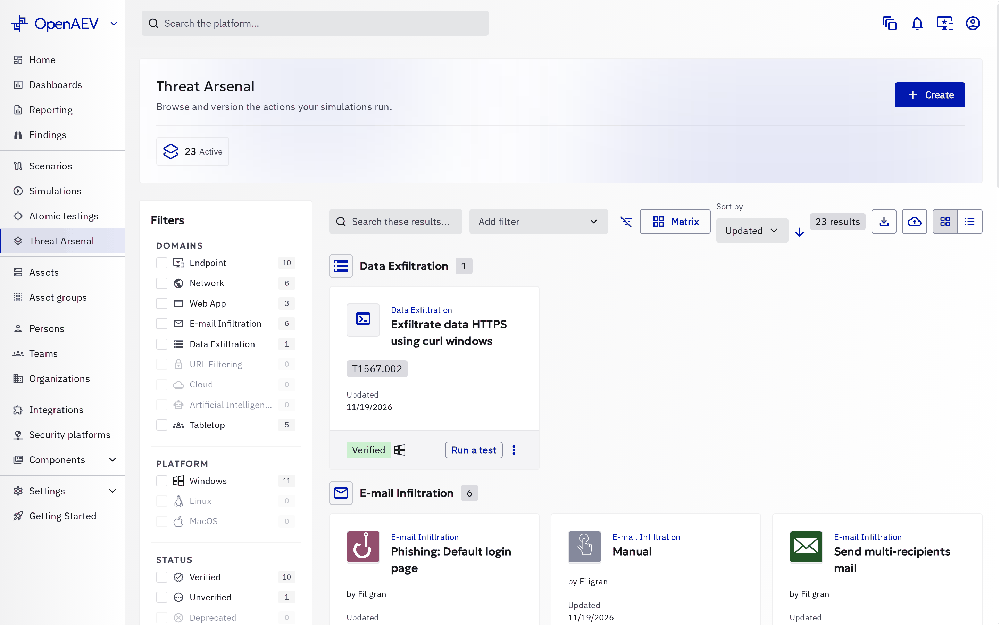
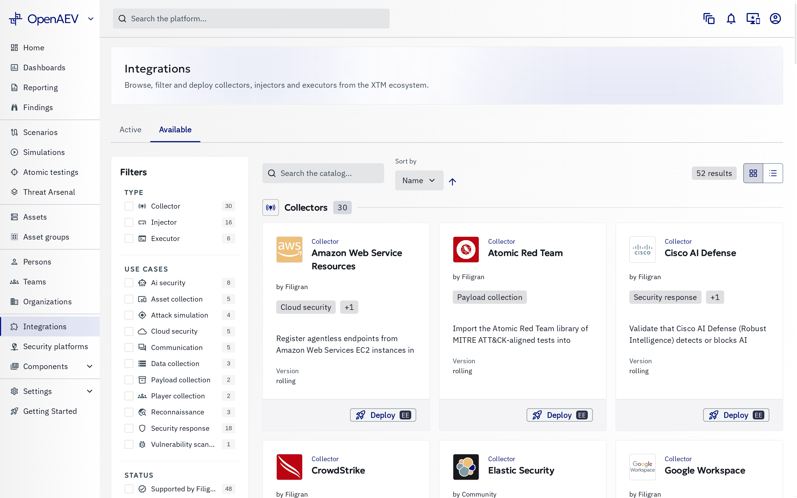
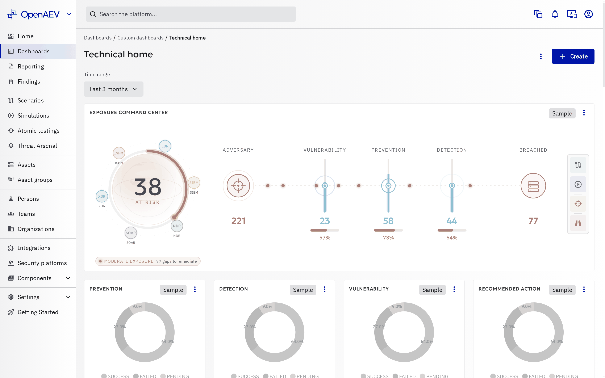
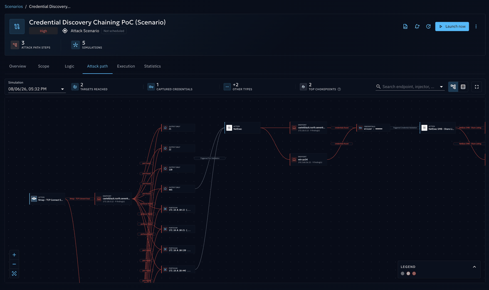
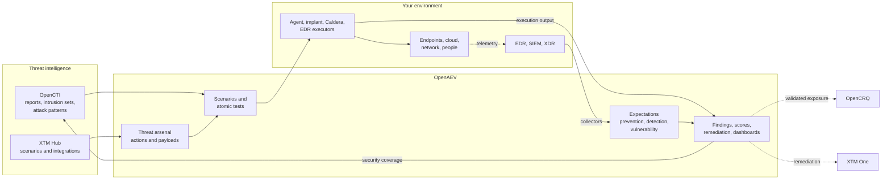
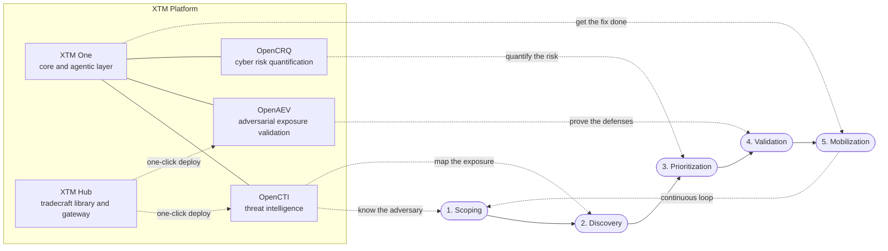

<h1 align="center">
  <a href="https://filigran.io/products/openaev"></a>
</h1>

<p align="center"><b>Adversarial exposure validation for Continuous Threat Exposure Management (CTEM).</b><br/>
Prove your defenses against the techniques of the adversaries that target you, find the exposures that matter, and get them fixed.</p>

<p align="center">
  <a href="https://github.com/OpenAEV-Platform/openaev/stargazers"></a>
  <a href="https://github.com/OpenAEV-Platform/openaev/releases/latest"></a>
  <a href="https://hub.docker.com/r/openaev/platform"></a>
  <a href="LICENSE"></a>
  <a href="https://docs.openaev.io"></a>
  <a href="https://community.filigran.io"></a>
</p>

<p align="center">
  <a href="https://filigran.io/products/openaev">Website</a> ·
  <a href="https://docs.openaev.io">Documentation</a> ·
  <a href="https://demo.openaev.io">Live demo</a> ·
  <a href="https://github.com/OpenAEV-Platform/openaev/releases">Releases</a> ·
  <a href="https://community.filigran.io">Community</a>
</p>

OpenAEV is the open source adversarial exposure validation platform of the [XTM Platform](https://filigran.io), Filigran's
platform for Continuous Threat Exposure Management (CTEM). It turns threat intelligence from
[OpenCTI](https://github.com/OpenCTI-Platform/opencti) into attack scenarios, runs them against your real endpoints,
cloud and security stack, and tells you which techniques were prevented, which were detected and which got through.
The result is a list of exposures backed by evidence, with the detection and remediation work to close them.

> If OpenAEV helps your security team, **[star the repository](https://github.com/OpenAEV-Platform/openaev/stargazers)**.
> It is the simplest way to support the project and help other defenders find it.

<p align="center">
  <picture>
    <source media="(prefers-color-scheme: dark)" srcset="./.github/img/openaev-home-dark.png">
    
  </picture>
  <br/><sub>Home: the exposure command center, from the adversary to what got through (sample data).</sub>
</p>

## Table of contents

- [Why OpenAEV](#why-openaev)
- [Capabilities](#capabilities)
- [Gallery](#gallery)
- [How OpenAEV works](#how-openaev-works)
- [OpenAEV in the XTM Platform](#openaev-in-the-xtm-platform)
- [Editions](#editions)
- [Quick start](#quick-start)
- [Documentation and demo](#documentation-and-demo)
- [Contributing](#contributing)
- [Community](#community)
- [Security](#security)
- [About](#about)

## Why OpenAEV

Most security teams know their vulnerabilities and their threat landscape. Few can say, with evidence, whether their
controls stop the techniques the adversaries that target them actually use. OpenAEV answers that question continuously:

- **Threat-informed.** Scenarios come from the intrusion sets, campaigns, reports and attack patterns in OpenCTI, not
  from a generic checklist.
- **Real execution, safe by design.** Payloads run through agents and implants on your own endpoints, inside the scope
  you define.
- **Outcome per control.** Every action expects a prevention and a detection; collectors read your EDR, SIEM and XDR to
  score each expectation.
- **Exposure you can act on.** Results become findings and gaps with detection and remediation guidance, tracked from
  one run to the next.

## Capabilities

| Capability | What it does |
|---|---|
| **Threat-informed scenarios from OpenCTI** | Generate scenarios from OpenCTI security coverage (reports, intrusion sets, campaigns, incidents): attack patterns are mapped to compatible actions of your threat arsenal and scheduled for execution. Results flow back to OpenCTI. |
| **Breach and attack simulation** | Execute payloads on Windows, Linux and macOS through the OpenAEV agent and implant, Caldera, or the EDR executors (CrowdStrike Falcon, SentinelOne, Microsoft Defender for Endpoint, Tanium, Palo Alto Cortex). |
| **Threat arsenal** | MITRE ATT&CK-mapped actions, payloads (commands, executables, files, DNS), output parsers and a library of injectors, importable from the XTM Hub. |
| **Prevention and detection validation** | Expectations per action (prevention, detection, vulnerability, manual), scored automatically by collectors that read your EDR, SIEM and XDR. |
| **Atomic testing** | Run a single technique against a single target to validate one control in minutes. |
| **Attack chaining** | Chain actions with conditions on their outputs into a logic graph, and read how the attack propagated on the attack path map: endpoints reached, findings produced, chokepoints. |
| **Findings and exposure** | CVEs, open ports, credentials, shares and Active Directory weaknesses extracted from execution output, deduplicated across runs, enriched with CVSS, sensitive values masked. |
| **Remediation** | Detection remediation on threat arsenal actions and injects, remediation on CVEs, so every gap comes with the rule or fix that closes it. |
| **Dashboards** | The exposure command center on the home page (assets at risk, prevention, detection and vulnerability scores, gaps to remediate), and custom dashboards and widgets over simulations, findings and coverage. |
| **Generative AI** | Generate content and scenarios with AI, through your own AI provider or XTM One. |
| **Autonomous attack path** | Describe an objective in plain language; an AI orchestrator in [XTM One](https://github.com/XTM-One-Platform/xtm-one) plans, executes and adapts a chained attack against your authorized scope, streams its decisions and records proof of exploitation and capability gaps. |
| **Multi-tenancy** | Isolated tenants on one platform. |
| **Human-centric exercises** | Phishing campaigns and tabletop injects (email, media pressure, challenges) for the human side of exposure. |

Which capabilities belong to the Enterprise Edition is listed in the
[documentation](https://docs.openaev.io/latest/administration/enterprise/).

## Gallery

<table>
  <tr>
    <td width="50%" valign="top">
      <picture>
        <source media="(prefers-color-scheme: dark)" srcset="./.github/img/openaev-scenario-injects-dark.png">
        
      </picture>
      <br/><sub><b>Scenarios.</b> Injects on network and endpoints, built from the techniques and CVEs of a threat.</sub>
    </td>
    <td width="50%" valign="top">
      <picture>
        <source media="(prefers-color-scheme: dark)" srcset="./.github/img/openaev-threat-arsenal-dark.png">
        
      </picture>
      <br/><sub><b>Threat arsenal.</b> MITRE ATT&amp;CK-mapped actions by domain and platform, ready to run as a test.</sub>
    </td>
  </tr>
  <tr>
    <td width="50%" valign="top">
      <picture>
        <source media="(prefers-color-scheme: dark)" srcset="./.github/img/openaev-integrations-dark.png">
        
      </picture>
      <br/><sub><b>Integrations.</b> Collectors, injectors and executors from the XTM ecosystem, deployed from the platform.</sub>
    </td>
    <td width="50%" valign="top">
      <picture>
        <source media="(prefers-color-scheme: dark)" srcset="./.github/img/openaev-custom-dashboard-dark.png">
        
      </picture>
      <br/><sub><b>Custom dashboards.</b> Widgets over simulations, findings and coverage, for each audience.</sub>
    </td>
  </tr>
  <tr>
    <td colspan="2" valign="top">
      
      <br/><sub><b>Attack path map.</b> How a chained simulation propagated: endpoints reached, findings produced, prevention and detection outcome.</sub>
    </td>
  </tr>
</table>

## How OpenAEV works



- **Threat in**: scenarios come from OpenCTI security coverage and from the XTM Hub scenarios library.
- **Execution**: injects run through the OpenAEV [agent](https://github.com/OpenAEV-Platform/agent) and
  [implant](https://github.com/OpenAEV-Platform/implant), Caldera, or the EDR executors (CrowdStrike Falcon, SentinelOne,
  Microsoft Defender for Endpoint, Tanium, Palo Alto Cortex); [injectors](https://github.com/OpenAEV-Platform/injectors)
  reach the network, cloud, web and email.
- **Scoring**: [collectors](https://github.com/OpenAEV-Platform/collectors) read your security stack and score every
  prevention and detection expectation.
- **Result**: findings, scores and remediation, sent back to OpenCTI as security coverage.

## OpenAEV in the XTM Platform

The XTM Platform runs the five stages of Continuous Threat Exposure Management (CTEM). OpenAEV is the validation stage.



- **[OpenCTI](https://github.com/OpenCTI-Platform/opencti)**: the threat knowledge behind every scenario, and where
  validation results land as security coverage.
- **[XTM One](https://github.com/XTM-One-Platform/xtm-one)**: the core and agentic layer of the XTM Platform. It hosts
  the autonomous attack path orchestrator and the AI agents that work across OpenCTI, OpenAEV and OpenCRQ.
- **[OpenCRQ](https://filigran.io/products/opencrq)**: turns validated exposure into business risk.
- **[XTM Hub](https://github.com/XTM-Hub/xtm-hub)**: the [OpenAEV scenarios library](https://hub.filigran.io/cybersecurity-solutions/openaev-scenarios)
  and integrations, deployed in one click.

## Editions

OpenAEV follows an open core model:

- **Community Edition**, licensed under the [Apache License 2.0](LICENSE): the whole validation workflow, from
  threat-informed scenarios to findings and dashboards.
- **Enterprise Edition**, licensed under the [Enterprise Edition license](LICENSE). Source files under this license
  carry a header saying so. What it adds is listed in the
  [documentation](https://docs.openaev.io/latest/administration/enterprise/).

Enable the Enterprise Edition in **Settings > Filigran Experience** with a license or a
[trial license](https://filigran.io/enterprise-editions-trial/). A Filigran license of the XTM Platform, installed in
OpenAEV or received through a registered XTM One, also enables it. Details:
[Enterprise Edition](https://docs.openaev.io/latest/administration/enterprise/) and
[contact Filigran](https://filigran.io/contact).

## Quick start

OpenAEV runs with Docker Compose from the [OpenAEV-Platform/docker](https://github.com/OpenAEV-Platform/docker)
repository, which also starts XTM One next to it:

```bash
git clone https://github.com/OpenAEV-Platform/docker.git openaev-docker
cd openaev-docker
cp .env.sample .env   # set the admin credentials, tokens and passwords
docker compose -p openaev -f docker-compose.yml up -d
```

Then open the URL set by `OPENAEV_HOST` and `OPENAEV_PORT` in `.env`, install an agent on a test endpoint, and launch
your first atomic test. The full guide covers manual installation, production sizing and every setting:
[installation](https://docs.openaev.io/latest/deployment/platform/installation/).

- **Images**: [openaev/platform on Docker Hub](https://hub.docker.com/r/openaev/platform).
- **Kubernetes**: the community [Helm chart](https://github.com/devops-ia/helm-openaev) the installation guide points to.
- **The whole XTM Platform**: [FiligranHQ/xtm-docker](https://github.com/FiligranHQ/xtm-docker) starts OpenCTI, OpenAEV
  and XTM One together.
- **Releases**: the [GitHub releases page](https://github.com/OpenAEV-Platform/openaev/releases).

## Documentation and demo

- [Documentation](https://docs.openaev.io): getting started, scenarios, attack chaining, findings, dashboards,
  integrations, administration.
- [Live demo](https://demo.openaev.io).
- [Filigran Academy](https://academy.filigran.io): free OpenAEV courses and badges.
- [OpenAEV product page](https://filigran.io/products/openaev).

## Contributing

- [Contributing guide](CONTRIBUTING.md): development process, how to propose fixes and improvements, how to build and
  test.
- [Code of Conduct](CODE_OF_CONDUCT.md).
- Writing an injector or a collector: start from the
  [ecosystem documentation](https://docs.openaev.io/latest/development/injectors/).

## Community

- **Issues**: bugs and feature requests on [GitHub issues](https://github.com/OpenAEV-Platform/openaev/issues).
- **Ecosystem repositories**: [agent](https://github.com/OpenAEV-Platform/agent),
  [implant](https://github.com/OpenAEV-Platform/implant), [injectors](https://github.com/OpenAEV-Platform/injectors),
  [collectors](https://github.com/OpenAEV-Platform/collectors), [payloads](https://github.com/OpenAEV-Platform/payloads),
  [Python client](https://github.com/OpenAEV-Platform/client-python), [docker](https://github.com/OpenAEV-Platform/docker).
- **Slack**: questions, integrations and PR discussions on the
  [Filigran Community Slack](https://community.filigran.io/?utm_medium=community&utm_source=github).
- **Star the project**: a [star](https://github.com/OpenAEV-Platform/openaev/stargazers) helps other security teams find
  OpenAEV.

<a href="https://star-history.com/#OpenAEV-Platform/openaev&Date">
  <picture>
    <source media="(prefers-color-scheme: dark)" srcset="https://api.star-history.com/svg?repos=OpenAEV-Platform/openaev&type=Date&theme=dark" />
    
  </picture>
</a>

## Security

Report a vulnerability as described in the [security policy](SECURITY.md). Do not open a public issue for it.

## About

OpenAEV is designed and developed by [Filigran](https://filigran.io), with the other products of the XTM Platform:
[XTM One](https://github.com/XTM-One-Platform/xtm-one), [OpenCTI](https://github.com/OpenCTI-Platform/opencti),
[OpenCRQ](https://filigran.io/products/opencrq) and [XTM Hub](https://github.com/XTM-Hub/xtm-hub).

<a href="https://filigran.io"></a>

### Usage telemetry

To improve its features and performance, OpenAEV collects anonymous statistical data about its usage and health.
Details on the data collected and how it is used:
[usage telemetry](https://docs.openaev.io/latest/reference/deployment/telemetry/).
