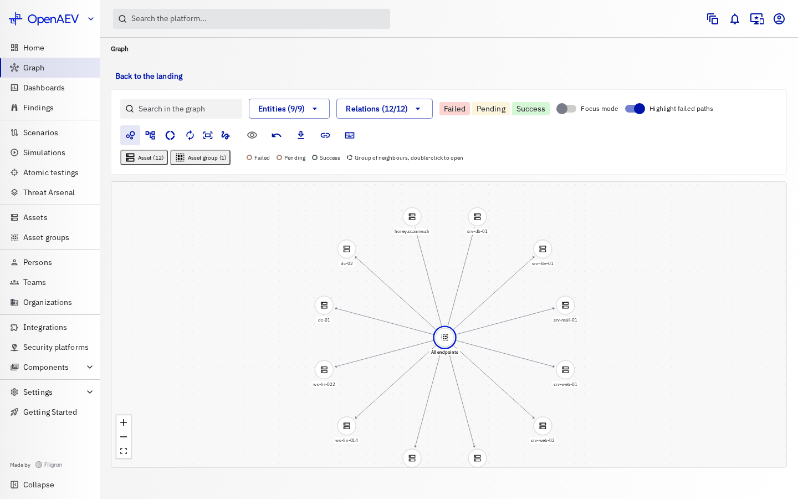
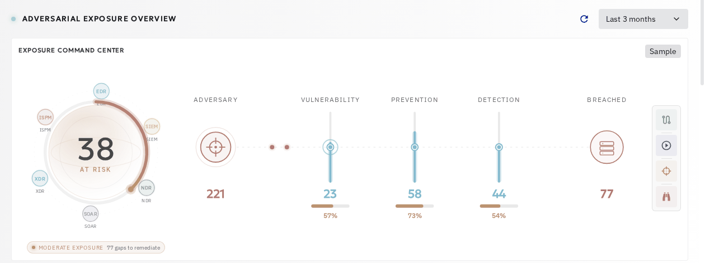
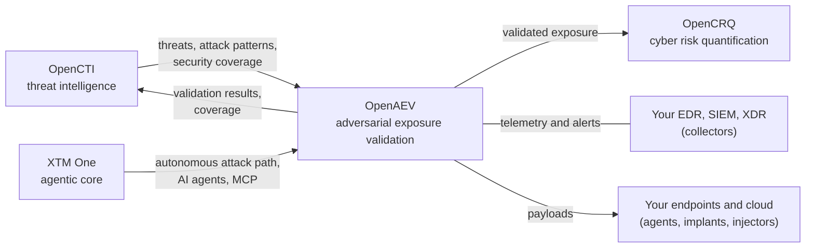

<h1 align="center">
  <a href="https://openaev.io"></a>
</h1>

<p align="center"><b>Adversarial exposure validation for Continuous Threat Exposure Management (CTEM).</b><br/>
Prove your defenses against the techniques of the adversaries that target you, find the exposures that matter, and get them fixed.</p>

<p align="center">
  <a href="https://github.com/OpenAEV-Platform/openaev/stargazers"></a>
  <a href="https://github.com/OpenAEV-Platform/openaev/releases/latest"></a>
  <a href="https://hub.docker.com/r/openaev/platform"></a>
  <a href="LICENSE"></a>
  <a href="https://docs.openaev.io"></a>
  <a href="https://community.filigran.io"></a>
</p>

<p align="center">
  <a href="https://openaev.io">Website</a> ·
  <a href="https://docs.openaev.io">Documentation</a> ·
  <a href="https://demo.openaev.io">Live demo</a> ·
  <a href="https://github.com/OpenAEV-Platform/openaev/releases">Releases</a> ·
  <a href="https://community.filigran.io">Community</a>
</p>

OpenAEV is the open source adversarial exposure validation platform of the [XTM Platform](https://filigran.io), Filigran's
platform for Continuous Threat Exposure Management (CTEM). It turns threat intelligence from
[OpenCTI](https://github.com/OpenCTI-Platform/opencti) into attack scenarios, runs them against your real endpoints,
cloud and security stack, and tells you which techniques were prevented, which were detected and which got through.
The result is a list of exposures backed by evidence, with the detection and remediation work to close them.

> If OpenAEV helps your security team, **[star the repository](https://github.com/OpenAEV-Platform/openaev/stargazers)**.
> It is the simplest way to support the project and help other defenders find it.

<p align="center">
  <picture>
    <source media="(prefers-color-scheme: dark)" srcset="./.github/img/openaev-graph-dark.png">
    
  </picture>
  <br/><sub>The exploration graph (coming in the next release, <a href="https://github.com/OpenAEV-Platform/openaev/pull/9448">#9448</a>).</sub>
</p>

## Table of contents

- [Why OpenAEV](#why-openaev)
- [Capabilities](#capabilities)
- [OpenAEV in the XTM Platform](#openaev-in-the-xtm-platform)
- [Editions](#editions)
- [Quick start](#quick-start)
- [Documentation and demo](#documentation-and-demo)
- [Contributing](#contributing)
- [Community](#community)
- [Security](#security)
- [About](#about)

## Why OpenAEV

Most security teams know their vulnerabilities and their threat landscape. Few can say, with evidence, whether their
controls stop the techniques the adversaries that target them actually use. OpenAEV answers that question continuously:

- **Threat-informed.** Scenarios come from the intrusion sets, campaigns, reports and attack patterns in OpenCTI, not
  from a generic checklist.
- **Real execution, safe by design.** Payloads run through agents and implants on your own endpoints, inside the scope
  you define.
- **Outcome per control.** Every action expects a prevention and a detection; collectors read your EDR, SIEM and XDR to
  score each expectation.
- **Exposure you can act on.** Results become findings and gaps with detection and remediation guidance, tracked from
  one run to the next.

## Capabilities

| Capability | What it does | Status |
|---|---|---|
| **Threat-informed scenarios from OpenCTI** | Generate scenarios from OpenCTI security coverage (reports, intrusion sets, campaigns, incidents): attack patterns are mapped to compatible actions of your threat arsenal and scheduled for execution. Results flow back to OpenCTI. | Released |
| **Breach and attack simulation** | Execute payloads on Windows, Linux and macOS through the OpenAEV agent, Caldera, or the EDR executors (CrowdStrike Falcon, SentinelOne, Microsoft Defender for Endpoint, Tanium, Palo Alto Cortex). | Released (EDR executors: EE) |
| **Threat arsenal** | MITRE ATT&CK-mapped actions, payloads (commands, executables, files, DNS), output parsers and a library of injectors, importable from the XTM Hub. | Released |
| **Prevention and detection validation** | Expectations per action (prevention, detection, vulnerability, manual), scored automatically by collectors that read your security platforms. | Released |
| **Atomic testing** | Run a single technique against a single target to validate one control in minutes. | Released |
| **Attack chaining** | Chain actions with conditions on their outputs into a logic graph, and read how the attack actually propagated on the attack path map: endpoints reached, findings produced, chokepoints. | Released, EE, preview flag |
| **Findings and exposure** | CVEs, open ports, credentials, shares and Active Directory weaknesses extracted from execution output, deduplicated across runs, enriched with CVSS, sensitive values masked. | Released |
| **Remediation** | Detection remediation on threat arsenal actions and injects, remediation on CVEs, so every gap comes with the rule or fix that closes it. | Released, EE |
| **Dashboards** | Custom dashboards and widgets over simulations, findings and coverage; a default home dashboard; usage shown before a dashboard is deleted and starter-pack dashboards restored (coming in the next release, [#9420](https://github.com/OpenAEV-Platform/openaev/pull/9420)). | Released |
| **Exploration graph** | One graph across simulations, scenarios, endpoints, asset groups, findings, attack patterns, persons and organizations, with time range and attack paths. | Coming in the next release ([#9448](https://github.com/OpenAEV-Platform/openaev/pull/9448)) |
| **OpenCTI and OpenCRQ pivots** | See the OpenCTI counterpart of an asset, attack pattern, vulnerability or threat, and its OpenCRQ risk, from the OpenAEV screen you are on. | Coming in the next release ([#9393](https://github.com/OpenAEV-Platform/openaev/pull/9393)) |
| **Generative AI** | Generate content and scenarios with AI, through your own AI provider or XTM One. | Released, EE |
| **Autonomous attack path** | Describe an objective in plain language; an AI orchestrator in [XTM One](https://github.com/XTM-One-Platform/xtm-one) plans, executes and adapts a chained attack against your authorized scope, streams its decisions and records proof of exploitation and capability gaps. | Preview, EE, requires XTM One |
| **Multi-tenancy** | Isolated tenants on one platform. | Released, EE |
| **Human-centric exercises** | Phishing campaigns and tabletop injects (email, media pressure, challenges) for the human side of exposure. | Released |

<table>
  <tr>
    <td width="50%">
      <picture>
        <source media="(prefers-color-scheme: dark)" srcset="./.github/img/openaev-dashboard-dark.png">
        
      </picture>
      <p align="center"><sub>Home dashboard</sub></p>
    </td>
    <td width="50%">
      <picture>
        <source media="(prefers-color-scheme: dark)" srcset="./.github/img/openaev-findings-dark.png">
        
      </picture>
      <p align="center"><sub>Findings</sub></p>
    </td>
  </tr>
</table>

## OpenAEV in the XTM Platform

CTEM is a loop: scope, discover, prioritize, validate, mobilize. OpenAEV is the validation stage, connected to the
other modules of the XTM Platform:



- **[OpenCTI](https://github.com/OpenCTI-Platform/opencti)**: the threat knowledge behind every scenario, and where
  validation results land as security coverage.
- **[XTM One](https://github.com/XTM-One-Platform/xtm-one)**: the agentic core of the XTM Platform. It hosts the
  autonomous attack path orchestrator and the AI agents that work across OpenCTI, OpenAEV and OpenCRQ.
- **[OpenCRQ](https://filigran.io)**: turns validated exposure into business risk.
- **Integrations**: injectors, collectors and executors are listed in the
  [OpenAEV ecosystem](https://docs.openaev.io/latest/development/injectors/) and on the
  [XTM Hub](https://hub.filigran.io).

## Editions

OpenAEV follows an open core model:

- **Community Edition**, licensed under the [Apache License 2.0](LICENSE): the whole validation workflow, from
  threat-informed scenarios to findings and dashboards.
- **Enterprise Edition**, licensed under the [Enterprise Edition license](LICENSE): AI features, the autonomous attack
  path, attack chaining, EDR executors, remediation guidance and multi-tenancy. Source files under this license carry
  a header saying so.

Enable the Enterprise Edition in **Settings > Filigran Experience** with a license or a
[trial license](https://filigran.io/enterprise-editions-trial/). A Filigran license of the XTM Platform, installed in
OpenAEV or received through a registered XTM One, also enables it. Details:
[Enterprise Edition](https://docs.openaev.io/latest/administration/enterprise/) and
[offering](https://filigran.io/offering/subscribe).

## Quick start

OpenAEV runs with Docker Compose from the [OpenAEV-Platform/docker](https://github.com/OpenAEV-Platform/docker)
repository, which also starts XTM One next to it:

```bash
git clone https://github.com/OpenAEV-Platform/docker.git openaev-docker
cd openaev-docker
cp .env.sample .env   # set the admin credentials, tokens and passwords
docker compose -p openaev -f docker-compose.yml up -d
```

Then open the URL set by `OPENAEV_HOST` and `OPENAEV_PORT` in `.env`, install an agent on a test endpoint, and launch
your first atomic test. The full guide covers manual installation, production sizing and every setting:
[installation](https://docs.openaev.io/latest/deployment/installation/).

Releases are published on the [GitHub releases page](https://github.com/OpenAEV-Platform/openaev/releases); a
[rolling release](https://releases.openaev.io) is built from `main`.

## Documentation and demo

- [Documentation](https://docs.openaev.io): getting started, scenarios, attack chaining, findings, dashboards,
  integrations, administration.
- [Live demo](https://demo.openaev.io): open to everyone, reset every night on reference data.

## Contributing

- [Contributing guide](CONTRIBUTING.md): development process, how to propose fixes and improvements, how to build and
  test.
- [Code of Conduct](CODE_OF_CONDUCT.md).
- [Good first issues](https://github.com/OpenAEV-Platform/openaev/labels/good%20first%20issue) to get started.
- [Development environment](https://docs.openaev.io/latest/development/environment_ubuntu/).
- Writing an injector or a collector: start from the
  [ecosystem documentation](https://docs.openaev.io/latest/development/injectors/).

## Community

- **Issues**: bugs and feature requests on [GitHub issues](https://github.com/OpenAEV-Platform/openaev/issues).
- **Slack**: questions, integrations and PR discussions on the
  [Filigran Community Slack](https://community.filigran.io/?utm_medium=community&utm_source=github).
- **Star the project**: a [star](https://github.com/OpenAEV-Platform/openaev/stargazers) helps other security teams find
  OpenAEV.

<a href="https://star-history.com/#OpenAEV-Platform/openaev&Date">
  <picture>
    <source media="(prefers-color-scheme: dark)" srcset="https://api.star-history.com/svg?repos=OpenAEV-Platform/openaev&type=Date&theme=dark" />
    
  </picture>
</a>

## Security

Report a vulnerability as described in the [security policy](SECURITY.md). Do not open a public issue for it.

## About

OpenAEV is designed and developed by [Filigran](https://filigran.io), with the products
[OpenCTI](https://github.com/OpenCTI-Platform/opencti), [OpenCRQ](https://filigran.io) and
[XTM One](https://github.com/XTM-One-Platform/xtm-one).

<a href="https://filigran.io"></a>

### Usage telemetry

To improve its features and performance, OpenAEV collects anonymous statistical data about its usage and health.
Details on the data collected and how it is used:
[usage telemetry](https://docs.openaev.io/latest/reference/deployment/telemetry/).
