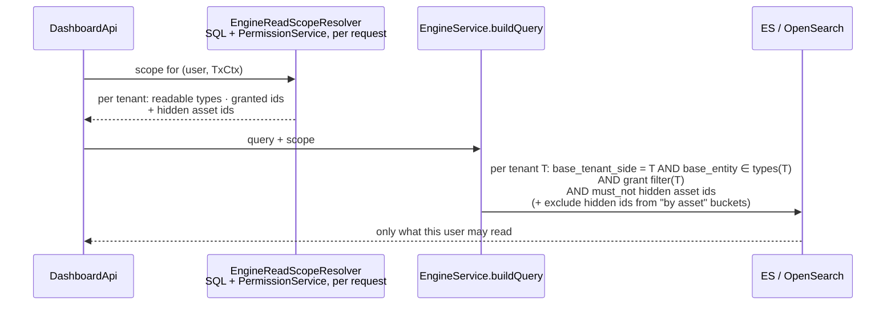
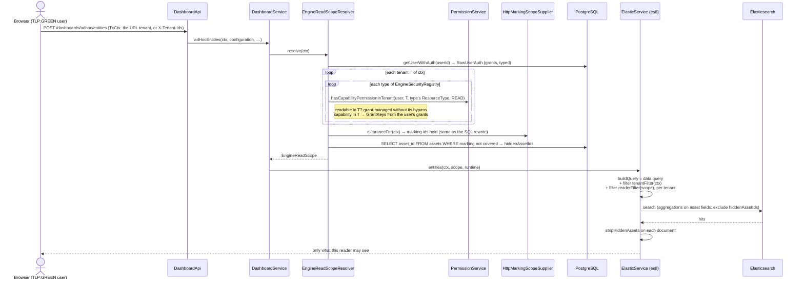

# Task 4 — Markings and dashboards (Elasticsearch / OpenSearch): brainstorming

**Status**: exploration, nothing implemented.

Dashboards do not read PostgreSQL: they read a search engine (Elasticsearch 8/9 or OpenSearch,
`engine.engine-selector`), fed by background jobs. Everything Task 3 / Task 4 built for markings is a
**SQL** mechanism (statement inspector + `is_marking_set_allowed`), so none of it reaches dashboards.

# Part 1 — How RBAC works today

## 1.1 The use case: Atomic testing without ACCESS_ASSETS

**Setup.** <br/>
User `amber` belongs to the group `Manager`, which carries the marking `TLP:AMBER`. <br/>
The role `Manager` was edited to remove `ACCESS_ASSETS`, `MANAGE_ASSETS` and `DELETE_ASSETS`, so Amber has no
asset capability. <br/>
Amber still reads atomic testings, through `ACCESS_ASSESSMENT` or a grant.


| Step | What Amber sees |
|---|---|
| Amber creates an atomic testing | The asset picker is empty: no asset can be added as a target. |
| An admin creates an atomic testing targeting a GREEN and a RED asset; Amber opens it | The atomic testing and the GREEN asset in its target list. The RED asset is hidden: marking filtering works. |
| Amber opens the same atomic testing to update it | 1/ in overview Amber can see the asset GREEN, RED is filtered<br/> 2/ when updating atomic testing, user does not see any asset in the form 🐞: the targets cannot be seen nor deleted nor edited |

**Why, in the code.** The detail view and the edit form read the assets through **two different
endpoints, checked against two different permissions.**

- **Detail view: the parent's permission.** =>
  `POST /api/injects/{injectId}/targets/ASSETS/search`  protected by
  `@AccessControl(resourceId = "#injectId", actionPerformed = READ, resourceType = INJECT)`. `INJECT` is
  in `RESOURCES_USING_PARENT_PERMISSION` (`PermissionService.java:60`), so `hasPermission` swaps it for
  its parent, `ATOMIC_TESTING` READ. `ACCESS_ASSETS` is never checked. The rows are read from
  PostgreSQL through the statement inspector, hence the RED asset is hidden.
- **Edit form: the catalogue's permission.** The form's asset list (`InjectEndpointsList.tsx`) loads the
  selected assets through an `EndpointContext`, implemented once per parent type:

## 1.2 RBAC implementation: the different options to make it consistent

**Option A: The capability also gates embedded assets. (this is not what is implemented atm)** Without `ACCESS_ASSETS`, no asset is shown
anywhere, including inside a scenario, a simulation or an atomic testing.

- ✅ One rule, easy to explain: no capability, no asset.
- ❌ A `Manager` without assets sees atomic testings with no target, and expectation results with no
  asset.
- ❌ Not local: every REST surface that embeds assets changes (targets, expectation results per asset,
  the endpoint column of the findings list, exports, attack paths), and dashboards too.

**Option B: The editor follows the parent. (this is the current implementation, with some UI inconsistencies/bugs)**

- ✅  An asset embedded in a resource the user reads is
  visible
- ✅ removable if the user may update that resource
- ❌ Adding a new asset searches the catalogue, so it still requires `ACCESS_ASSETS`


> [!NOTE]
> **This is how RBAC works today: Option B: The editor follows the parent.** A capability gates the
> **catalogue** (the Assets menu, the picker, `/api/endpoints/search`), not an asset **embedded** in a
> scenario, a simulation or an atomic testing. An embedded asset follows its parent's permission.

## 1.3 What Option B: The editor follows the parent gives Amber in the edit form

| Action | Endpoint | Allowed without `ACCESS_ASSETS`? |
|---|---|---|
| See the current assets | new `/api/atomic-testings/{id}/endpoints/find`, checked on `ATOMIC_TESTING` READ, returning only assets the inject references | ✅ |
| Remove an asset | this only edits the inject's id list, then saves through the update endpoint (`ATOMIC_TESTING` WRITE / `MANAGE_ASSESSMENT` or grant) | ✅ if she may edit the atomic testing |
| Add an asset | the picker (`EndpointsPicker`) searches the whole catalogue: `/api/endpoints/search` | ❌ stays `ACCESS_ASSETS`. The UI should hide or disable "Add" instead of opening an empty picker |
| Save the form | update endpoint, with the asset ids unchanged | ✅ |

> [!WARNING]
> 🐞 <b> UI Bugs: atomic testing does not follow Option B: The editor follows the parent.</b>
> - Adding an asset should not be offered without `ACCESS_ASSETS`: atm the "Add" button opens a picker
>   that gets a 403 and stays empty. It should be hidden or disabled with
>   `ability.can(ACTIONS.ACCESS, SUBJECTS.ASSETS)`.
> - Same shape for findings: the rows of an embedded findings list link to a detail page the user
>   cannot open. The link should be disabled without `ACCESS_FINDINGS`.

# Part 2 — How grants work today

A grant gives a **group** a role on **one** resource. It is the second way to reach a resource, next to
capabilities: a capability says "every scenario", a grant says "this scenario".

## 2.1 The model

Table `grants` (`Grant.java`):

| Column | Meaning |
|---|---|
| `grant_group` | the group holding the grant: every member gets it |
| `grant_resource` | the id of **one** resource (a plain string, no foreign key) |
| `grant_resource_type` | `SCENARIO`, `SIMULATION`, `ATOMIC_TESTING`, `THREAT_ARSENAL` (the grant is on an injector contract id), `AUTONOMOUS_RUN`; `PAYLOAD` is deprecated, `UNKNOWN` |
| `grant_name` | the role: `OBSERVER` < `PLANNER` < `LAUNCHER`. A higher role includes the lower ones (`GRANT_TYPE.andHigher()`) |

What each role allows:

| Role | Backend actions (`PermissionService.hasGrantPermission`) | Frontend actions on the `RESOURCE` subject (`parserRbac.ts`) |
|---|---|---|
| `OBSERVER` | `READ` | `ACCESS` |
| `PLANNER` | + `WRITE`, `DELETE` | + `MANAGE`, `DELETE` |
| `LAUNCHER` | + `LAUNCH` | + `LAUNCH` |

## 2.2 Who sets grants

- **By hand**: Settings › Groups › a group › Grants, one tab per type: scenarios, simulations, atomic
  testings, threat arsenals (`settings/groups/tenant_groups/grants/*`). API:
  `POST /api/groups/{groupId}/grants` and `DELETE /api/groups/{groupId}/grants/{grantId}`, checked on
  `USER_GROUP` WRITE, i.e. `MANAGE_TENANT_USERS_GROUPS_AND_ROLES`.
- **Copied by the platform**:
  - a simulation created from a scenario receives a **copy** of the scenario's grants
    (`ScenarioToExerciseService.java:106`). It is a copy at creation time, not an inheritance: a
    grant added to or removed from the scenario later does not change its existing simulations;
  - duplicating a scenario or a simulation copies its grants (`ScenarioService.java:1284`,
    `ExerciseService.java:589`);
  - relaunching an atomic testing moves its grants to the new inject (`AtomicTestingService.java:260`).
- **Not anymore**: group default grants (a grant given automatically on every new scenario or
  simulation) were removed by `V4_25__Remove_Default_Grants_Table`; the `DefaultGrant` class is a
  leftover with no use.

## 2.3 How one request is decided

`PermissionService.checkPermission`, in this order:

1. admin → allowed;
2. `BYPASS` of the matching scope (platform / tenant) → allowed;
3. a type that uses its parent's permission (inject, injector contract, objective, evaluation,
   workflow, step, condition, autonomous run) is replaced by its parent: an inject by its scenario,
   simulation or atomic testing, an injector contract by its threat arsenal. `READ` stays `READ`,
   `LAUNCH` stays `LAUNCH`, the rest becomes `WRITE`;
4. a grant-managed type with `SEARCH` → allowed, the list is filtered in the query (§2.4);
5. the user has **the capability** (e.g. `ACCESS_ASSESSMENT`) → allowed, on every resource of that
   type, without looking up any grant. Without the capability, go on;
6. a grant-managed type → **the grant**: allowed only if one of the user's groups has a grant on
   this resource id, with a role high enough (`GrantRepository.existsByUserIdAndResourceIdAndNameIn`).
   Example: no `ACCESS_ASSESSMENT`, an OBSERVER grant on scenario `S1` → `S1` is readable, the other
   scenarios are not;
7. an `/options` endpoint called with a `sourceId` → a grant on that `sourceId`;
8. otherwise → denied.

The capabilities that make grants irrelevant (step 5):

| Grant resource type | `READ` | `WRITE` | `LAUNCH` | `DELETE` |
|---|---|---|---|---|
| `SCENARIO`, `SIMULATION`, `ATOMIC_TESTING`, `AUTONOMOUS_RUN` | `ACCESS_ASSESSMENT` | `MANAGE_ASSESSMENT` | `LAUNCH_ASSESSMENT` | `DELETE_ASSESSMENT` |
| `THREAT_ARSENAL` | `ACCESS_THREAT_ARSENALS` | `MANAGE_THREAT_ARSENALS` | — | `DELETE_THREAT_ARSENALS` |

## 2.4 What grants do not cover

- **Only five types** are grant-managed. There is no grant on an asset, a finding, a team…: those are
  capability-only.
- **No inheritance**: a simulation gets a copy of its scenario's grants at creation (§2.2), and an
  inject or a workflow follows its parent's permission (§2.3, step 3).
- **Dashboards ignore grants**: the engine filter that used them is commented out (§3.5); §4.4
  describes how to bring them back, typed per resource.

# Part 3 — How dashboards work today

## 3.1 Where dashboards stand against Option B: The editor follows the parent

Part 1 showed that the REST API follows Option B: The editor follows the parent (except the atomic
testing bug). Dashboards on `main` do not follow it: they are not "assets visible through the
parent", they are "no RBAC at all". Every `DashboardApi` endpoint only checks `ResourceType.DASHBOARD`
(the widget's dashboard, or dashboard search), and the engine only adds `tenantFilter(ctx)` (§3.4).

| What the user reads | REST API (Option B: The editor follows the parent) | Dashboards on `main` |
|---|---|---|
| Asset catalogue: the endpoint index, an "entities" widget on endpoints, search hits on assets | `/api/endpoints/search` requires `ACCESS_ASSETS` | ✅ visible to anyone with dashboard access: **wider than Option B** |
| Assets embedded in a parent the user reads (`base_assets_side` of a simulation, "findings per endpoint" of a readable simulation) | ✅ visible, parent's permission | ✅ visible: consistent with Option B, only because nothing is checked |
| The parent itself (a scenario or simulation without grant and without `ACCESS_ASSESSMENT`) | ❌ hidden | ✅ visible: **wider than Option B** |
| A RED asset (marking) | ❌ hidden | ✅ visible: **leak** |

## 3.2 Sync: PostgreSQL → search engine

- `EngineSyncExecutionJob` registers one job per model every **15 s** to sync each of the 15 entities.
- 15 model entities to the synced entities: `asset`, `asset-group`,
      `attack-pattern`, domain, finding, inject, expectation-inject, scenario, simulation,
      security-platform, tag, team, vulnerable-endpoint, plus two snapshot observation models behind the
      `BULK_SNAPSHOT_EXPORT` dev feature.

**Latency.** Create/update: typically 1-17 s.

**The indexes.** One per `@Indexable` model, named `<prefix>_<index>`:

| Index | Document | Built from (PostgreSQL) | Asset reference | Scenario / simulation / atomic testing reference |
|---|---|---|---|---|
| `asset` | `EsAsset` | `assets` (endpoints) | itself (`base_id`) | — |
| `security-platform` | `EsSecurityPlatform` | `assets` (security platforms) | itself (`base_id`) | — |
| `asset-group` | `EsAssetGroup` | `asset_groups` | — (members not indexed) | — |
| `attack-pattern` | `EsAttackPattern` | `attack_patterns` | — | — |
| `tag` | `EsTag` | `tags` | — | — |
| `team` | `EsTeam` | `teams` | — | — |
| `domain` | `EsSecurityDomain` | `domains` | — | — |
| `scenario` | `EsScenario` | `scenarios` | targets (`base_assets_side`) | itself (`base_id`) |
| `simulation` | `EsSimulation` | `exercises` | targets (`base_assets_side`) | itself, `base_scenario_side` |
| `inject` | `EsInject` | `injects` | targets (`base_assets_side`) | `base_scenario_side`, `base_simulation_side`, itself for an atomic testing |
| `expectation-inject` | `EsInjectExpectation` | `injects_expectations` | `base_asset_side` (and `base_asset_group_side`, `base_security_platforms_side`) | `base_scenario_side`, `base_simulation_side`, `base_inject_side` |
| `finding` | `EsFinding` | `findings` + `findings_assets` | `base_endpoint_side` (a set: one finding, several assets) | `base_scenario_side`, `base_simulation_side`, `base_inject_side` |
| `vulnerable-endpoint` | `EsVulnerableEndpoint` | computed per (asset, simulation) from the findings | `vulnerable_endpoint_id`, plus hostname, platform, agents copied in | `base_scenario_side`, `base_simulation_side` |
| `snapshot-attack-observation` | `EsAttackObservation` | attack observations (dev feature `BULK_SNAPSHOT_EXPORT`) | `base_asset_side`, plus `asset_name`, `asset_hostname` copied in | `base_scenario_side`, `base_simulation_side` |
| `snapshot-vulnerability-observation` | `EsVulnerabilityObservation` | vulnerability observations (same) | same | same |

`audit-log` (`LogEvent`) is also `@Indexable`, but it is written by the audit log transport, not by
`EngineSyncExecutionJob`, and no dashboard reads it.

## 3.3 Data model

Fields shared by every document (`EsBase`, `EsTenantBase`):

<table>
  <thead>
    <tr><th>Field</th><th>Meaning</th></tr>
  </thead>
  <tbody>
    <tr><td><code>base_id</code>, <code>base_entity</code></td><td>id, document type (= index name)</td></tr>
    <tr><td><code>base_representative</code></td><td>display label (asset name, scenario name…)</td></tr>
    <tr><td><code>base_created_at</code>, <code>base_updated_at</code></td><td>timestamps (<code>base_updated_at</code> = effective updated_at)</td></tr>
    <tr style="background-color: rgba(40, 167, 69, 0.15);"><td><code>base_tenant_side</code></td><td><b>tenant id</b>, on every document</td></tr>
    <tr style="background-color: rgba(220, 53, 69, 0.15);"><td><code>base_restrictions</code></td><td>grant ACL ids (scenario / simulation / own id); written but not used, see 3.5</td></tr>
    <tr><td><code>base_dependencies</code></td><td>ids whose deletion deletes this document</td></tr>
  </tbody>
</table>


**No marking is indexed today.** `assets.marking_ids` is not selected by the asset indexing query
(`AssetRepository.java:112-123`), and no `Es*` class has a marking field.

## 3.4 How tenant isolation filtering was done (the precedent)

Multi-tenancy had the same problem as markings: every document of every type must be filtered for
the reader. It was solved in two moves:

1. **Denormalize the scope onto every document.** Every `Es*` extends `EsTenantBase`, whose
   `base_tenant_side` is filled by each handler from the row's `tenant_id`.
2. **One central filter on every read.** Every query of the three engines goes through the private
   `buildQuery` (`ElasticService.java:301-339`), which always adds `tenantFilter(ctx)`
   (`ElasticService.java:357-378`), built from the request's `TxCtx`:

## 3.5 No per-user filtering exists today for GRANT or CAPABILITY

**Per-user filtering does not exist today.** `buildQueryRestrictions(user)` (grants on
`base_restrictions`) is commented out in `buildQuery`,  ([`6f5609722`](https://github.com/OpenAEV-Platform/openaev/commit/6f5609722728ad2dc992da228bd4d3cd1c496a92), Hedi Tarchouni, 2025-09-24).
(`searchCursorPaged`) still applies it. 

> A bit of History of `buildQueryRestrictions` (why per-user filtering disappeared)
> 
> - **2021-12-19** — `bdb66c492` (Julien Richard): **Grants** exist from the original backend: a group is granted on a scenario or a simulation. At that time, access is "admin, or a grant".
> - **2025-04-23** — [`a6b967c06`](https://github.com/OpenAEV-Platform/openaev/commit/a6b967c06) (Romuald Lemesle, Custom Dashboards): The engine gets `base_restrictions` and `buildQueryRestrictions`: a non-admin sees a document only if its `base_restrictions` contains a scenario or simulation they have a **grant** on, or if it has no restriction. **Intent: dashboards mirror the grant model, the only access model then.**
> - **2025-06 → 2025-08** — `7bee25072`, `8f04f2606`, `6caf0555a` (Hedi Tarchouni, #375): **RBAC**: roles and capabilities. A capability such as `ACCESS_ASSESSMENT` gives access to every scenario and simulation **without any grant**.
> - **2025-09-24** — [`6f5609722`](https://github.com/OpenAEV-Platform/openaev/commit/6f5609722728ad2dc992da228bd4d3cd1c496a92) (Hedi Tarchouni, #375): The filter is commented out: "issue/3768 will refactor this logic to have restriction based on markings". No reason in the commit.
> - **2026-10-05** — `78d284bf1` (Alexandre Gaspard, OpenGRC snapshot export): The filter is re-enabled **for the snapshot export only**, and skipped for admin, BYPASS and `ACCESS_ASSESSMENT` (`SnapshotObservationService.grantFilter`).

**Why it was removed (inferred from the code, to confirm with Hedi):** the filter only knew grants, and
RBAC broke its assumptions:

- a user with the `ACCESS_ASSESSMENT` capability but no grant sees every scenario in the REST API, yet
  would have seen **empty dashboards**;
- assets, asset groups, tags, teams and domains were indexed with **their own id** in
  `base_restrictions` (`EndpointHandler`, `AssetGroupHandler` at `6f5609722^`). Nobody holds a grant on
  an asset id, so every non-admin saw **none** of them.

The snapshot export re-enabled it in 2026 with exactly the missing piece, the capability bypass, which
supports this reading.

# Part 4 — Exploring one approach: Resolve filtering thro SQL, pass filtered ids to ES

## 4.1 Requirements

Part 3 showed that dashboards apply **no per-user filtering at all**: no capability check per document
type, no grant, no marking, only the tenant filter. Filtering on markings alone would leave the other
holes open, so the dashboard filter has to cover **four dimensions**, the same ones the REST API
enforces, and `EngineReadScopeResolver` resolves all four:

| Dimension | REST API today | Question for each indexed document |
|---|---|---|
| **Tenancy** | the request's `TxCtx` (path tenant, `X-Tenant-Ids`, or every membership), and the user's rights **in that tenant** (`TenantContext` set from the path) | does this document belong to a tenant of the request, and what are the user's rights *in that tenant*? |
| **Capability** (RBAC) | `@AccessControl` per resource type | may this user read this *type* (asset, finding, scenario…)? |
| **Grant** | `RESOURCES_MANAGED_BY_GRANTS` (scenario, simulation, atomic testing) | does the user have a grant on the scenario / simulation this document belongs to (unless a capability such as `ACCESS_ASSESSMENT` covers all)? |
| **Marking** | statement inspector + derived tables | is every asset this document is about within the user's clearance? |

The same dimensions apply to every dashboard read, including a dashboard shown inside a scenario or
a simulation (§4.5): there is no context-dependent rule.

**Tenancy is not only a filter on `base_tenant_side`.** One request can read several tenants (§4.2,
"One request, several tenants"), and capabilities, grant bypasses and `BYPASS` are held **per
tenant**. The three other dimensions are therefore evaluated tenant by tenant, and each tenant's
result only applies to that tenant's documents.

And three constraints on *how*:

1. **Security state changes often** (a marking, a group, a grant, a role). Anything stored in the
   documents is only corrected by the next sync: 15 s at best, minutes under load, and a full reindex
   for some changes. During that window the dashboard shows what the REST API already hides.
2. **The index is history.** Findings, expectations and vulnerable endpoints of past simulations stay
   in the index. When an asset becomes RED, the REST API hides its history instantly; the index must
   do the same for the documents already there, not only for new ones.
3. **No second copy of the rules.** Capabilities, grants and markings are already decided by
   `PermissionService` and SQL. Re-implementing them in ES queries means two implementations to keep
   identical, in three engines.

## 4.2 The approach

**Principle.** Store in the index only what does not change with security: **ids of relationships**
(an expectation's asset, a finding's assets, an inject's simulation). They are already there
(`base_asset_side`, `base_endpoint_side`, `vulnerable_endpoint_id`, `base_scenario_side`,
`base_simulation_side`…). At each read, ask **SQL and `PermissionService`** — the single source of
truth — what the user may see in each tenant of the request, and add it to the ES query as plain id
filters, bound to each tenant:



How each dimension is resolved, reusing what exists:

| Dimension | Resolved in SQL / Java (source of truth) | Applied in ES |
|---|---|---|
| **Tenancy** | the tenants of the request's `TxCtx` (already checked against the user's memberships); in each of them, the user's rights through `PermissionService.hasCapabilityPermissionInTenant` (the user's groups in that tenant plus platform groups), never the ambient `TenantContext` | each tenant's rules are bound to `base_tenant_side = T`; a document without a tenant only gets what every tenant of the request allows |
| **Capability** | for each index, its `ResourceType` (asset → `ASSET`, finding → `FINDING`, security-platform → `SECURITY_PLATFORM`…), checked with `PermissionService` / `Capability` READ | `terms(base_entity, readable types)` |
| **Grant** | generic, per indexed type (§4.4): for a type managed by grants, `PermissionService` first checks the capability that makes grants irrelevant (e.g. `ACCESS_ASSESSMENT` for scenarios and simulations); without it, the user's grants of the matching `GRANT_RESOURCE_TYPE` (from `RawUserAuth`, already loaded) | on the fields the registry declares as grant keys for that type (today `base_scenario_side`, `base_simulation_side`, `base_id`, `base_inject_side`), within the granted ids, **checked on the document's parent resource only** (its simulation, else its scenario, else its atomic testing, §4.4), as the REST API does; a document with none of these fields set is not grant-filtered. Types not managed by grants (assets, tags, teams…) are only filtered by capability: OpenAEV has no grant on an asset today. Supporting one later is a registry entry, not new code |
| **Marking** | `SELECT asset_id FROM assets WHERE marking_ids <> '{}' AND NOT is_marking_set_allowed(marking_ids)` under the user's clearance, over the tenants of the request, grouped per tenant (`SELECT asset_id, tenant_id`): **the same SQL function** as the REST API, so no copy of the rule | inside each tenant's clause, `must_not terms` on the asset reference of each type (asset: `base_id`; expectation, observations: `base_asset_side`; finding: `base_endpoint_side`; vulnerable-endpoint: `vulnerable_endpoint_id`). Aggregations on `base_assets_side` get `exclude: <hidden ids>` (see below), and the same ids are stripped from the `base_assets_side` of returned documents |

### One request, several tenants

**The case** (found in review, missed by the first version of the POC):

- The unprefixed dashboard routes (`/api/dashboards/…`) take their tenants from `X-Tenant-Ids`, or
  default to **every** tenant the user is a member of. `TxCtxArgumentResolver` only checks
  **membership**, not rights.
- `User.getCapabilities()` reads the ambient `TenantContext`. On an unprefixed route nothing sets
  it, so it falls back to the **default tenant**.
- A user holding `ACCESS_ASSETS` and `ACCESS_ASSESSMENT` in the default tenant only, and member of
  tenant B with `ACCESS_DASHBOARDS` alone, would read B's assets and B's ungranted scenarios: the
  default tenant's rights were applied to every tenant of the request.

**The rule.** The resolver builds the rules **per tenant of the `TxCtx`**, each from the user's
rights in that tenant, and the engine binds each tenant's rules to `base_tenant_side`:

| Reader | Default tenant | Tenant B |
|---|---|---|
| Capabilities held | `ACCESS_DASHBOARDS`, `ACCESS_ASSETS`, `ACCESS_ASSESSMENT` | `ACCESS_DASHBOARDS` |
| Assets | readable | **not readable** |
| Scenarios | every scenario | only the granted ones |

- The rights in a tenant come from `PermissionService.hasCapabilityPermissionInTenant(user,
  tenantId, …)`, backed by `User.getCapabilitiesIn(tenantId)` and `hasTenantBypassIn(tenantId)`: the
  same rule as `hasCapabilityPermission`, for an explicit tenant. `TenantContext` is never swapped.
- Markings are per tenant too: each tenant's rules carry the hidden assets of that tenant, and its
  clause excludes them. Only two uses take the union of every tenant's hidden assets, because they
  are not bound to one tenant: the `exclude` of an aggregation (its buckets mix the tenants of the
  request) and the stripping of returned documents.
- A scope that is not restricted to tenants (`TxCtx.Missing`, `AllTenants`; no HTTP reader has one)
  gets no tenant rules: it reads nothing.
- Regression: `DashboardMultiTenantReaderScopeTest` (unprefixed search with `X-Tenant-Ids`,
  different capabilities in two member tenants).

**Where the tenant filter stands.** es8 still applies `tenantFilter(ctx)` in `buildQuery`, next to
the reader filter, which now also restricts documents to the tenants of its rules. The target is one
filter, built from the scope: with `MARKING` off, every tenant of the `TxCtx` gets the rules "read
everything", which is exactly `tenantFilter`. Then the engine no longer needs the `TxCtx` at all.

> [!WARNING]
> **Ambient-tenant capability checks elsewhere.** `PermissionService.hasCapabilityPermission`,
> `User.getCapabilities()` and `isAdminOrBypass()` read the ambient `TenantContext`. They are right
> when the data read belongs to that single tenant: tenant-prefixed routes (the interceptor sets
> `TenantContext` from the path), background jobs that set it per tenant, and v1 tables, whose
> `@Filter` follows the same `TenantContext`. They are **wrong as soon as one request reads several
> tenants through the `TxCtx`**: the search engine, and the v2-active tables (`assets`,
> `asset_groups`, `findings`, `payloads`, `reportings`, …) on unprefixed routes with
> `X-Tenant-Ids`. `@AccessControl` itself checks the endpoint capability in the ambient tenant only,
> so `ACCESS_ASSETS` in the default tenant may open `POST /api/endpoints/search` over tenant B's
> assets too. To check and fix platform-wide, outside this POC: for instance, narrow a multi-tenant
> `TxCtx` to the tenants where the caller holds the endpoint's capability.

**Against the three constraints** (of §4.1)

1. **No lag.** Nothing security-related is in the index. A marking, grant or role change is visible on
   the next dashboard request (or on cache eviction, which already exists for clearance
   and memberships).
2. **History is covered.** Old findings and expectations reference the asset by id, and ids never
   change: the moment `ASSET_RED` is hidden, its whole history is filtered, like in the REST API.
3. **One copy of the rules.** The decision stays in `PermissionService` and `is_marking_set_allowed`.
   ES only receives id lists. What remains to maintain is the mapping "index → resource type" and
   "index → field holding the asset / scenario / simulation reference": a small registry, the
   counterpart of `MarkingDerivedTables`, with a test that every `Es*` class is listed.

**Costs and limits**

- **One extra SQL query per dashboard request** (the hidden asset ids), on the marked assets only
  (`marking_ids` has a GIN index). Cacheable per (user, tenant), evicted when an asset's markings or
  the user's clearance change.
- **Deny-list size.** ES caps a `terms` query at 65 536 values by default (`index.max_terms_count`).
  The hidden list is the user's *restricted* assets, normally a minority. Above a threshold, fail
  closed (hide the asset-related types for that user).
- **Multi-asset findings.** A deny-list hides a finding as soon as one of its assets is hidden (strict).
  The SQL rule is permissive ("visible if at least one visible asset"). Either accept strict in
  dashboards, or filter findings with the *allowed* list instead.
- **Three engines** (es8, es9, OpenSearch): the filters are written three times, like `tenantFilter`.
- **Where the scope is applied**: in `buildQuery` (documents), in every terms aggregation on an
  asset-id field (buckets), in `resolveIdsRepresentative` (labels), and on returned documents (the
  `*_side` arrays). Missing one leaks the id.

**Effort: M.** No index change, no reindex, no handler change. A resolver service with its cache, the
registry, the filters in three engines, and tests mirroring the tenant ones (plus one per dimension).

## 4.3 Classes: `EngineReadScopeResolver`, `EngineReadScope` vs `RawUserAuth`

### What changes in the engine's contract

Before, every engine read received the **user** (`RawUserAuth`): raw facts (admin flag, grants) that
the engine would have had to interpret itself. It received them but used nothing (the grant filter
was commented out). Now it receives the **decision** (`EngineReadScope`): what this reader may read,
already resolved from the source of truth. The engine only turns it into id filters.

| | `RawUserAuth` (before) | `EngineReadScope` (now) |
|---|---|---|
| What it is | facts about the user: `user_admin`, `user_grants` | what the reader may read, per tenant and per indexed type |
| Who interprets it | the engine (`buildQueryRestrictions`, off since 2025) | the resolver, with `PermissionService` and the SQL clearance |
| Tenancy | not carried (the engine only gets the `TxCtx`) | `tenantRules`: one entry per tenant of the request, from the user's rights in that tenant |
| Capabilities | not carried | per tenant, `TenantRules.readableEntities` |
| Grants | raw, untyped list of resource ids | per tenant, `TenantRules.grantFilters`: per type, the fields to match and the granted ids |
| Markings | not carried | per tenant, `TenantRules.hiddenAssetIds`; their union (`EngineReadScope.hiddenAssetIds()`) for aggregations and returned documents |
| Still used for | the snapshot export of es9 / OpenSearch until they are ported (`legacyGrantUser`) | every read of es8 |

### The scope object, on an example

A user member of two tenants, cleared `TLP:GREEN`, reading both on an unprefixed route:

- in tenant `T1`: `ACCESS_DASHBOARDS`, `ACCESS_ASSETS` and `ACCESS_FINDINGS`, **without**
  `ACCESS_ASSESSMENT`, and a group granted on scenario `S1`;
- in tenant `T2`: every capability.

Asset `A-RED` (in `T1`) is marked `TLP:RED`.

```text
EngineReadScope(
  unrestricted   = false,
  tenantRules    = {
    T1: TenantRules(
      unrestricted     = false,
      readableEntities = [asset, asset-group, tag, team, domain, attack-pattern,
                          scenario, simulation, inject, expectation-inject, finding,
                          vulnerable-endpoint],
                         # no security-platform (no ACCESS_SECURITY_PLATFORMS), no snapshot observations
      grantFilters     = {                         # in precedence order: first key set wins (§4.4)
        scenario:           [GrantKey(base_id,              {S1})],
        simulation:         [GrantKey(base_id,              {S1's simulations created after the grant})],
                                                           # grants copied at creation, §2.2; no
                                                           # scenario key: no inheritance
        inject:             [GrantKey(base_simulation_side, {S1's simulations created after the grant}),
                             GrantKey(base_scenario_side,   {S1}),
                             GrantKey(base_id,              {})],   # atomic testing
        expectation-inject: [... same order, base_inject_side for atomic testing ...],
        finding:            [... same order ...],
        vulnerable-endpoint:[GrantKey(base_simulation_side, {...}), GrantKey(base_scenario_side, {S1})]
      },
      hiddenAssetIds   = {A-RED}),                 # T1's assets outside the clearance
    T2: TenantRules.ALL   # every type, no grant filter, no hidden asset
  },
  legacyGrantUser = <the user's RawUserAuth>     # used by es9 / OpenSearch only
)
```

**When `exclude` is needed.** A document can hold asset information of its own: the ids of the
assets it depends on (an inject's targets, a finding's endpoints). These are its **dependency
fields**, declared per index in `EngineSecurityRegistry`, which plays here the role
`MarkingDerivedTables` plays in SQL: it says where derived asset information sits in each
document. Two tools filter a hidden asset out of them:

- `must_not` removes the **whole document** when its dependency field holds a hidden asset: the
  document is about that asset (an expectation, a finding, a vulnerable endpoint);
- an aggregation's `exclude` removes the hidden asset **from the dependency field of a document that
  stays visible**, so that it gets no bucket of its own (a scenario targeting GREEN and RED stays,
  RED gets no bar). Returned documents are stripped the same way (`stripHiddenAssets`).

So `exclude` only matters for a multi-valued dependency field of documents that stay visible:

| Breakdown field | Carried by | Document still returned when it references RED? | `exclude` needed? |
|---|---|---|---|
| `base_assets_side` | inject, scenario, simulation (their targets) | **yes**: the parent stays visible | **yes**, otherwise RED gets a bar |
| `base_asset_side` | expectation, observations | no: dropped by `must_not` | no, redundant |
| `base_endpoint_side` | finding | **yes** when one endpoint is still visible (a finding needs one visible endpoint, as in SQL) | **yes**, otherwise the hidden endpoint gets a bar |
| `vulnerable_endpoint_id`, `base_id` | vulnerable endpoint, asset | no: dropped | no, redundant |

The `exclude` uses the union of every tenant's hidden assets, since one aggregation spans the tenants
of the request.

**Filters on targeted assets: only visible assets count.**

*Use case.* Asset `RED` is `TLP:RED`, asset `GREEN` is `TLP:GREEN`. Scenario `S1` targets `GREEN`
and `RED`; scenario `S3` targets `RED` only. A `TLP:GREEN` reader opens a dashboard whose widget
counts "scenarios targeting `RED`" (built by an admin, or through a dashboard parameter).

| What the `TLP:GREEN` reader sees | REST API and dashboards |
|---|---|
| `S1` in a list | ✅, targets: `GREEN` only |
| scenarios targeting `RED` | none |
| scenarios with no target | `S3` (its only target is hidden) |

*Why a rule is needed.* Stripping and `exclude` clean what is **returned**, but Elasticsearch
evaluates a widget's filter on the stored document, which still holds `RED`: counting "scenarios
targeting `RED`" would return 2 and reveal `RED` and who targets it.

*How it is implemented.* A filter on a dependency field only looks at the visible values, after
dashboard parameters are resolved. `eq` / `not_eq`: the hidden ids are removed from the filter's values (no value left:
`eq` matches nothing, `not_eq` is dropped). `empty`, `not_empty`, `contains`, ranges: a small Painless
script checks the field's values and skips the hidden ids. A reader without hidden assets gets the
same query as before.

An admin gets `EngineReadScope.unrestricted(…)`: no per-user filter at all. A user holding every
capability, with no hidden asset, gets the same.

### How it reaches the query


> [!NOTE]
> **Derived documents: `EngineSecurityRegistry` plays the role of `MarkingDerivedTables`.**
> In SQL, Task 4 declares in `MarkingDerivedTables` how each child table reaches `assets` (a parent
> link such as `injects_expectations.asset_id`, or link rows such as `findings_assets`), and
> `MarkingDimension` filters the child through its asset. The index has no join, so the registry
> declares, per indexed type, the fields that hold asset ids: `assetFields` for a document about one
> asset (like a parent link: the document goes with its asset), `linkedAssetFields` for a document
> linked to several assets (like link rows: hidden only when all of them are hidden).
>
> | | SQL (REST API) | Index (dashboards) |
> |---|---|---|
> | Where the dependency is declared | `MarkingDerivedTables` | `EngineSecurityRegistry.assetFields` / `linkedAssetFields` |
> | Expectation of a RED asset | hidden (parent link) | hidden (`base_asset_side`) |
> | Finding of a RED asset only | hidden (link rows) | hidden (`base_endpoint_side`) |
> | Finding on a GREEN **and** a RED asset | **visible**: at least one visible asset (`MarkingDimension.linkRowsPredicate`) | **visible**, with `GREEN` only: excluded only when all its endpoints are hidden, RED stripped from `base_endpoint_side` |
> | Inject / scenario / simulation targeting RED | visible, RED not listed | visible, RED stripped from `base_assets_side` and from "by asset" buckets |
> | Expectation / observation on GREEN reported by a RED security platform | visible; the RED platform is not in the security platforms list | visible, RED stripped from `base_security_platforms_side` (and an observation's `attack_observation_platforms_succeeded`) and from "by security platform" buckets |
>
> **Findings.** A finding can be on several endpoints (`base_endpoint_side` is a set). "At least one
> visible endpoint" cannot be expressed with a `terms` query, so es8 uses a small script (the one of
> the filters on targeted assets), only for readers with hidden assets. If it costs too much on a
> large findings index (§4.7), the alternative is an indexed endpoint count and a `terms_set` query,
> with no security data in the index.
>
> **Security platforms.** A security platform is an asset, so it can be marked. Expectations and
> observations keep the platforms that reported on them as references, like the targets of a
> scenario: the document stays with its asset, the hidden platform is dropped from the returned
> document, its buckets and the filters on these fields.
>
> **Same as the REST API, tracked in Task 4** ([`implementation-plan.md`](./implementation-plan.md)):
> - An asset-group expectation (`base_asset_group_side`, no asset) rolls up every member, RED
>   included: Chunk 3b.
> - An expectation's results still name a hidden security platform in the REST API (dashboards no
>   longer index them since #5150), and an observation's platform types (`EDR`, `SIEM`) count its
>   contribution: Chunk 15.

## 4.4 The grant dimension in detail: generic, not scenario-only

The only grant filter that runs today, the snapshot export (`SnapshotObservationService.grantFilter`,
[`78d284bf1`](https://github.com/OpenAEV-Platform/openaev/commit/78d284bf1bce03e4010d50ddb827b032773f5bb2)),
cannot be reused as is:

- its bypass is hard-coded to `ACCESS_ASSESSMENT`, the capability of scenarios and simulations only,
  while grants also exist for atomic testings and threat arsenals (`RESOURCES_MANAGED_BY_GRANTS`);
- it matches `base_restrictions`, one untyped list that each handler fills differently:

| Index | `base_restrictions` today | Problem |
|---|---|---|
| asset, asset-group, tag, team, domain, security-platform, vulnerable-endpoint | their own id | not a grant key: hides them from every non-admin |
| scenario | scenario id | ok |
| simulation | simulation + scenario ids | **inheritance**: a scenario grant opens every simulation of that scenario; the REST API does not (§2.2) |
| inject | scenario + simulation ids | an atomic testing inject has neither → `null` → visible to everyone |
| expectation-inject | simulation + inject id | no scenario id; the inject id matches an atomic testing grant by coincidence |
| finding | scenario id only | a grant on the simulation is ignored; atomic testing findings unrestricted |
| snapshot observations | scenario + simulation ids | same inheritance as simulations |
| — | no threat arsenal id anywhere | threat arsenal grants cannot apply |

**Generic version.** A registry per index, next to the marking one:

- the **`ResourceType`** that gates reading it (asset → `ASSET`, finding → `FINDING`, inject → the
  type of its parent…);
- its **typed grant keys**: which already-indexed field holds which grantable resource (inject:
  `base_scenario_side` → SCENARIO, `base_simulation_side` → SIMULATION, `base_id` → ATOMIC_TESTING
  for an atomic testing…).

At query time, per index, `PermissionService`'s own rule decides, instead of a copy of it:

1. the user has the capability for that type (admin, BYPASS, `ACCESS_ASSESSMENT`, and any future
   capability) → no grant filter;
2. else, the type is grant-managed → the document's **parent resource** must be granted: `parent
   field ∈ ids of the user's grants of that resource type` (see below);
3. else → the index is excluded for this user.

Reads run on the `openaev_*` wildcard, so the per-index conditions combine as
`(base_entity = X AND filter_X) OR (base_entity = Y AND filter_Y) …`, next to `tenantFilter` and the
marking filter. A new grantable resource is then one registry entry, and `base_restrictions` can be
retired instead of fixed handler by handler.

### A simulation is read through its own grant (no inheritance)

*Use case.* Group `Analysts` (no `ACCESS_ASSESSMENT`) is granted on scenario `S1`.

1. `S1` runs every day: each new simulation gets a **copy** of `S1`'s grants
   (`ScenarioToExerciseService.java:106`), so `Analysts` can read them.
2. The admin removes `Analysts`' grant from `S1`. Simulations created **afterwards** are not granted
   to `Analysts`; the **earlier** ones keep their copied grant.
3. The admin also revokes `Analysts`' grant on one earlier simulation `X`.

| What `Analysts` sees | REST API and dashboards |
|---|---|
| simulations created while `S1` was granted | ✅ (copied grant) |
| simulations created after the grant was removed | ❌ (no grant) |
| a simulation of `S1` created **before** `S1` was granted | ❌ |
| simulation `X`, its own grant revoked, `S1` still granted | ❌ |
| their injects, expectations, findings | same as their simulation |

*Why a rule is needed.* A simulation's documents also carry its scenario's id
(`base_scenario_side`). Accepting a document when **any** of its grant fields matches would let a
grant on `S1` open every simulation of `S1`, which the REST API never does: it reads a simulation
through its own grant only (`grantService.hasGrant`, `ExerciseSpecification.findGrantedFor`,
`ExerciseRepository.rawAllGranted`).

*How it is implemented.* A document is checked on the grant of its **parent resource**, the resource
it belongs to, as the REST API's parent permission (`Inject.getParentResourceId()`):

| Document | Parent resource | Checked on |
|---|---|---|
| simulation | itself | `base_id` → SIMULATION grant only |
| inject, expectation, finding, vulnerable endpoint, observation of a simulation | the simulation | `base_simulation_side` → SIMULATION grant |
| scenario, and the injects of a scenario | the scenario | `base_id` / `base_scenario_side` → SCENARIO grant |
| atomic testing and its documents | the atomic testing | `base_id` / `base_inject_side` → ATOMIC_TESTING grant |
| linked to nothing grant-managed | — | not grant-filtered |
| observation (snapshot) with no simulation or scenario | an atomic testing, or a deleted simulation | not readable without the bypass (`ACCESS_ASSESSMENT`) |

The registry declares a type's grant keys in that order, and es8's `grantedQuery` uses the **first
one set** on the document:

```text
should (minimum_should_match = 1):
  - base_simulation_side ∈ granted simulations
  - NOT exists base_simulation_side AND base_scenario_side ∈ granted scenarios
  - neither set AND base_inject_side (or base_id) ∈ granted atomic testings
  - none of these fields set (not for observations: see below)
```

An observation always comes from a run, but does not always name it: it keeps no atomic testing key,
and it loses its simulation key when the simulation is deleted (the observation survives it, by
design). "None of these fields set" would then open it to every reader of observations, so for these
two types (`parentRequired` in the registry) a document without a key is only readable through the
bypass. With `MARKING` off, the export's `base_restrictions` filter gives the same result for a
deleted simulation.

With `MARKING` off, nothing changes: the OpenGRC export keeps `main`'s `base_restrictions` filter.

## 4.5 Embedded dashboards: assets shown in a breakdown

### The use case

- **Amber** belongs to the group `Manager`, which carries the marking `TLP:AMBER`. The role `Manager`
  has no `ACCESS_ASSETS` (same setup as §1.1).
- An admin creates a dashboard with a widget on **scenarios, broken down by asset**. The same
  dashboard can be opened from Workspaces or attached to a scenario's Statistics tab: any dashboard
  can be attached there, so the rule must not depend on where the dashboard is opened.
- What Amber sees, with the POC:
  - ✅ the RED asset's bar is gone: markings are applied;
  - ✅ only the scenarios she may read (grant or `ACCESS_ASSESSMENT`);
  - ❌ every other bar is labelled **"deleted"** instead of the asset name.

### Why "deleted"

1. The breakdown counts the scenario data per asset **id**.
2. The asset names are fetched in a second read, with Amber's permissions. Without `ACCESS_ASSETS`
   she may not read assets, so no name comes back, and a bar without a name is labelled "deleted": a
   fallback meant for an asset that really was deleted.

### Why it is not consistent with embedded RBAC

Part 1 showed that the REST API follows Option B: The editor follows the parent: an asset embedded in
something the user reads is shown (Amber sees the GREEN asset in an atomic testing's target list).
Here the assets are embedded in scenarios Amber reads, yet their names are hidden. And "deleted" is
false: the asset exists.

### Options

**Option 1: display the name of the asset when it is used in a breakdown.** The names are resolved
without the asset capability, but still within the tenant and the markings (a RED asset is never
named; it has no bar anyway).

- ✅ Consistent with the REST API and Option B: The editor follows the parent.
- ✅ Small backend change, in the name lookup only.
- ❌ A user without `ACCESS_ASSETS` reads asset names through dashboards, as through the REST API
  today.

**Option 2: rename "deleted" to "restricted" in the UI.** Names stay hidden; the bars say why.

- ✅ Honest, and no asset name is shown.
- ❌ Bars without a name are of little use.
- ❌ Not consistent with the REST API. To keep "deleted" for assets really deleted, the lookup has to
  tell "not found" from "not readable".

> [!IMPORTANT]
> **To decide with Soumaya**
> - Which option for assets in a breakdown: Option 1 (display the asset name, consistent with the
>   RBAC implemented today, Option B: The editor follows the parent), or Option 2 (keep the names
>   hidden, label the bars "restricted")?

## 4.6 The sync lag: what can be stale

PostgreSQL is the source of truth; the index follows it with a lag (§3.2: about 15 s, minutes under
load). The ids match by construction: each document's `base_id` (and its Elasticsearch `_id`) is the
row's id, and the `*_side` fields hold PostgreSQL ids. Two types have a composite `base_id`
(`vulnerable-endpoint`: `assetId_simulationId`; snapshot observations: an md5 of the grain), which is
why the registry filters them on another field (`vulnerable_endpoint_id`, `base_asset_side`).

The approach splits what can lag:

- **Security state is read from PostgreSQL on every request** (capabilities, grants, clearance, the
  hidden asset ids): a change applies on the next read, for documents already indexed too.
- **Relationships come from the index** (which asset a finding is about, which scenario an inject
  belongs to): they can be one sync behind.

| Case | Effect during the lag | Severity |
|---|---|---|
| An asset becomes `TLP:RED` | Hidden immediately: its id is in the hidden list on the next read, history of past simulations included | none |
| A new `TLP:RED` asset, not indexed yet | Nothing to show yet; once indexed, it is already in the hidden list | none |
| A grant or a role is removed | Immediate | none |
| An inject's targets change (RED added) | The index still shows the old targets: RED's id appears in the inject only after the next sync, and is then stripped | none (missing, never leaked) |
| A finding gets linked to a RED asset after its creation | The finding stays visible until its document is re-indexed with RED among its assets | **small window** |
| An entity is deleted in PostgreSQL | The delete is pushed after commit (replayed within 60 s if it fails); a deleted RED asset is no longer in the hidden list, so documents still referencing it are visible until the delete reaches them | **small window** |

The residual risk is limited to **relationships edited after creation**, for at most one sync. Most
links never change once written (an expectation's asset, a document's scenario or simulation).
Storing the security state itself in the index would instead make **every** marking, grant or role
change wait for a re-index.

## 4.7 Performance

The approach adds two costs to every dashboard read: **building the id lists** (in PostgreSQL and
Java) and **filtering with them** (in Elasticsearch). Neither has been measured yet.

### 1) Building the lists

| Step | What it costs | What makes it grow |
|---|---|---|
| Load the user with roles and grants (`getUserWithAuth`) | 1 SQL query | the number of grants of the user's groups |
| Capability per indexed type, per tenant | in memory, about 15 checks per tenant of the request | the number of tenants the request reads (unprefixed routes: every membership by default) |
| Granted ids per type | in memory, from the grants already loaded | the number of grants. Grants are **copied** to every simulation created from a granted scenario (§2.2): a user granted on one scenario run daily for a year holds about 365 simulation grants |
| Hidden asset ids (markings) | 1 SQL query on the tenant's assets; the user's clearance itself is cached | the number of marked assets the user may not see. The `NOT (marking_ids <@ clearance)` test cannot use the GIN index on `marking_ids`, so it scans the tenant's assets |
| How often | once per HTTP call, and a dashboard sends one call per widget | the number of widgets: a 10-widget dashboard resolves the same scope 10 times |

### 2) Filtering in Elasticsearch

| Step | What it costs | What makes it grow |
|---|---|---|
| `terms` filters on the granted ids and the hidden asset ids | cheap on keyword fields, run in filter context | the size of the lists. Elasticsearch refuses a `terms` query above 65 536 values (`index.max_terms_count`) |
| One `should` clause per readable type, per tenant | about 15 clauses per tenant of the request | the number of tenants the request reads |
| `exclude` of the hidden ids in asset aggregations | per bucket | the number of hidden assets |
| Filter cache | the lists differ per user, so Elasticsearch reuses cached filters less than with the tenant filter alone | the number of distinct users |
| Request size | the lists travel in every query | the size of the lists |

### How to measure

**Data.** A restored dump of a large environment, reindexed, plus three generated profiles:

| Profile | Assets / marked assets hidden from the user | Grants of the user | Documents in the index |
|---|---|---|---|
| Small | 1 000 / 50 | 10 | 100 k |
| Medium | 20 000 / 2 000 | 500 | 5 M |
| Large | 100 000 / 20 000 | 5 000 | 50 M |

**Readers.** For each profile, the same dashboard opened by:
- an admin: no per-user filter, the baseline, equal to `main`;
- a user with every capability and no grant filter, hidden assets only;
- a user with grants only (no `ACCESS_ASSESSMENT`) and hidden assets: the worst case.

**What to record.**

| Measure | How |
|---|---|
| Time to build the scope | a timer around `EngineReadScopeResolver.resolve`, split into the user load and the hidden-assets query |
| Hidden-assets query plan | `EXPLAIN ANALYZE` on the medium and large profiles |
| Elasticsearch query time | `took` in the responses, and the `profile` API on one widget to see the cost of the reader filter |
| Endpoint latency, p50 / p95 | add `@LogExecutionTime` to the dashboard endpoints (they lack it today, while the convention requires it), then load a dashboard of 10 widgets with 1 and 20 concurrent users |
| Elasticsearch side effects | query-cache hit rate and heap, from the node stats |

Compare each reader with the admin baseline, profile by profile. These measurements belong in a
benchmark run, not in a test assertion: timings depend on the machine (see `orm.instructions.md`).

**Acceptance (to agree on).** For example: p95 of a widget within 20 % of the admin baseline on the
medium profile, and no query refused on the large profile.

### If it is too slow

- **Resolve once per dashboard, not per widget**: cache the scope per (user, tenant) for a few seconds,
  or evict it on the changes that already evict the clearance cache, plus grant changes.
- **Make the hidden-assets query indexable**: a partial index on the marked assets only
  (`WHERE cardinality(marking_ids) > 0`), or the list cached per (clearance, tenant) and evicted when
  an asset's markings change.
- **Shorten the grant lists**: match simulations through their scenario (`base_scenario_side`)
  instead of listing every copied simulation grant. This changes the semantics (copy at creation
  becomes inheritance, §2.2), so it is a product decision, not only an optimisation.
- **Above the `terms` limit**: fail closed (hide the related types for that user), or move the list
  into a small per-user document and use a `terms` lookup instead of sending it with every query.

## 4.8 Alternative approaches

Three reasonable ways to bring the REST API's rights to dashboards. The registry (which field holds
which asset, scenario or simulation) and the value-level handling (stripping, the bucket `exclude`,
filters on dependency fields) are needed in all three: a parent document targeting GREEN and RED
stays visible whatever the approach.

| | 1. Rights resolved per request (current) | 2. Same, optimised | 3. Hybrid: grants in the index |
|---|---|---|---|
| **Idea** | Per request, SQL and `PermissionService` compute what the reader may see; Elasticsearch receives id lists: hidden assets, granted ids, readable types | Option 1, plus a scope cache per (user, tenant), and the long lists stored in a small security document read by a `terms` lookup | Each document carries the **groups granted on its parent resource** (the simulation it belongs to, else its scenario, else its atomic testing: the parent the REST API checks); the query only sends the reader's group ids. Markings stay as in option 1 |
| **Read cost** | grows with the hidden assets and the **granted ids**: grants are copied into every simulation of a granted scenario, so a recurring scenario adds one id per run | smaller requests, cached; Elasticsearch still filters on the full lists | small and stable for grants (a few group ids); markings as in option 1 |
| **Freshness** | immediate for everything | immediate (cache evicted on change) | markings immediate; a grant added or revoked on a resource applies once that resource's documents are re-indexed (the REST API applies it at once) |
| **Extra work** | none (built) | cache, security index | a new indexed field, handlers resolving the groups granted on the parent resource, a reindex |
| **When to choose it** | as long as the lists stay reasonable | when requests get large | when granted-id lists grow without bound (long-running recurring scenarios) |

**Why grants, not markings, are the candidate for the index.** The granted-id list grows with time
(one id per simulation of a granted recurring scenario), while the hidden-asset list is bounded by
the asset inventory. Re-indexing is also cheaper for grants: grants are copied, not inherited, so a
grant change on one resource only touches that resource's documents, while a marking change on one
asset touches every document derived from it, across its whole history.

**Recommendation.** Keep option 1 and measure the largest granted-id and hidden-asset lists on a
main-environment dump (§4.7). Move to option 2 if the requests get heavy, and to option 3 if
granted-id lists grow without bound; option 3's grant-revocation delay is a product decision to take
first.
