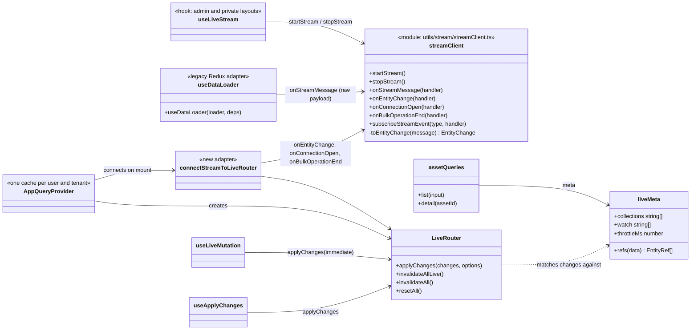
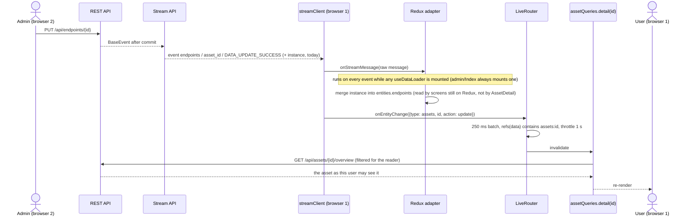
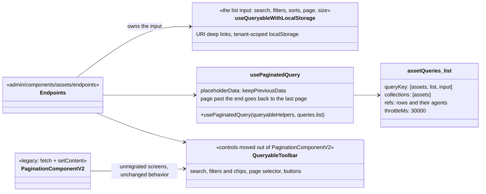
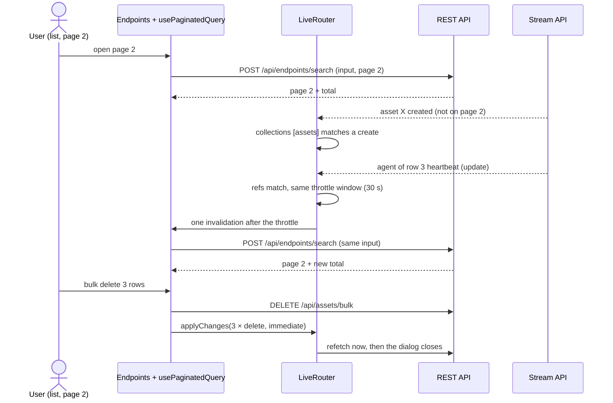
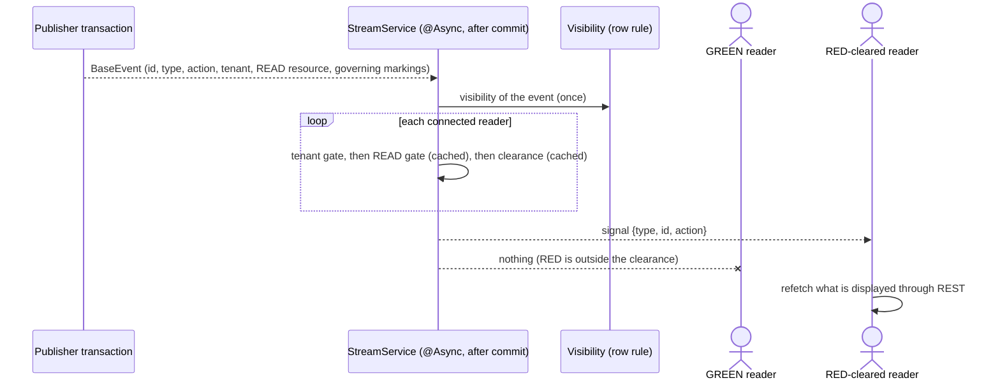
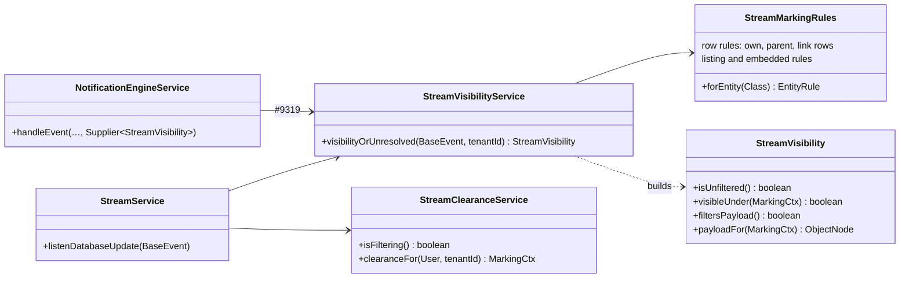

# Ping events: live screens driven by change signals — Technical Design

| | |
|---|---|
| **Status** | Part 1 and Part 2 in review, Part 3 proposal |
| **Implementation plan** | [implementation-plan.md](./implementation-plan.md): what is done, the lots, the screens to migrate per entity |
| **Part 1** | [#8737](https://github.com/OpenAEV-Platform/openaev/pull/8737) — TanStack Query, refreshed live from the platform stream (asset details) |
| **Part 2** | [#8916](https://github.com/OpenAEV-Platform/openaev/pull/8916) — the assets list read from a live paginated query (stacked on #8737) |
| **Part 3** | [#8563](https://github.com/OpenAEV-Platform/openaev/issues/8563) — the stream sends change signals instead of entity content (epic [#8171](https://github.com/OpenAEV-Platform/openaev/issues/8171)) |
| **Related** | [#9717](https://github.com/OpenAEV-Platform/openaev/issues/9717) duplicate stream events · [#9319](https://github.com/OpenAEV-Platform/openaev/pull/9319) notifications filtered by marking clearance · marking Task 4: [tech design](../../marking/task4/tech-design.md#the-sse-stream-rules-read-from-the-registry-and-the-jpa-mapping), [implementation plan, Chunk 5](../../marking/task4/implementation-plan.md#chunk-5--sse---stream-api-revisited) |

# 📋 Context

Every logged-in browser keeps one Server-Sent Events connection open on `/api/stream`. Each time an entity
is created, updated or deleted, the backend sends the **whole entity** to every connected user who passes the
tenant and READ checks (and, behind the `MARKING` preview, the marking check):

```json
{
  "event_type": "DATA_UPDATE_SUCCESS",
  "attribute_schema": "endpoints",
  "attribute_id": "asset_id",
  "instance": { "asset_id": "8b78…", "asset_name": "web-01", "asset_ips": ["…"], "asset_agents": ["…"], "…": "…" },
  "listened": true
}
```

The frontend writes that `instance` into the Redux store, and the screens read it from there. This has four
costs:

- **Leaks**: the payload is the entity as the *publisher* loaded it. Sending it safely to a reader with less
  clearance means stripping it field by field (marking Task 4, Chunk 5).
- **Stale lists**: the paginated screens (66 files on `PaginationComponentV2`) fetch each page through REST and
  keep the rows in local state; they never read the Redux store the stream feeds. They refresh only when their
  own input changes (page, filter, sort, search), after the user's own mutations (`reloadContentCount`), or on
  remount, so a change made by someone else shows only after one of those.
- **Two sources of truth**: a screen shows what REST returned, merged with whatever the stream pushed.
- **Backend cost**: each event is serialized up to three times and checked field by field for each reader.

**Target**: the event is a **signal** ("entity `<id>` of type `<type>` was created, updated or deleted"). The
screen re-reads what it shows through REST, which already applies tenant, RBAC and marking filtering for the
reader.

The migration has three parts:

1. **Part 1**: a live query layer on the frontend, which needs only `{type, id, action}` from an event. It is
   proven on the asset details page.
2. **Part 2**: the same layer for paginated lists, proven on the assets list.
3. **Part 3**: the backend stops sending the payload. It still has to decide **who** receives a signal,
   because even an id reveals that a restricted entity exists and changed.

# 🧩 Part 1 — The live query layer, on the details page (#8737)

## Principle

Screens read server data through TanStack Query. A query declares in its `meta` which entities and types its
data depends on. When a change arrives, a single router finds the queries concerned and **invalidates** them,
so TanStack refetches them through REST. Nothing ever writes server data into the cache: the screen always
shows exactly what the REST API returned for this reader.

From an event, the router needs only three things:

```ts
interface EntityChange {
  type: string;              // 'assets', 'agents', 'assetgroups'…
  id: string;
  action: 'create' | 'update' | 'delete';
  parents?: EntityRef[];     // entities the change also affects (an agent → its asset)
}
```

## Components



- **`streamClient.ts`** owns the single `EventSource`. It reconnects with a backoff that grows with the outage
  (2 s, 10 s, then 30 s, ±30% jitter), and a watchdog reconnects a connection that went silent. It reduces each
  message to an `EntityChange`. It is the only place that reads `instance`, apart from the Redux adapter.
- **`useLiveStream()`** keeps the connection open while the admin or private layout is mounted.
  - **Before**, `useDataLoader` opened the stream lazily: the first mounted loader created the `EventSource`,
    and the last one to unmount closed it. A fully migrated page mounts no loader, so it would have had no
    stream.
  - **Now** the connection is explicit. Standalone pages (report rendering, comcheck, public lessons…) mount
    no layout and stay without a stream.
- **Two adapters** listen to the same connection:
  - **Redux adapter** (`useDataLoader.js`, legacy): normalizes `instance` into `entities[attribute_schema]`
    while at least one loader is mounted. It re-runs the mounted loaders on reconnection and at the end of a
    bulk operation.
  - **Live router adapter** (`connectStreamToLiveRouter.ts`, new): forwards `EntityChange`s to
    `LiveRouter.applyChanges`. On (re)connection and at the end of a bulk operation it calls
    `invalidateAllLive()`, because no per-entity event covers those cases.
- **`AppQueryProvider`** (in `root.tsx`) holds one query cache per user and tenant (it is remounted when they
  change). A change of rights refetches every query (`invalidateAll` when rights grow, `resetAll` when they
  shrink) without remounting the tree.

> **Reading `admin/Index.tsx`**: it mounts both `useLiveStream()` and `useDataLoader(...)`. These are not two
> subscriptions. `useLiveStream()` holds the one connection. The `useDataLoader` loads the taxonomies (attack
> patterns, kill chain phases, tags, domains), and as a side effect keeps the Redux adapter active for every
> screen not migrated yet.

## From a stream message to a change

`toEntityChange` (`streamClient.ts`) does the following:

| Field | Source | Notes |
|---|---|---|
| `type` | `attribute_schema` through `TYPE_OF` | `endpoints`, `securityplatforms`, `aitargets` → `assets`: the queries see one asset id space, while the backend streams subtypes under their own schema (`getStreamSchema()`) for the Redux buckets |
| `id` | `instance[attribute_id]` | the only field read from the payload for every type |
| `action` | `event_type` | `DATA_FETCH_SUCCESS` → `create`, `DATA_DELETE_SUCCESS` → `delete`, anything else → `update` |
| `parents` | `PARENTS_OF[schema](instance)` | today only `agents` → `{assets, instance.agent_asset}`: an agent change refreshes the screens showing its asset |

Entity type names come from `ENTITY_TYPES` (`utils/query/entityChange.ts`). A type that is not listed there
cannot be used by a query, so a typo does not compile.

## The router

A query opts in with `meta: liveMeta({ refs, collections, watch, throttleMs })`. A change matches a query when:

| Declared | Matches | Example |
|---|---|---|
| `refs(data)` | a change of any action on an entity the data shows | the asset on its details page, its agents |
| `collections` | a create or delete of the type, even off-page | a list of assets (its rows and total change) |
| `watch` | any change of the type | a page whose content depends on another type (asset groups on the asset details page) |

The router then refetches the matching queries:

- **Stream changes and `useApplyChanges`**:
  - changes are buffered for 250 ms and deduplicated;
  - each query is throttled (1 s by default, `throttleMs` to raise it);
  - a query that is fetching keeps the changes aside and matches them against the data its fetch returns;
  - in a hidden tab, queries are only marked stale, and TanStack refetches them when the tab is shown.
- **The user's own mutation** (`useLiveMutation`, or `useApplyChanges` with `{ immediate: true }`): no batch,
  no throttle, a fetch in flight is restarted, and the call resolves once the queries are refetched. This lets
  the dialog close on up-to-date data.
- **`invalidateAllLive()`**: every live query goes through the throttle, without matching. It is used for a
  (re)connection or the end of a bulk operation.

Team rule: `liveRouter.ts` is the only caller of `invalidateQueries`. Nothing calls `setQueryData`, and there
are no optimistic updates. The stream and the user's own mutations refresh screens the same way.

## Sequence: an admin renames an endpoint shown on a details page



On this page the Redux write is unused: `AssetDetail` reads the asset only from its query. The write only matters
for the screens still on Redux that read `entities.endpoints` (`EndpointUpdate`, `InjectEndpointsList`,
`ChainedTimeline`, `TechnicalExpectationAssetGroup`…).

## The details page

```ts
detail: (assetId: string) => queryOptions({
  queryKey: assetKeys.detail(assetId),
  queryFn: ({ signal }) => getAssetOverview({ assetId, signal }),
  meta: liveMeta<EndpointOverviewOutput>({
    // Group membership is owned by the group: joining one only streams a change of that group.
    watch: [ENTITY_TYPES.ASSET_GROUPS],
    refs: asset => [
      { type: ENTITY_TYPES.ASSETS, id: asset.asset_id },
      ...asset.asset_agents.map(agent => ({ type: ENTITY_TYPES.AGENTS, id: agent.agent_id })),
    ],
  }),
}),
```

A deleted asset answers 404, and the page shows it as deleted (`isNotFoundError`).

**What the details page needs from the event: `type`, `id`, `action`, plus the parent asset of an agent.**
Nothing else from the payload reaches it.

Some data on the page is not migrated yet and still comes from Redux: the linked person's name (`users`) and
the tags. The frontend conventions allow this during the migration, as long as a screen never reads the *same*
data from both sources.

# 📄 Part 2 — Paginated lists (#8916)

## The problem

`PaginationComponentV2` (66 files) calls the screen's REST search itself (`fetch(searchPaginationInput)`), and
the screen keeps the rows in its own state through `setContent`:

- a change streamed into the Redux store does not reach the rows, because the list never reads the store;
- the total is kept by hand (`handleChangeTotalElements`, `incrementTotalElements`);
- a refresh after a mutation is a `setReloadCount` / `reloadContentCount`.

The fetch runs again only when its effect's dependencies change (`searchPaginationInput`, `reloadContentCount`,
`contextId`):

- the user changes the page, a filter, the sort, the search text or the page size;
- the screen bumps `reloadContentCount` after its own mutations;
- the context changes (another simulation, for example);
- the screen remounts (navigating away and back, or a reload).

It does not run again when the stream reconnects or a bulk operation ends, since those re-run the `useDataLoader`
loaders and this fetch is not one. A change made by someone else (another user, the backend, an agent) therefore
shows only after one of the triggers above. The marking work added `patchRowsFromStore` to the Endpoints list to
patch the names of the visible rows from the store; the other lists had no such workaround.

## Design



- **The caller owns the input** (`useQueryableWithLocalStorage`, or `useQueryable` for pickers and dialogs). The
  query key carries the whole input, so each page, filter or sort is its own query.
- **The total comes from the data.** A change is described (`useApplyChanges`), never patched into the rows or
  the total.
- **While another page, filter or sort loads**, the previous page stays as placeholder data, so the total and
  the page selector do not reset. The loader shows on `isPending || isPlaceholderData`, not on a refetch of the
  same page.
- **A page past the end after a delete** moves to the new last page once its data is settled.
- **`QueryableToolbar`** holds the controls of `PaginationComponentV2`, moved unchanged.
  `PaginationComponentV2` keeps its fetch effect around them, so the screens not migrated behave as before.

## Live rules for a list

```ts
list: (input: SearchPaginationInput) => queryOptions({
  queryKey: assetKeys.list(input),
  queryFn: ({ signal }) => searchAssets({ input, signal }),
  meta: liveMeta<Page<EndpointOutput>>({
    collections: [ENTITY_TYPES.ASSETS],
    throttleMs: 30_000,
    refs: page => page.content.flatMap(asset => [
      { type: ENTITY_TYPES.ASSETS, id: asset.asset_id },
      ...(asset.asset_agents ?? []).map(agent => ({ type: ENTITY_TYPES.AGENTS, id: agent.agent_id })),
    ]),
  }),
}),
```

- **`collections` + `refs`, not `watch`**: with `watch`, every change of the type would refetch every open
  page.
- **Known limit**: an entity updated *into* the filter or sort window from another page shows at the next
  refetch.
- **`throttleMs: 30_000`**: every agent heartbeat (every 2 minutes per agent) streams an update of the agent and
  its endpoint. A page of agent-backed rows gets one nearly all the time, so the list refetches at most every
  30 s. The user's own changes still refetch at once.

## Sequence: a user on page 2 while assets change elsewhere



## Found in review

The backend streams asset subtypes under `endpoints`, `securityplatforms` and `aitargets`, but the queries
matched on `assets`, so no stream change ever reached the list or the details page. Fixed in the adapter with
the `TYPE_OF` mapping (Part 1 table), and covered by `streamClient.test.ts` and the e2e spec
`assets-list-live-updates.spec.ts`.

# 🔒 Part 3 — Marking and SSE stream (#8563)

## 3.1 No payload, but the marking check stays

### What the marking brainstorm decided

From the marking Task 4 tech design ("The SSE stream: rules read from the registry and the JPA mapping") and
implementation plan (Chunk 5):

1. **Observed** (2026-10-08): renaming a `TLP:RED` endpoint sent the full RED endpoint (name, IPs, MACs,
   markings, embedded agent) to a `TLP:GREEN` user's stream. Nothing was displayed, but the data was in the
   network stream and the Redux store.
2. **Short term, shipped behind `MARKING`** (2026-11-12): the stream applies the same rules as the SQL
   filtering, in memory, read at startup from the marked tables (registry included) and the JPA mapping.

   | Rule | Example | Decision |
   |---|---|---|
   | own markings | an asset | sent when the reader holds the markings |
   | parent row | an agent, an expectation, a trace (through its agent) | sent when the parent row is visible |
   | link rows (*about*) | a finding | sent when it has no link or one visible link |
   | listing | `inject_assets`, `asset_group_dynamic_assets` | hidden ids removed from the payload |
   | embedded | `inject_expectations`, `inject_status.status_traces` | hidden objects removed from the payload |

   - **Fail-closed**: when markings cannot be read, the event is hidden from every restricted reader.
   - **Known limits**:
     - the payload is the publisher's view, so a reader with more clearance may receive a shorter list;
     - a reader who loses access (GREEN → RED, grant removed) gets no event, and the row stays until reload;
     - a reader who gains access (RED → GREEN) gets an update, which a list ignores for a row it does not
       show, so the row appears only at the next refetch.

     Both marking cases are fixed, for every table with its own markings, by point 4 of 3.2 below.
3. **Longer term (this document)**: stream a signal, not the content. The client re-reads through REST,
   already filtered. This removes the payload filtering and both known limits, at the cost of one REST request
   per refresh and migrating the views that rely on the pushed payload.

**Signal format** (from #8563, the shape of today's id-only delete event):

```json
{ "event_type": "DATA_UPDATE_SUCCESS", "attribute_schema": "assets", "attribute_id": "asset_id", "instance": { "asset_id": "5a962860-…" } }
```

The definition of done of #8563 includes:
- a GREEN consumer does not receive anything from a RED asset update, **not even the id**, because the id and
  its timing already reveal that a restricted asset exists and changed;
- no database query per event for the marking check.

### Why the check stays

A signal carries no content, but it is still a disclosure. The backend keeps deciding, for each event and each
reader, whether the reader may **know** about it:



### The visibility code is shared with notifications

PR #9319 (notifications filtered by marking clearance) reuses the stream's visibility decision. It calls
`StreamVisibilityService.visibilityOrUnresolved(event, tenantId)` and keeps only the recipients for which
`visibility.visibleUnder(clearance)` is true. It uses **only the row decision**: not `payloadFor`,
`filtersPayload` or `keepOnly`.



### What goes away and what stays

| Part | Used by | With signal-only events |
|---|---|---|
| **Row decision**: `visibilityOf` / `visibilityOrUnresolved`, `isUnfiltered`, `visibleUnder`, row rules (own, parent, link rows), reading the parents' markings | stream, notifications (#9319) | **stays**, as a component shared by both features rather than part of the stream |
| **Payload stripping**: `payloadFor`, `filtersPayload`, `keepOnly`, `holdersOf`; listing and embedded rules (`ListingRule`, `EmbeddedRule`, `collectNested`) | stream only | **removed**, once injects, asset groups and findings send signals |
| Per-tenant trimming of streamed users (`UserStreamMixIn`, `userInTenantOf`) | stream only | removed |
| Redaction of `notifier_configuration` | stream only | removed |
| The stream's own re-serializations (`mapper.valueToTree` in `StreamService` and `StreamVisibilityService`) | stream | removed |
| Serialization in the `BaseEvent` constructor (`instanceData`) | notifications (`NotificationEngineListener`) | stays while notifications read it |

Injects and asset groups are not hidden as a whole today: only the asset ids listed in them are stripped. As
signals, they need no marking check at all, which matches the SQL behavior.

## 3.2 Event sent on marking assignment changes

The current row decision does not meet "no database query per event":

- for agents, traces, expectations and findings, it re-serializes the entity after commit, then reads the
  parent asset's markings with one or two JPQL queries per event (`StreamVisibilityService`);
- `isFiltering()` reads the platform settings for each event, and again for each reader.

Proposal:

1. **Capture what the check needs when the event is published.** Inside the writer's session, the way
   `permissionResourceId` is already captured, store on the `BaseEvent` the markings that govern the entity:
   - an asset: its own `asset_markings`, a plain column, so free;
   - an agent, trace or expectation: its asset's markings;
   - a finding: the markings of its linked assets.

   That costs at most one read per *write*, never per reader, and nothing reads a lazy relation after commit.
2. **Check each reader in memory only**: tenant, READ (30 s cache), clearance (5 min cache). Cache
   `isFiltering()` as well.
3. **Deletes**: use the markings captured at `@PreRemove`. Today a deleted child whose parent is gone too
   (cascade) cannot be checked, so it fails closed and restricted readers keep a ghost row.
4. **Marking changes: seen from each reader, a marking change is a create or a delete.** For a row that carries
   its own markings, the stream compares each reader's clearance with the markings the row had before the write
   and the ones it has after:

   | Change | Reader cleared before | Reader cleared after | Signal for this reader | What the list does |
   |---|---|---|---|---|
   | GREEN → GREEN + other marking | yes | yes | **update** | refetches if the row is shown (`refs`) |
   | GREEN → RED | yes | no | **delete** | the row is shown, so its id is in `refs` (and `collections` matches a delete): refetch, the row disappears |
   | RED → GREEN | no | yes | **create** | `collections` matches a create: refetch, the row appears if it matches the page, filter and sort |
   | RED → RED + other marking | no | no | nothing | — |

   - The delete leaks nothing: the reader already knew the id.
   - The create discloses the id to a reader who is now allowed to know it.
   - The details page follows the same rules: a delete refetches the row, the REST call is refused, and the page
     shows it as not found.
   - Rows marked through another one (agents, traces, expectations through their asset; findings through their
     link rows) get no signal of their own: no row of theirs changed, and the client refetches them through REST,
     which filters them.
   - The frontend needs no change: `liveMeta` of the assets list (`collections: [ASSETS]`, `refs` on the rows)
     already reacts to creates and deletes.

   **Before the fix** (observed on #8916, 2026-11-24, admin and `TLP:AMBER` reader on the assets list):
   - GREEN → RED: the reader received nothing, so the row stayed until the next refetch (the known limit above).
   - RED → GREEN: the reader received an **update**. The list matches an update only on the rows it shows
     (`refs`), and `collections` matches only creates and deletes, so the asset appeared only at the next
     refetch (filter or page change, window focus, reconnect).

   **Server-side design (implemented in commit `f586d57ff8` on the review branch of #8916).** It applies to every entity of a
   marked table with its own `marking_ids` column, whoever writes it, not to assets only:

   ```mermaid
   sequenceDiagram
       actor A as Admin
       participant W as Any writer (markings API, a save)
       participant L as ModelBaseListener
       participant S as StreamService (after commit)
       actor G as AMBER reader
       actor X as Admin's other tab

       W->>L: @PostLoad of the row
       L->>L: loadedMarkingIds = copy of [GREEN]
       A->>W: set the markings to [RED]
       W->>L: flush → @PostUpdate
       L-->>S: BaseEvent(DATA_UPDATE), markingIdsBeforeChange = [GREEN] (differs from [RED])
       L->>L: loadedMarkingIds = [RED] (the next flush compares with the database)
       S->>S: per reader: visibility.visibleUnder(clearance) and visibility.wasVisibleUnder(clearance)
       S-->>G: DATA_DELETE_SUCCESS {asset_id} (before yes, now no)
       S-->>X: DATA_UPDATE_SUCCESS (before yes, now yes)
   ```

   ```mermaid
   classDiagram
       direction LR
       class MarkedEntity {
           <<interface>>
           +getMarkingIds() String[]
           +getLoadedMarkingIds() String[]
           +setLoadedMarkingIds(String[])
       }
       class Asset
       class ModelBaseListener {
           @PostLoad, @PostPersist, @PostUpdate: remember the markings
       }
       class BaseEvent {
           +getMarkingIdsBeforeChange() Set~String~
       }
       class StreamVisibility {
           +visibleUnder(MarkingCtx) boolean
           +wasVisibleUnder(MarkingCtx) boolean
       }
       class StreamMarkingRules {
           startup guard: own-column table → MarkedEntity
       }
       MarkedEntity <|.. Asset
       ModelBaseListener ..> MarkedEntity : remembers
       BaseEvent ..> MarkedEntity : compares loaded / current
       StreamVisibility ..> BaseEvent : markings before
       StreamMarkingRules ..> MarkedEntity : requires
   ```

   | Where | Change |
   |---|---|
   | `MarkedEntity` (model) | interface of an entity whose table has its own markings: `getMarkingIds()` and the markings the row was loaded or last written with (`getLoadedMarkingIds` / `setLoadedMarkingIds`). `Asset` implements it with a `@Transient @JsonIgnore` field, so `Endpoint` and `SecurityPlatform` do too |
   | `ModelBaseListener` | `@PostLoad`, and after building the event of `@PostPersist` and `@PostUpdate`: remember a copy of the markings. Every writer is covered: the markings API, a plain save, a merge of a detached entity (the merge loads the managed copy) |
   | `BaseEvent` | `markingIdsBeforeChange` (`Set<String>`, `@JsonIgnore`): for an update of a `MarkedEntity` whose loaded markings differ from the current ones, as sets; null otherwise, creations and deletions included. Read when the event is built, so a later write cannot change what the consumer reads after commit. One set is enough: an event is about one row, which has one marking column |
   | `StreamVisibility` (+ `StreamVisibilityService`) | `wasVisibleUnder(clearance)`, next to `visibleUnder`: for a row whose rule is its own markings and whose markings changed, whether the clearance allows the previous set; otherwise the same as `visibleUnder`. The marking semantics stay in one class, and the contract #9319 relies on (`visibilityOrUnresolved`, `isUnfiltered`, `visibleUnder`) is unchanged |
   | `StreamService.streamDatabaseEvent` | after the READ gate: visible before and not now → id-only `DATA_DELETE_SUCCESS` (the tombstone code is shared with grant-managed root deletions, `sendIdOnly`); visible now and not before → the event as `DATA_FETCH_SUCCESS`, with the usual payload rules; otherwise unchanged. The event is cloned, never retyped, so the other consumers keep the update |
   | `StreamMarkingRules` | refuses to start when an entity of an active marked table with its own column does not implement `MarkedEntity`, as `MarkedTables.requireResolvableParents` does for links: a new marked table cannot silently fall back to the old behaviour |
   | Tests | `BaseEventTest`: previous markings on a changed update, none for the same set in another order, none for a creation or deletion. `StreamVisibilityServiceTest`: `wasVisibleUnder` for GREEN → RED and RED → GREEN, and as now for an unchanged asset and an agent. `StreamServiceTest`: delete, create and update per reader (the admin always gets the update), and the id-only delete. `StreamMarkingRulesTest`: the startup guard. `AssetMarkingsApiTest`: the markings API and a plain entity change both publish the update with the previous markings |

   **Marking a new table** needs no change to the stream: the migration adds the `marking_ids` column, the table
   joins `openaev.marking.active-tables`, and its entity implements `MarkedEntity`. The startup guard enforces the
   last step.

   Cost: a copy of the markings array per row loaded (usually empty), one set comparison per update of a marked
   row, and one per reader in the stream, in memory, no query. With `MARKING` off, every reader has the full
   clearance, so nothing changes.

   **Limits that remain:**
   - **Duplicate events** (#9717, point 5): the listener runs twice for an endpoint. The first event carries the
     previous markings, the second does not (they were reset after the first), so a reader gets the create or
     delete, then nothing (still hidden) or an update (still visible): harmless.
   - **Bulk marking replace**: events are not streamed per entity inside a bulk operation (`BulkOperationContext`),
     and the `bulk-operation` progress events go only to the user who launched it. Other readers see the change at
     their next refetch. Follow-up: during the operation, count the distinct before/after marking pairs (a bulk
     replace sets the same markings everywhere, so a few pairs, not one entry per row); at the end, send each reader
     for whom one pair was visible before or after one id-less signal per type, which the router treats as a
     change of every query listing or showing that type. One signal per reader per operation, nothing for a reader
     who saw none of the rows.
   - **The reader's clearance changes**: no row changed, so no entity event. Handled by point 6.
   - **Rows marked through another one** get no create or delete of their own. The screens refetch their parent,
     which is enough for the queries; the Redux store keeps them until reload.
   - **A change made in SQL** (a native or bulk `@Modifying` query) skips the listener, so it streams nothing, as
     for any other field (see `orm.instructions.md`).

   This applies to the stream only. A notification records a fact at the time it happens, so the digest
   deliberately does not re-check clearance.
5. **Fix the duplicate events** ([#9717](https://github.com/OpenAEV-Platform/openaev/issues/9717)):
   `ModelBaseListener` is declared on `Asset` and again on `Endpoint` and `SecurityPlatform`, so each write of
   those streams twice. Fixing it halves the work.
6. **Clearance changes: the reader is told to re-read** (implemented in commit `c00a62cd5f` on the review branch of #8916).
   An admin moves user A from a RED group to a GREEN one, or removes a marking from A's group. No row changed, so
   point 4 sends nothing, while the backend applies the new clearance at once: `MarkingClearanceCacheManager` is
   evicted for the affected users, and both the SQL filtering and the stream read it. Before this point, nothing
   told the browser: the frontend's rights-change path (`AppQueryProvider`, `rightsOf(me)`) compares admin,
   capabilities and grants, not the clearance, so A kept the RED rows on screen until the next refetch (focus,
   page or filter change, reconnect, or a live change on the query).

   ```mermaid
   sequenceDiagram
       actor Ad as Admin
       participant G as TenantGroupService / UserService / MarkingDefinitionService
       participant C as MarkingClearanceCacheManager
       participant S as StreamService (after commit)
       participant F as A's browser (streamClient → liveRouter)

       Ad->>G: remove TLP:RED from A's group
       G->>C: evictForUsers(group members)
       C->>C: drop the cached clearances, in every tenant
       C-->>S: MarkingClearanceChangedEvent(userIds)
       S-->>F: event "clearance-changed", data {} (A's connections only)
       F->>F: onClearanceChange → router.resetAll()
       F->>F: mounted queries refetch through REST, filtered with the new clearance
   ```

   | Where | Change |
   |---|---|
   | `MarkingClearanceChangedEvent` | `userIds`, or `allUsers` for `evictAll` |
   | `MarkingClearanceCacheManager` | `evictForUser`, `evictForUsers` and `evictAll` publish it. Every clearance change already goes through them: group markings, group membership (user create, update, tenant join or leave), SSO group mapping when it changed, marking definition changes (`evictAll`) |
   | `StreamService.listenClearanceChange` | `@TransactionalEventListener(fallbackExecution = true)`, async: after commit, so that the re-read sees the new clearance. Sends a named `clearance-changed` event with an empty payload to the connections of the users concerned: it names no marking and no other user |
   | `streamClient.onClearanceChange` + `connectStreamToLiveRouter` | `router.resetAll()`: the data read with the previous clearance is dropped, not only refetched, as when rights shrink, whichever way the clearance changed |
   | Tests | `MarkingClearanceCacheManagerTest` (eviction in every tenant publishes the users, `evictAll` publishes everyone), `StreamServiceTest` (only the concerned user's connections, empty payload; everyone), `streamClient.test.ts`, `connectStreamToLiveRouter.test.ts` |

   Limits:
   - `resetAll` concerns the live queries (TanStack). Screens still on Redux keep what they loaded until reload.
   - A marking definition change (`evictAll`) resets every connected user's queries once: rare, an admin action.

Points 1 to 3 change how the decision shared with notifications is computed. They must keep the contract #9319
relies on (`visibilityOrUnresolved` → `isUnfiltered()` / `visibleUnder(clearance)`) and its tests, and they come
after #9319 is merged, or are done together with it.

The frontend impact and the rollout, entity by entity, are in the
[implementation plan](./implementation-plan.md).

# ❓ Open questions

- **Capabilities and grants changed through a group**: `rightsOf(me)` only changes when `me` is refreshed, and a
  group change does not touch the user's row. Does the same gap exist for them, and should point 6's signal
  cover every rights change rather than the clearance only?

- **Signal marker**: an explicit field (`"signal": true`) or a distinct `event_type`? The legacy name
  `DATA_FETCH_SUCCESS` for a creation is worth fixing at the same time.
- **Where the shared row decision lives** once it is no longer stream-specific (`service/stream/` →
  `service/marking/`?), and when, given #9319.
- **Notifications**: can `NotificationEngineListener` build its message without `instanceData`? If so, the
  serialization in the `BaseEvent` constructor can go too.
- **Redux fallback**: re-run the mounted loaders, or fetch the entity by id per type (~30 REST getters)?
- **Refetch load during simulations**: injects, expectations and traces change at a high rate. A refetch per
  signal needs the router's batching and per-type throttle on the legacy path too.
- **Admin layout**: once the migrated pages no longer read Redux (executors on `Endpoints`, users on
  `AssetDetail`), make explicit in `admin/Index.tsx` that `useDataLoader` is there for the taxonomies only.
