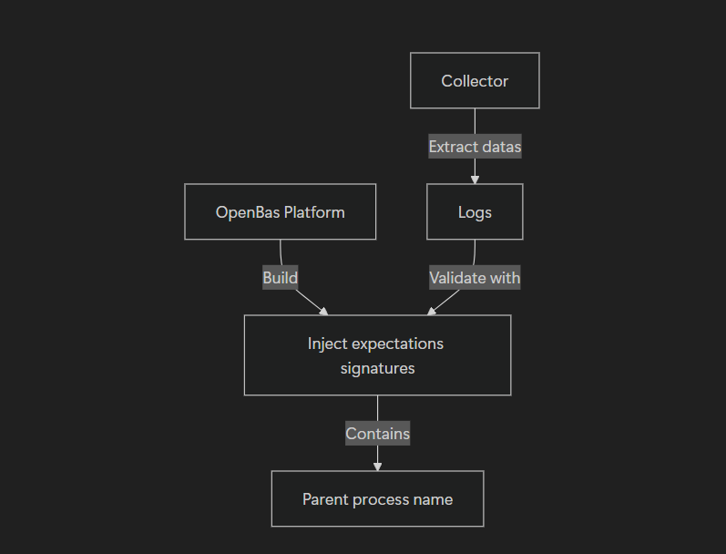

# Collector development

This page explains what OpenAEV expects from a Collector: a process that reads the security events of a detection or prevention product, such as an **EDR (Endpoint Detection and Response)** or a **SIEM (Security Information and Event Management)**, and matches them against the expectations of the Injects that OpenAEV executed.

To set up a new Collector project (template, `pyoaev` dependency, local development), follow the [Collectors repository README](https://github.com/OpenAEV-Platform/collectors#development). For a functional overview, see [Collectors](../integrations/collectors/collectors.md).

## How a Collector works with OpenAEV

1. **Register.** The Collector registers through `POST /api/collectors` and appears under **Integrations > Deployed**.
2. **Read the expectations.** At each run, it fetches the expectations it has not answered yet. Answer them quickly to measure how fast the product responds.
3. **Match and report.** It compares each expectation's signatures with the product's alerts, then tells OpenAEV whether the attack was prevented or detected (see [Report a result](#report-a-result)).

You do not need to fail late expectations yourself: the expectation expiration job of OpenAEV marks unanswered expectations as expired after a timeout (see [Platform managers](../deployment/platform/managers.md#scheduled-jobs)).

## Report a result

The Collector reports its result through `PUT /api/injects/expectations/{expectation_id}`, or through `PUT /api/injects/expectations/bulk` to answer several expectations in one call. The body carries the following fields:

| Field | Required | Description |
|---|---|---|
| `collector_id` | Yes | ID of the Collector that answers. |
| `is_success` | Yes | `true` if the product prevented or detected the attack, `false` otherwise. |
| `metadata` | No | Key-value pairs kept on the result, such as the ID or the link of the matching alert. If the Collector answers the same expectation again without `metadata`, OpenAEV keeps the previous ones. |
| `result` | No | **Deprecated** and ignored. |

OpenAEV derives the result label from `is_success` and the expectation type: **Prevented** or **Not Prevented** for a prevention expectation, **Detected** or **Not Detected** for a detection expectation.

When the Collector answers an Asset or an asset group expectation, OpenAEV applies the result to each agent expectation below it (or to the Asset itself when it has no agent), then recomputes the Asset and the asset group from their agents (see [Expectations](../usage/run-and-evaluate/expectations/expectations.md)).

!!! example "Bulk call"

    ```json
    {
      "inputs": {
        "<expectation_id>": {
          "collector_id": "<collector_id>",
          "is_success": true,
          "metadata": { "alert_id": "<alert_id>" }
        }
      }
    }
    ```

## Logging expectations

!!! note "Preview"

    Logging expectations are a preview feature: they exist only when the `LOGGING_EXPECTATION` preview feature is enabled (see [Parameters](../administration/parameters.md)).

A logging expectation checks that the attack left raw events in the product, whatever its alerts say. A Collector answers it only if it declares it:

1. **Declare the type.** Send `collector_supported_expectation_types` at registration, for example `["DETECTION", "PREVENTION", "LOGGING"]`. OpenAEV replaces the list at each registration. Without the field, the Collector answers detection and prevention expectations only, and OpenAEV never waits for it on a logging expectation.
2. **Read the expectations.** Fetch them through `GET /api/injects/expectations/logging/{collector_id}`. The other expectation routes never return logging expectations. The route returns only the expectations still waiting for this Collector, and an empty list when the preview feature is disabled.
3. **Report a match only.** Answer with `is_success: true` as in [Report a result](#report-a-result): OpenAEV derives **Logged** from the expectation type. Never send `is_success: false`: when nothing is found, send nothing, and the expectation comes back at the next run until it expires to **Not Logged**.
4. **Send the trace.** With `POST /api/inject-expectations-traces/bulk`, send the link to the search, the time of the first matching event, and how it matched in `inject_expectation_trace_match_type`: `marker` (the implant name), `source_ip` or `target_ip`.

## Signatures

A signature is a way to find an attack in an alert. The main ones are:

| Signature | Description |
|---|---|
| `parent_process_name` | Name of the parent process of the attack. For the OpenAEV implant, it is `oaev-implant-<inject_id>-agent-<agent_id>` (the file itself has `.exe` on Windows). |
| `source_ipv4_address`, `source_ipv6_address` | IP address of the Asset that ran the attack. |
| `target_ipv4_address`, `target_ipv6_address`, `target_hostname_address` | IP address or hostname targeted by the attack. |



For reference implementations, see the [CrowdStrike](https://github.com/OpenAEV-Platform/collectors/tree/main/crowdstrike), [Microsoft Defender](https://github.com/OpenAEV-Platform/collectors/tree/main/microsoft-defender) and [Microsoft Sentinel](https://github.com/OpenAEV-Platform/collectors/tree/main/microsoft-sentinel) Collectors.

## What's next?

- [Deploy Collectors](../integrations/collectors/deploy-collectors.md) -- Deploy and configure a Collector
- [Expectations](../usage/run-and-evaluate/expectations/expectations.md) -- Understand the expectations a Collector answers
- [Injector development](injectors.md) -- Build a custom Injector
