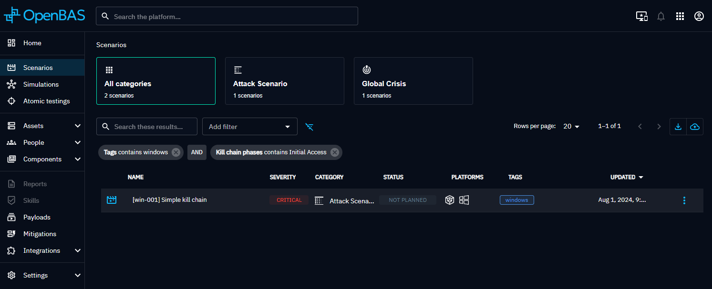
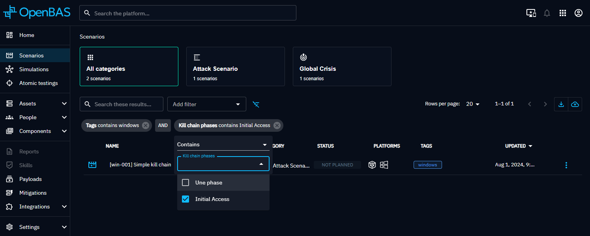
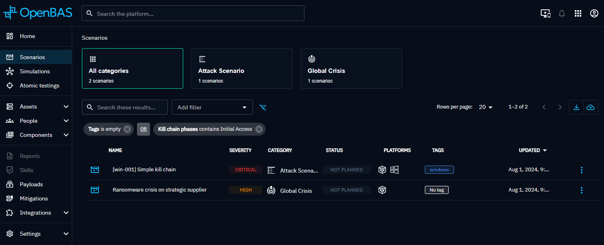

# Filters

In OpenAEV, you can filter lists, such as Scenarios or Simulations, to show only the items with specific attributes. This page explains how to filter in the UI and the `FilterGroup` format used by the [REST API](rest-api.md) search endpoints.

## Filters in the UI

Filters are not stored in the database. Your browser keeps them in local storage for each view, so you find them again when you come back. They are also saved in the URL, so you can bookmark and share a filtered view.



### Create a filter

1. Pick an attribute in the **Add filter** box. It lists the attributes you can filter on in the current view.
2. In the box that opens, select the operator.
3. Select the values to compare, unless the operator is empty or not empty.

You can add as many filters as you need.



The boolean mode (AND or OR) between filters is **global** to the view. Click it to switch between AND and OR.



## Filter format

Search endpoints accept a `filterGroup` object in the request body:

```json
{
  "filterGroup": {
    "mode": "and",
    "filters": [
      {
        "id": "name-filter",
        "key": "scenario_name",
        "mode": "or",
        "operator": "contains",
        "values": ["ransomware", "phishing"]
      }
    ]
  }
}
```

### Filter group

| Property | Type | Description |
|---|---|---|
| `mode` | string | `and` or `or`. Boolean operation between the filters of the group. Required by the OpenAPI schema; defaults to `and` |
| `filters` | array | List of filters |

### Filter

| Property | Type | Description |
|---|---|---|
| `id` | string | Filter identifier. Required by the OpenAPI schema |
| `key` | string | Attribute to filter on, for example `scenario_name` or `scenario_tags`. Required |
| `operator` | string | Operation between the attribute and the values, see [Operators](#operators) |
| `values` | array of strings | Values to compare with. Relations, such as tags, are matched by ID |
| `mode` | string | `and` or `or`. Boolean operation between the values when there are several |

### Operators

| Value | Meaning |
|---|---|
| `eq` | Equal |
| `not_eq` | Not equal |
| `contains` | Contains |
| `not_contains` | Does not contain |
| `starts_with` | Starts with |
| `not_starts_with` | Does not start with |
| `gt` | Greater than |
| `gte` | Greater than or equal |
| `lt` | Lower than |
| `lte` | Lower than or equal |
| `empty` | Empty, no value |
| `not_empty` | Not empty, any value |

By default, the UI offers these operators depending on the attribute type. Some attributes override this list.

| Attribute type | Operators |
|---|---|
| Text | `eq`, `not_eq`, `contains`, `not_contains`, `starts_with`, `not_starts_with` |
| Single value from a list (enum or reference) | `eq`, `not_eq`, `empty`, `not_empty` |
| List (array), such as tags | `contains`, `not_contains`, `empty`, `not_empty` |
| Date | `gt`, `gte`, `lt`, `lte`, `empty`, `not_empty` |
| Number | `gt`, `gte`, `lt`, `lte`, `eq`, `not_eq`, `empty`, `not_empty` |

!!! note

    - Negative operators (`not_eq`, `not_contains`, `not_starts_with`) always combine values with AND, whatever the filter `mode`: the result excludes all the values.
    - Text comparisons (`eq`, `not_eq`, `contains`, `starts_with` and their negations) are case-insensitive.
    - Date values use the ISO 8601 format, for example `2026-01-31T00:00:00Z`.
    - An unknown `operator` falls back to `eq`, and an unknown `mode` falls back to `and`.

## What's next?

- [REST API](rest-api.md) -- Authentication, pagination and search endpoints
