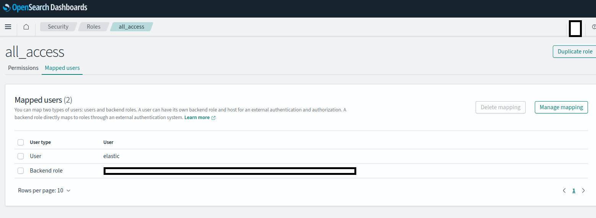

# Configuration

This page lists the main configuration keys of the OpenAEV platform, as properties (manual deployment) and as
environment variables (containers). All defaults live in the
[`application.properties` file](https://github.com/OpenAEV-Platform/openaev/blob/main/openaev-api/src/main/resources/application.properties).

!!! note "Parameters equivalence"

    To get the environment variable, write the key in upper case and replace each dot (`.`) with an underscore (`_`).

    For example:
    ```properties
    spring.servlet.multipart.max-file-size=5GB
    ```

    becomes:
    ```bash
    SPRING_SERVLET_MULTIPART_MAX-FILE-SIZE=5GB
    ```

## Platform

### API & frontend

#### Basic parameters

| Parameter                                             | Environment variable                                  | Default value         | Description                                                                                                                                                                                |
|:------------------------------------------------------|:------------------------------------------------------|:----------------------|:-------------------------------------------------------------------------------------------------------------------------------------------------------------------------------------------|
| server.address                                        | SERVER_ADDRESS                                        | 0.0.0.0               | Listen address of the application                                                                                                                                                          |
| server.port                                           | SERVER_PORT                                           | 8080                  | Listen port of the application                                                                                                                                                             |
| openaev.base-url                                      | OPENAEV_BASE-URL                                      | http://localhost:8080 | Base URL of the application, used for some email links and as the default agent URL (agent installer scripts and executor commands) unless `openaev.agent-url` is set. In production environments, ensure this URL can be resolved from endpoints where agents will be deployed.               |
| openaev.agent-url                                     | OPENAEV_AGENT-URL                                     |                       | Optional URL agents use to reach the platform when it differs from `openaev.base-url` (reverse proxy, VPN, load balancer, network segregation). When unset, agent installer scripts and executor commands fall back to `openaev.base-url`. |
| server.servlet.session.timeout                        | SERVER_SERVLET_SESSION_TIMEOUT                        | 1440m                 | Rolling session timeout: every request extends the session by this duration. Sessions are persisted in PostgreSQL and survive platform restarts                                            |
| openaev.session-idle-timeout                          | OPENAEV_SESSION-IDLE-TIMEOUT                          | 0                     | Idle time before the UI locks the screen and asks the user to continue or log out (0 = disabled, e.g. 30m). Must be lower than the session timeout                                          |
| openaev.session-cookie                                | OPENAEV_SESSION-COOKIE                                | `false`               | When `true`, the session cookie dies when the browser closes (server-side timeout still applies). When `false`, users stay logged in across browser restarts: the cookie is re-issued on every request (sliding Max-Age), so it only expires after `openaev.cookie-duration` of inactivity |
| openaev.session-cookie-same-site                      | OPENAEV_SESSION-COOKIE-SAME-SITE                      |                       | SameSite attribute of the session cookie: `None`, `Lax`, `Strict`, or blank to omit it. `Lax` drops the cookie on POST login callbacks (SAML2, OpenID `form_post`); `Strict` breaks all SSO (Single Sign-On) callbacks. `None` forces the `Secure` flag, for HTTPS SSO deployments |
| openaev.cookie-secure                                 | OPENAEV_COOKIE-SECURE                                 | `false`               | Turn on if the access is done in HTTPS                                                                                                                                                     |
| openaev.cookie-duration                               | OPENAEV_COOKIE-DURATION                               | P1D                   | Cookie validity sliding window (default 1 day). Each request re-issues the cookie with this Max-Age, so active users are never logged out by cookie expiration                             |
| openaev.admin.email                                   | OPENAEV_ADMIN_EMAIL                                   | *required*            | Login email of the admin user (for example `admin@openaev.io`)                                                                                                                             |
| openaev.admin.password                                | OPENAEV_ADMIN_PASSWORD                                | *required*            | Password of the admin user                                                                                                                                                                 |
| openaev.admin.token                                   | OPENAEV_ADMIN_TOKEN                                   | *required*            | API token of the admin user (must be a valid UUIDv4)                                                                                                                                       |
| openaev.admin.encryption_key                          | OPENAEV_ADMIN_ENCRYPTION_KEY                          | *required*            | Key used with the salt to derive the 256-bit key that encrypts sensitive data in the database                                                                                             |
| openaev.admin.encryption_salt                         | OPENAEV_ADMIN_ENCRYPTION_SALT                         | *required*            | Salt used with the encryption key. Must be at least 8 bytes long                                                                                                                          |
| openaev.healthcheck.key                               | OPENAEV_HEALTHCHECK_KEY                               | ChangeMe              | Key passed as `health_access_key` to the health check endpoint (`/api/health`). Change it in production                                                                                   |
| openaev.healthcheck.connectivity-probe-interval       | OPENAEV_HEALTHCHECK_CONNECTIVITY_PROBE_INTERVAL       | PT10S                 | Interval between two background connectivity probes of the dependencies (ISO-8601 duration). `/api/health` serves the result of the last probe and never contacts a dependency itself; it answers 503 once a required dependency (database, RabbitMQ, file storage) is down or has not been probed for 3 intervals |
| openaev.healthcheck.storage-probe-interval            | OPENAEV_HEALTHCHECK_STORAGE_PROBE_INTERVAL            | PT4H                  | Interval between two background computations of the storage sizes returned by `/api/health?details=true` and exported as `openaev_storage_used_bytes` (ISO-8601 duration). Computing them walks the whole object storage listing and queries the engine cluster, so low values are costly |
| openaev.metrics.key                                   | OPENAEV_METRICS_KEY                                   | *empty*               | Scrape key for `/actuator/prometheus`, sent by the scraper as `Authorization: Bearer <key>`. While empty (the default), every `/actuator/**` request is rejected with a 401                |
| inject.execution.threshold.minutes                    | INJECT_EXECUTION_THRESHOLD_MINUTES                    | 10                    | Time in minutes OpenAEV waits for Agents to report back after an inject is sent. Agents that did not report get a `TIMEOUT` trace and the inject is set to `ERROR` or `PARTIAL`. Late starts are handled by `openaev.scheduling.inject-staleness-threshold`. |
| openaev.cron.config.agent.inactivity.monitor.interval | OPENAEV_CRON_CONFIG_AGENT_INACTIVITY_MONITOR_INTERVAL | 5                     | Polling interval in minutes for the agent inactivity monitor job.                                                                                               |
| openaev.run-mode                                      | OPENAEV_RUN-MODE                                      | normal                | Startup run mode (`normal` or `safe`). In `safe`, Quartz background processing is disabled. See [Run modes](../../deployment/platform/run-modes.md).                                                       |
| openaev.starterpack.enabled                           | OPENAEV_STARTERPACK_ENABLED                           | true                  | StarterPack feature, providing default endpoint, asset group, scenarios and dashboards                                                                                                     |
| openaev.url.access.token.expiry-margin-days           | OPENAEV_URL_ACCESS_TOKEN_EXPIRY-MARGIN-DAYS           | 7                     | Number of days added after an exercise end date before URL access tokens expire                                                                                                            |
| openaev.url.access.token.retention-days               | OPENAEV_URL_ACCESS_TOKEN_RETENTION-DAYS               | 30                    | Number of days to retain expired or revoked URL access tokens before the purge job deletes them                                                                                            |
| openaev.retention.execution-traces.retention-days     | OPENAEV_RETENTION_EXECUTION-TRACES_RETENTION-DAYS     | 0                     | Number of days to keep execution traces (one row per agent execution message). `0` disables the purge job                                                                                   |

!!! warning "Admin settings are mandatory"

    - On first start, the platform stops if the admin email, password or token is missing. Later starts keep the stored values.
    - An invalid admin email or token stops every start.
    - A missing `encryption_key` or `encryption_salt` stops every start.

    Use strong, unique secrets, never `ChangeMe`.

#### Network and security

| Parameter                       | Environment variable            | Default value           | Description                                                                                                                                                                                                                                                                                                                                                                                                                 |
|:---------------------------------|:---------------------------------|:--------------------------|:-------------------------------------------------------------------------------------------------------------------------------------------------------------------------------------------------------------------------------------------------------------------------------------------------------------------------------------------------------------------------------------------------------------------------------|
| server.ssl.enabled              | SERVER_SSL_ENABLED              | `false`                 | Turn on to enable SSL on the local server                                                                                                                                                                                                                                                                                                                                                                                   |
| server.ssl.key-store-type       | SERVER_SSL_KEY-STORE-TYPE       | PKCS12                  | Type of SSL keystore                                                                                                                                                                                                                                                                                                                                                                                                        |
| server.ssl.key-store            | SERVER_SSL_KEY-STORE            | classpath:localhost.p12 | SSL keystore path                                                                                                                                                                                                                                                                                                                                                                                                           |
| server.ssl.key-store-password   | SERVER_SSL_KEY-STORE-PASSWORD   | admin                   | SSL keystore password                                                                                                                                                                                                                                                                                                                                                                                                       |
| server.ssl.key-alias            | SERVER_SSL_KEY-ALIAS            | localhost               | SSL key alias                                                                                                                                                                                                                                                                                                                                                                                                               |
| openaev.unsecured-certificate   | OPENAEV_UNSECURED-CERTIFICATE   | `false`                 | Turn on to accept self-signed or insecure SSL certificates                                                                                                                                                                                                                                                                                                                                                                  |
| openaev.with-proxy              | OPENAEV_WITH-PROXY              | `false`                 | Turn on for environments that use a proxy                                                                                                                                                                                                                                                                                                                                                                                  |
| openaev.extra-trusted-certs-dir | OPENAEV_EXTRA-TRUSTED-CERTS-DIR |                         | Local folder with extra trusted TLS certificates (public `.pem` files) to reach external applications such as CrowdStrike, Tanium or SentinelOne. With Docker, uncomment the volume in the [docker compose file](https://github.com/OpenAEV-Platform/docker/blob/master/docker-compose.yml) and set this value                                                                                                             |
| openaev.notification.webhook-allow-internal-targets | OPENAEV_NOTIFICATION_WEBHOOK-ALLOW-INTERNAL-TARGETS | `false` | Turn on to let webhook notifiers call internal or private addresses. This skips the SSRF (Server-Side Request Forgery) check on private addresses; scheme, host and HTTP verb checks still apply |
| openaev.theme.asset-allow-internal-targets | OPENAEV_THEME_ASSET-ALLOW-INTERNAL-TARGETS | `false` | Turn on to let theme logo and image URLs point at internal or private addresses, for on-premise networks with no public place to host a logo. This skips the SSRF (Server-Side Request Forgery) check on private addresses, both when the theme is saved and when reports are rendered, where it applies to every external resource the renderer loads. The URL must still use `https` and have a host |

!!! warning "Extra trusted certificates format"

    Certificates in `openaev.extra-trusted-certs-dir` must be public PEM-armoured (`*.pem`), DER-encoded X509 certificates.

#### Rate limiting

!!! note "Preview feature"

    Rate limiting only applies when `RATE_LIMITING` is listed in `openaev.enabled-dev-features`.

| Parameter                           | Environment variable                | Default value | Description                                                                                               |
|:------------------------------------|:------------------------------------|:--------------|:----------------------------------------------------------------------------------------------------------|
| openaev.ratelimit.enabled           | OPENAEV_RATELIMIT_ENABLED           | `true`        | Turn on to enable global rate limiting on the REST API                                                    |
| openaev.ratelimit.store-backend     | OPENAEV_RATELIMIT_STORE-BACKEND     | `IN_MEMORY`   | Rate limit bucket store backend. Only `IN_MEMORY` is available.                                           |
| openaev.ratelimit.default-rps       | OPENAEV_RATELIMIT_DEFAULT-RPS       | 10            | Maximum requests per second for unauthenticated requests, segmented per originating IP address.           |
| openaev.ratelimit.authenticated-rps | OPENAEV_RATELIMIT_AUTHENTICATED-RPS | 300           | Maximum requests per second for authenticated requests, segmented per user account.                       |

#### Logging

| Parameter                                   | Environment variable                        | Default value      | Description                                   |
|:--------------------------------------------|:--------------------------------------------|:--------------------|:------------------------------------------------|
| logging.level.root                          | LOGGING_LEVEL_ROOT                          | fatal              | Root log level                                |
| logging.level.io.openaev                    | LOGGING_LEVEL_IO_OPENAEV                    | error              | OpenAEV log level                             |
| logging.file.name                           | LOGGING_FILE_NAME                           | ./logs/openaev.log | Log file path (in addition to console output) |
| logging.logback.rollingpolicy.max-file-size | LOGGING_LOGBACK_ROLLINGPOLICY_MAX-FILE-SIZE | 10MB               | Rolling max file size                         |
| logging.logback.rollingpolicy.max-history   | LOGGING_LOGBACK_ROLLINGPOLICY_MAX-HISTORY   | 7                  | Rolling max days                              |

#### Audit logging

Audit logging records the actions performed through the API, and some actions the platform performs on its own.

!!! warning "Modifying actions only"

    Only modifying API calls are logged (create, update, delete, duplicate, launch). Reading actions are not logged,
    except when access is denied.

Since OpenAEV 3.260917.1, audit logs also record the following events:

| Event                       | `event_type` | `event_scope`        | `event_status` | Description                                                                                                                                                                                                                                                           |
|:----------------------------|:-------------|:---------------------|:---------------|:----------------------------------------------------------------------------------------------------------------------------------------------------------------------------------------------------------------------------------------------------------------------|
| Expectation result          | `execution`  | `expectation_result` | `success`      | A Collector, a security platform or the expectation expiration manager sets the result of an expectation. The context holds the Inject, the expectation type, the result and its source.                                                                              |
| Agent inactive              | `execution`  | `coverage_gap`       | `warning`      | An agent sent no heartbeat for 1 hour and becomes inactive. The check runs every `openaev.cron.config.agent.inactivity.monitor.interval` minutes. The context holds the agent, its Endpoint and its last heartbeat.                                                   |
| Connector activity          | `mutation`   | `create` or `update` | `success`      | Registration of a Collector, Injector or Executor, and health checks of connector instances. Collector, Injector and connector instance calls that change nothing significant (heartbeats) are not logged, nor are XTM Composer connectivity checks and connector logs. |

| Parameter                          | Environment variable               | Default value | Description                                                                                                                                               |
|:-----------------------------------|:-----------------------------------|:--------------|:----------------------------------------------------------------------------------------------------------------------------------------------------------|
| openaev.audit-logs.transports      | OPENAEV_AUDIT-LOGS_TRANSPORTS      |               | Comma-separated list of transports: `file`, `console`. Empty disables audit logging. `engine` is accepted but not usable yet |
| openaev.audit-logs.halt-on-failure | OPENAEV_AUDIT-LOGS_HALT-ON-FAILURE | false         | Stop the platform when audit logging fails                                                                                                                |
| logging.level.io.openaev.utils.log | LOGGING_LEVEL_IO_OPENAEV_UTILS_LOG |               | Log level of the `console` audit transport. The `file` transport always logs at INFO |
| openaev.audit-logs.file.dir        | OPENAEV_AUDIT-LOGS_FILE_DIR        | logs          | Audit log directory for the `file` transport                                                                                                              |
| openaev.audit-logs.file.filename   | OPENAEV_AUDIT-LOGS_FILE_FILENAME   | audit         | Audit log basename (without extension) for the `file` transport                                                                                           |
| openaev.audit-logs.file.retention-days | OPENAEV_AUDIT-LOGS_FILE_RETENTION-DAYS | 365 | Number of days of rolled audit log files to keep                                                                                                          |
| openaev.audit-logs.file.rollover-max-size | OPENAEV_AUDIT-LOGS_FILE_ROLLOVER-MAX-SIZE | 100MB | Maximum size of one audit log file before rollover                                                                                                    |
| openaev.audit-logs.file.rollover-total-size-cap | OPENAEV_AUDIT-LOGS_FILE_ROLLOVER-TOTAL-SIZE-CAP | 20GB | Maximum total size of the audit log files. The oldest files are deleted first                                                                    |
|                                    | AUDIT_LOG_DIR                      | logs          | Legacy compatibility env var for the audit log directory. When set, it overrides `openaev.audit-logs.file.dir`.                                           |
|                                    | AUDIT_LOG_FILENAME                 | audit         | Legacy compatibility env var for the audit log basename. When set, it overrides `openaev.audit-logs.file.filename`; `audit` and `audit.log` are accepted. |

#### Inject execution

The inject execution engine runs the actions described in the Injector contracts registered in OpenAEV.

| Parameter                                     | Environment variable                          | Default value | Description                                                                                                                                                                                       |
|:----------------------------------------------|:----------------------------------------------|:--------------|:-------------------------------------------------------------------------------------------------------------------------------------------------------------------------------------------------|
| openaev.scheduling.inject-staleness-threshold | OPENAEV_SCHEDULING_INJECT-STALENESS-THRESHOLD | 4             | Grace period in minutes after the start time of a time-based Inject, during which it can still run. Past this period, the Inject is set in error. Values below `1` are treated as `1`. |

#### Credential status validation

A scheduled job re-checks the stored credentials against their cloud provider and records the result, so you see a
revoked or expired credential *before* a Simulation fails on it.

The job runs per Tenant and only checks credentials whose status is stale, up to a per-run limit. Credential types with
no remote counterpart (username/password, hash) are never checked and keep the `UNSET` status.

| Parameter                                                   | Environment variable                                       | Default value | Description                                                                                              |
|:------------------------------------------------------------|:-----------------------------------------------------------|:--------------|:---------------------------------------------------------------------------------------------------------|
| openaev.credentials.status-validation.enabled               | OPENAEV_CREDENTIALS_STATUS-VALIDATION_ENABLED              | true          | Enables the credential status validation job. When false, the job returns immediately and writes nothing. |
| openaev.credentials.status-validation.cron                  | OPENAEV_CREDENTIALS_STATUS-VALIDATION_CRON                 | 0 */6 * * * ? | Quartz cron expression driving the job. The default runs every 6 minutes. Each run makes one outbound call per stale credential. |
| openaev.credentials.status-validation.revalidate-after-days | OPENAEV_CREDENTIALS_STATUS-VALIDATION_REVALIDATE-AFTER-DAYS | 1             | How long a credential status stays fresh. Past this age the credential is checked again.                 |
| openaev.credentials.status-validation.max-per-run           | OPENAEV_CREDENTIALS_STATUS-VALIDATION_MAX-PER-RUN          | 500           | Maximum number of credentials checked per tenant and per run. Oldest verification first.                 |
| openaev.credentials.status-validation.timeout-seconds       | OPENAEV_CREDENTIALS_STATUS-VALIDATION_TIMEOUT-SECONDS      | 10            | Per-call budget for a single provider probe. A probe exceeding it is inconclusive, not a rejection.      |

#### Report rendering

The platform renders reports server-side with a headless Chromium browser.

| Parameter                               | Environment variable                    | Default value | Description                                                                                                                                         |
|:----------------------------------------|:----------------------------------------|:--------------|:----------------------------------------------------------------------------------------------------------------------------------------------------|
| openaev.reporting.render-timeout-seconds | OPENAEV_REPORTING_RENDER-TIMEOUT-SECONDS | 90           | Maximum duration of a single render, in seconds                                                                                                     |
| openaev.reporting.max-concurrent-renders | OPENAEV_REPORTING_MAX-CONCURRENT-RENDERS | 2            | Maximum number of simultaneous browser contexts. Bounds Chromium memory usage                                                                       |
| openaev.reporting.render-base-url        | OPENAEV_REPORTING_RENDER-BASE-URL        |              | URL the headless browser uses to reach the platform. Empty uses loopback (`http(s)://localhost:{server.port}`). Override only when loopback does not serve the UI |

### Dependencies

#### XTM Suite: OpenCTI

Each OpenCTI connection is scoped to an OpenAEV tenant, identified by its UUID (`{id}`).

| Parameter                                    | Environment variable                         | Default value | Description                                                                                                                                    |
|:-----------------------------------------------|:-----------------------------------------------|:--------------|:-----------------------------------------------------------------------------------------------------------------------------------------------|
| openaev.xtm.opencti.{id}.enable              | OPENAEV_XTM_OPENCTI_{id}_ENABLE              | false         | Enable this OpenCTI connection                                                                                                                 |
| openaev.xtm.opencti.{id}.url                 | OPENAEV_XTM_OPENCTI_{id}_URL                 |               | OpenCTI instance URL                                                                                                                           |
| openaev.xtm.opencti.{id}.api_url             | OPENAEV_XTM_OPENCTI_{id}_API_URL             |               | OpenCTI API URL — completely overrides the base URL. Defaults to `openaev.xtm.opencti.{id}.url` + `/graphql`                                   |
| openaev.xtm.opencti.{id}.token               | OPENAEV_XTM_OPENCTI_{id}_TOKEN               |               | OpenCTI API token                                                                                                                              |

#### XTM Suite: XTM Hub

| Parameter                                             | Environment variable             | Default value | Description                                                         |
|:--------------------------------------------------------|:--------------------------------------------------------|:---------------------------------------|:----------------------------------------------------------------------|
| openaev.xtm.hub.enable                                | OPENAEV_XTM_HUB_ENABLE                                | true                                 | Enables integration with XTM Hub                                     |
| openaev.xtm.hub.url                                   | OPENAEV_XTM_HUB_URL                                   | https://hub.filigran.io              | XTM Hub URL                                                         |
| openaev.xtm.hub.override-api-url                      | OPENAEV_XTM_HUB_OVERRIDE_API_URL                      |                                      | When specified, override `openaev.xtm.hub.url` during backend calls |
| openaev.xtm.hub.collector.enable                      | OPENAEV_XTM_HUB_COLLECTOR_ENABLE                      | false                                | Enables the XTM Hub connectivity collector                          |
| openaev.xtm.hub.collector.id                          | OPENAEV_XTM_HUB_COLLECTOR_ID                          | b402f1f5-29ba-4ee3-b366-f0467754cf4e | Identifier of the XTM Hub connectivity collector                    |
| openaev.xtm.hub.collector.connectivity-check-interval | OPENAEV_XTM_HUB_COLLECTOR_CONNECTIVITY_CHECK_INTERVAL | 3600000 (1 hour)                     | Interval in milliseconds at which the connectivity with XTM Hub is checked |

#### XTM Suite: XTM One

| Parameter            | Environment variable  | Default value | Description                                                                                                       |
|:---------------------|:----------------------|:--------------|:------------------------------------------------------------------------------------------------------------------|
| openaev.xtm.one.url   | OPENAEV_XTM_ONE_URL   |               | XTM One URL, as reachable from OpenAEV (an internal address such as `http://xtm-one:4000` in Docker works)         |
| openaev.xtm.one.token | OPENAEV_XTM_ONE_TOKEN |               | XTM One registration token. With the URL, OpenAEV registers with XTM One every 5 minutes                          |

OpenAEV and XTM One sign their requests to each other with short-lived tokens:

- OpenAEV reads XTM One's public identity (its `BASE_URL`) and signing keys from `/xtm/auth/metadata` on `openaev.xtm.one.url`, so this URL can be an internal address.
- The links that open XTM One in the browser also use this public identity. OpenAEV refreshes it with the 5-minute registration, at most once an hour, and keeps the last known value while XTM One is unreachable.
- On the XTM One side, set `OPENAEV_API_URL` to the address XTM One uses to reach OpenAEV.
- Keep `openaev.base-url` as the public URL of OpenAEV: XTM One trusts it as OpenAEV's identity and token audience.

#### PostgreSQL

| Parameter                  | Environment variable       | Default value         | Description                                                                                |
|:------------------------------|:------------------------------|:-------------------------|:-------------------------------------------------------------------------------------------|
| spring.datasource.url      | SPRING_DATASOURCE_URL      | jdbc:postgresql://localhost:5432/openaev | URL of the PostgreSQL database                                              |
| spring.datasource.username | SPRING_DATASOURCE_USERNAME | openaev               | Login for the database                                                                     |
| spring.datasource.password | SPRING_DATASOURCE_PASSWORD | openaev               | Password for the database                                                                  |
| spring.datasource.hikari.maximum-pool-size | SPRING_DATASOURCE_HIKARI_MAXIMUM-POOL-SIZE | 20 | Maximum number of database connections in the pool                                  |

#### Engine

OpenAEV stores and searches data in Elasticsearch or OpenSearch. The default selector `elk` targets Elasticsearch 8
(8.19 or later). Elasticsearch 9 is also supported with `engine.engine-selector=elk9`.

With classic authentication, use Elasticsearch or OpenSearch:

| Parameter              | Environment variable   | Default value         | Description                                                                                                                            |
|:--------------------------|:--------------------------|:--------------------------|:---------------------------------------------------------------------------------------------------------------------------------------|
| engine.engine-aws-mode | ENGINE_ENGINE_AWS_MODE | no                    | Classic authentication (no)                                                                                                            |
| engine.engine-selector | ENGINE_ENGINE_SELECTOR | elk                   | Engine to use: `elk` (Elasticsearch 8, default), `elk9` (Elasticsearch 9) or `opensearch` (OpenSearch)                                  |
| engine.url             | ENGINE_URL             | http://localhost:9200 | URL of the engine                                                                                                                      |
| engine.username        | ENGINE_USERNAME        |                       | Optional. Login for the engine                                                                                                         |
| engine.password        | ENGINE_PASSWORD        |                       | Optional. Password for the engine                                                                                                      |
| engine.index-prefix    | ENGINE_INDEX-PREFIX    | openaev               | Prefix of the index and lifecycle policy names                                                                                        |

With AWS SigV4 authentication, use Amazon OpenSearch or Amazon OpenSearch Serverless:

| Parameter                    | Environment variable     | Default value         | Description                                                                                                |
|:-----------------------------|:-------------------------|:--------------------------|:-----------------------------------------------------------------------------------------------------------|
| engine.engine-aws-mode       | ENGINE_ENGINE_AWS_MODE   |                       | Whether to use AWS SigV4 authentication Amazon OpenSearch or Amazon OpenSearch Serverless (`es` or `aoss`) |
| engine.engine-selector       | ENGINE_ENGINE_SELECTOR   |                       | Engine to use for storage and search (`opensearch` for OpenSearch)                                         |
| engine.engine-aws-host       | ENGINE_ENGINE_AWS_HOST   |                       | URL of the OpenSearch database, no http(s) prefix                                                          |
| engine.engine-aws-region     | ENGINE_ENGINE_AWS_REGION |                       | Example: eu-west-3                                                                                         |

!!! tip "Adding the needed authorization to AWS OpenSearch"

    * Connect to your AWS opensearch dashboard
    * Navigate to Security, Role
    * Click on “all_access” role, and “Mapped users” tab
    * Add as Backend role the IAM role for your EKS node
    * 
    
    

Tuning parameters applicable to both engines:

| Parameter                                | Environment variable                     | Default value | Description                                                                                                                                                                                                                                                        |
|:-----------------------------------------|:-----------------------------------------|:--------------|:-------------------------------------------------------------------------------------------------------------------------------------------------------------------------------------------------------------------------------------------------------------------|
| engine.indexing-grace-window-seconds     | ENGINE_INDEXING_GRACE_WINDOW_SECONDS     | 60            | Indexing cursor grace window in seconds. The cursor persisted after each indexing round never gets closer to wall-clock than this window, so rows committed late by long write transactions are still indexed. Must exceed the longest expected write transaction. |
| engine.indexing-misfire-threshold-ms     | ENGINE_INDEXING_MISFIRE_THRESHOLD_MS     | 120000        | Threshold in milliseconds after which a model synchronisation is declared misfired and is rescheduled.                                                                                                                                                             |
| engine.indexing-reset-epoch-reassert-delay-seconds | ENGINE_INDEXING_RESET_EPOCH_REASSERT_DELAY_SECONDS | 180 | Delay in seconds after which an instance that reset an index during a rolling deploy re-asserts the indexing cursor of that model, so a stale cursor written by an instance still running an older version does not skip rows. Must exceed the longest indexing round. Set to `0` to disable once every instance runs OpenAEV 3.261001.0 or later. |
| engine.indexing-refeed-reassert-delay-seconds | ENGINE_INDEXING_REFEED_REASSERT_DELAY_SECONDS | 1800 | Delay in seconds after which the instance that applied an upgrade re-feeding an index in place (for example the findings index, to mask the sensitive values indexed before) re-feeds it a second time. During a rolling deploy, instances still running the previous version take part in the first re-feed and write their own documents, such as finding values in cleartext; the second re-feed rewrites them. Set it longer than your longest rolling deploy plus one indexing round (15 seconds). Set to `0` to skip the second re-feed, which is safe when a single instance runs. |

!!! note "Re-feed of the Findings index after an upgrade"

    When an upgrade changes how Findings are indexed, for example to mask sensitive Finding values, OpenAEV re-feeds the Findings index in place at startup. Dashboards stay complete, and the indexed values are updated progressively, at about 50 minutes per 100,000 Findings. On a multi-instance deployment, the instance that applied the upgrade re-feeds the index a second time after `engine.indexing-refeed-reassert-delay-seconds`, to rewrite what instances still running the previous version wrote in the meantime.

    If your rolling deploy lasted longer than this delay, or if you rolled back and then upgraded again, trigger a new re-feed manually:

    ```sql
    UPDATE indexing_status
       SET indexing_status_indexing_date = '1970-01-01T00:00:00Z', indexing_status_last_id = NULL
     WHERE indexing_status_type = 'finding';
    ```

    A re-feed only rewrites the documents of existing Findings. A document left behind by a Finding whose deletion did not reach the search engine keeps the value it was indexed with. Only a full reindex removes such documents: during a maintenance window, with a single instance running, delete the `finding` row of the `indexing_status` table and restart.

!!! warning "Switching engines"

    After you change `engine.engine-selector`, delete the `indexing_status` table in PostgreSQL to trigger a full reindex.

#### RabbitMQ

| Parameter                             | Environment variable                  | Default value                     | Description                                                                                                                                                                       |
|:-----------------------------------------|:-----------------------------------------|:--------------------------------------|:------------------------------------------------------------------------------------------------------------------------------------------------------------------------------------|
| openaev.rabbitmq.prefix               | OPENAEV_RABBITMQ_PREFIX               | openaev                           | Prefix for the queue names                                                                                                                                                        |
| openaev.rabbitmq.hostname             | OPENAEV_RABBITMQ_HOSTNAME             | localhost                         | Hostname of the RabbitMQ server                                                                                                                                                   |
| openaev.rabbitmq.vhost                | OPENAEV_RABBITMQ_VHOST                | /                                 | Vhost of the RabbitMQ server                                                                                                                                                      |
| openaev.rabbitmq.port                 | OPENAEV_RABBITMQ_PORT                 | 5672                              | Port of the RabbitMQ Server                                                                                                                                                       |
| openaev.rabbitmq.management-port      | OPENAEV_RABBITMQ_MANAGEMENT-PORT      | 15672                             | Management port of the RabbitMQ Server                                                                                                                                            |
| openaev.rabbitmq.ssl                  | OPENAEV_RABBITMQ_SSL                  | `false`                           | Use SSL                                                                                                                                                                           |
| openaev.rabbitmq.user                 | OPENAEV_RABBITMQ_USER                 | guest                             | RabbitMQ user                                                                                                                                                                     |
| openaev.rabbitmq.pass                 | OPENAEV_RABBITMQ_PASS                 | guest                             | RabbitMQ password                                                                                                                                                                 |
| openaev.rabbitmq.queue-type           | OPENAEV_RABBITMQ_QUEUE-TYPE           | classic                           | RabbitMQ Queue Type ("classic" or "quorum")                                                                                                                                       |
| openaev.rabbitmq.management-insecure  | OPENAEV_RABBITMQ_MANAGEMENT-INSECURE  | `true`                            | Whether or not the calls to the management plugin of rabbitmq can be insecure                                                                                                     |
| openaev.rabbitmq.trust-store          | OPENAEV_RABBITMQ_TRUST_STORE          |                                   | Path to the p12 trust store (for example `file:/path/to/truststore.p12`) with the CA of the RabbitMQ server certificate. Used when SSL is on. When empty, the JVM default trust store applies. |
| openaev.rabbitmq.trust-store-password | OPENAEV_RABBITMQ_TRUST-STORE-PASSWORD |                                   | Password of the keystore                                                                                                                                                          |
| openaev.rabbitmq.publish-timeout-ms   | OPENAEV_RABBITMQ_PUBLISH-TIMEOUT-MS   | 30000                             | Hard cap in milliseconds on a single publish, so a broker that stops answering cannot hold a database transaction open. Must be strictly positive, otherwise the default applies.  |

#### S3 bucket

| Parameter               | Environment variable    | Default value | Description                                                                                                                                                                                                                                                                                                                                                                                                                   |
|:---------------------------|:---------------------------|:-------------------|:----------------------------------------------------------------------------------------------------------------------------------------------------------------------------------------------------------------------------------------------------------------------------------------------------------------------------------------------------------------------------------------------------------------------------|
| minio.endpoint          | MINIO_ENDPOINT          | localhost     | Hostname of the S3 service. For AWS S3, for example `s3.us-east-1.amazonaws.com`                                                                                                                                                                       |
| minio.port              | MINIO_PORT              | 9000          | Port of the S3 service. For AWS S3 over HTTPS, usually `443`                                                                                                                                                                                         |
| minio.secure            | MINIO_SECURE            | `false`       | Turn on when the S3 service uses TLS (for example AWS S3 over HTTPS)                                                                                                                                                                                |
| minio.access-key        | MINIO_ACCESS-KEY        | key           | Access key for the S3 service                                                                                                                                                                                                                       |
| minio.access-secret     | MINIO_ACCESS-SECRET     | secret        | Secret key for the S3 service                                                                                                                                                                                                                       |
| minio.bucket            | MINIO_BUCKET            | openaev       | S3 bucket name. Created at startup if missing                                                                                                                                                                                                       |
| openaev.s3.use-aws-role | OPENAEV_S3_USE-AWS-ROLE | `false`       | Use the AWS IAM role of the host, through AWS STS (Security Token Service), instead of access keys                                                                                                                                                  |
| openaev.s3.sts-endpoint | OPENAEV_S3_STS-ENDPOINT |               | `experimental` Optional custom STS endpoint. When empty, OpenAEV uses the global AWS STS endpoint (`https://sts.amazonaws.com`), or the [regional one](https://docs.aws.amazon.com/general/latest/gr/sts.html#sts_region) when `AWS_REGION` is set |

#### Agents (executors)

To run actions on endpoints, you need at least one **neutral Executor**. It runs implants as detached processes, and
the implants run the Threat Arsenal actions.

| Parameter                                    | Environment variable                         | Default value | Description                                                                              |
|:------------------------------------------------|:------------------------------------------------|:------------------|:-------------------------------------------------------------------------------------------|
| executor.openaev.agent.max-simultaneous-jobs | EXECUTOR_OPENAEV_AGENT_MAX-SIMULTANEOUS-JOBS | 5             | Maximum number of simultaneous jobs per agent, to avoid overloading the endpoint         |
| executor.openaev.agent.auto-update-enabled   | EXECUTOR_OPENAEV_AGENT_AUTO-UPDATE-ENABLED   | true          | When `false`, the platform does not queue agent upgrade jobs. Only applies with an active Enterprise Edition license |
| openaev.agent.queue-threshold              | OPENAEV_AGENT_QUEUE-THRESHOLD               | 0            | Max number of pending jobs per agent before marking it overloaded. 0 disables the check. |

##### OpenAEV Agent

The OpenAEV agent is enabled by default and cannot be disabled. It is available for:

- Windows (`x86_64` / `arm64`)
- Linux (`x86_64` / `arm64`)
- MacOS (`x86_64` / `arm64`)

##### Other executors

See the [Executors documentation](../../integrations/executors/executors.md) for the other available Executors.

#### Mail services

The platform sends emails with SMTP (Simple Mail Transfer Protocol) and synchronizes mailboxes with IMAP (Internet
Message Access Protocol).

!!! warning "Gmail two-factor authentication"

    With two-factor authentication on a Gmail account, SMTP and IMAP need an [app-specific password](https://support.google.com/accounts/answer/185833).

##### General

These mandatory parameters set the default sender identity of new Scenarios and Simulations, whatever the mail
transport.

| Parameter                   | Environment variable        | Default value        | Description                                                                                                                                                                                          |
|:-------------------------------|:--------------------------------|:-------------------------|:---------------------------------------------------------------------------------------------------------------------------------------------------------------------------------------------------|
| openaev.default-mailer      | OPENAEV_DEFAULT-MAILER      | no-reply@openaev.io  | Default sender email address, used to pre-fill new Scenarios/Simulations. It is read-only in the UI to prevent spoofing; only the sender name below can be edited from the UI |
| openaev.default-mailer-name | OPENAEV_DEFAULT-MAILER-NAME | no-reply             | Default sender display name ("Sender email from"), pre-fills the sender name on new Scenario/Simulation creation. Editable per-Scenario/Simulation afterwards in the UI                              |
| openaev.default-reply-to    | OPENAEV_DEFAULT-REPLY-TO    | contact@openaev.io   | Default Reply-To address used on outgoing emails                                                                                                                                                     |

##### SMTP

| Parameter                      | Environment variable           | Default value     | Description                                                                                                            |
|:-----------------------------------|:------------------------------------|:----------------------|:-----------------------------------------------------------------------------------------------------------------------|
| openaev.listener.smtp.enabled  | OPENAEV_LISTENER_SMTP_ENABLED  | `true`            | SMTP connection monitoring, enabled by default. Allow you to monitor service state from healthchecks and settings page |
| spring.mail.host               | SPRING_MAIL_HOST               | smtp.gmail.com    | SMTP Server hostname                                                                                                   |
| spring.mail.port               | SPRING_MAIL_PORT               | 587               | SMTP Server port                                                                                                       |
| spring.mail.username           | SPRING_MAIL_USERNAME           | username@mail.com | SMTP Server username                                                                                                   |
| spring.mail.password           | SPRING_MAIL_PASSWORD           | password          | SMTP Server password                                                                                                   |

| Parameter                                        | Environment variable                             | Default value | Description                   |
|:-----------------------------------------------------|:-----------------------------------------------------|:------------------|:--------------------------------|
| spring.mail.properties.mail.smtp.ssl.enable      | SPRING_MAIL_PROPERTIES_MAIL_SMTP_SSL_ENABLE      | `false`       | Turn on SMTP SSL mode         |
| spring.mail.properties.mail.smtp.ssl.trust       | SPRING_MAIL_PROPERTIES_MAIL_SMTP_SSL_TRUST       | *             | Trust unverified certificates |
| spring.mail.properties.mail.smtp.auth            | SPRING_MAIL_PROPERTIES_MAIL_SMTP_AUTH            | `true`        | Turn on SMTP authentication   |
| spring.mail.properties.mail.smtp.starttls.enable | SPRING_MAIL_PROPERTIES_MAIL_SMTP_STARTTLS_ENABLE | `true`        | Turn on SMTP STARTTLS         |

!!! note "Gmail"

    The defaults match Gmail (port 587 with STARTTLS). Set your Gmail address as username and an app-specific password as password.

##### IMAP

| Parameter                  | Environment variable       | Default value     | Description                                                                         |
|:-------------------------------|:-------------------------------|:----------------------|:----------------------------------------------------------------------------------------|
| openaev.mail.imap.enabled  | OPENAEV_MAIL_IMAP_ENABLED  | false             | Turn on to enable IMAP mail synchronization. Injector email must be well configured |
| openaev.mail.imap.host     | OPENAEV_MAIL_IMAP_HOST     | imap.mail.com     | IMAP Server hostname                                                                |
| openaev.mail.imap.port     | OPENAEV_MAIL_IMAP_PORT     | 993               | IMAP Server port                                                                    |
| openaev.mail.imap.username | OPENAEV_MAIL_IMAP_USERNAME | username@mail.com | IMAP Server username                                                                |
| openaev.mail.imap.password | OPENAEV_MAIL_IMAP_PASSWORD | password          | IMAP Server password                                                                |
| openaev.mail.imap.inbox    | OPENAEV_MAIL_IMAP_INBOX    | INBOX             | IMAP inbox directory to synchronize from                                            |
| openaev.mail.imap.sent     | OPENAEV_MAIL_IMAP_SENT     | Sent              | IMAP sent directory to synchronize from                                             |

| Parameter                         | Environment variable              | Default value | Description                   |
|:--------------------------------------|:--------------------------------------|:------------------|:--------------------------------|
| openaev.mail.imap.ssl.enable      | OPENAEV_MAIL_IMAP_SSL_ENABLE      | true          | Turn on IMAP SSL mode         |
| openaev.mail.imap.ssl.trust       | OPENAEV_MAIL_IMAP_SSL_TRUST       | *             | Trust unverified certificates |
| openaev.mail.imap.auth            | OPENAEV_MAIL_IMAP_AUTH            | true          | Turn on IMAP authentication   |
| openaev.mail.imap.starttls.enable | OPENAEV_MAIL_IMAP_STARTTLS_ENABLE | false         | Turn on IMAP STARTTLS         |

!!! example "Gmail"

    Keep the other defaults and set:

    ```properties
    openaev.mail.imap.enabled=true
    openaev.mail.imap.host=imap.gmail.com
    openaev.mail.imap.username=username@gmail.com
    openaev.mail.imap.password=<app-specific password>
    openaev.mail.imap.sent=[Gmail]/Sent Mail
    ```

#### AI service

!!! note "AI deployment and cloud services"

    [Enterprise Edition](../../administration/enterprise.md) customers can use OpenAEV AI endpoints in several ways:

    - The Filigran AI Service, with the token given by the support team.
    - OpenAI or MistralAI cloud endpoints, with your own tokens.
    - Local AI endpoints (Filigran can provide the custom model).

| Parameter       | Environment variable | Default value | Description                                               |
|:-------------------|:--------------------|:-----------------|:--------------------------------------------------------------|
| ai.enabled      | AI_ENABLED           | false         | Enable AI capabilities                                    |
| ai.type         | AI_TYPE              | mistralai     | AI type (`mistralai` or `openai`)                         |
| ai.endpoint     | AI_ENDPOINT          |               | Endpoint URL. Required when AI is enabled |
| ai.token        | AI_TOKEN             |               | Token for endpoint credentials                            |
| ai.model        | AI_MODEL             | mistral       | Model to be used for text generation (depending on type)  |
| ai.model_images | AI_MODEL_IMAGES      |               | Model to be used for image generation (depending on type) |

## What's next?

- [Installation](../../deployment/platform/installation.md) -- Deploy OpenAEV with Docker or manually
- [Authentication](../../deployment/platform/authentication.md) -- Configure local, OpenID and SAML2 login
- [Run modes](../../deployment/platform/run-modes.md) -- Start the platform in safe mode
- [Global debug mode](../../administration/debug-mode.md) -- Debug mode properties for diagnostics
- [Usage telemetry](telemetry.md) -- Usage data the platform collects
