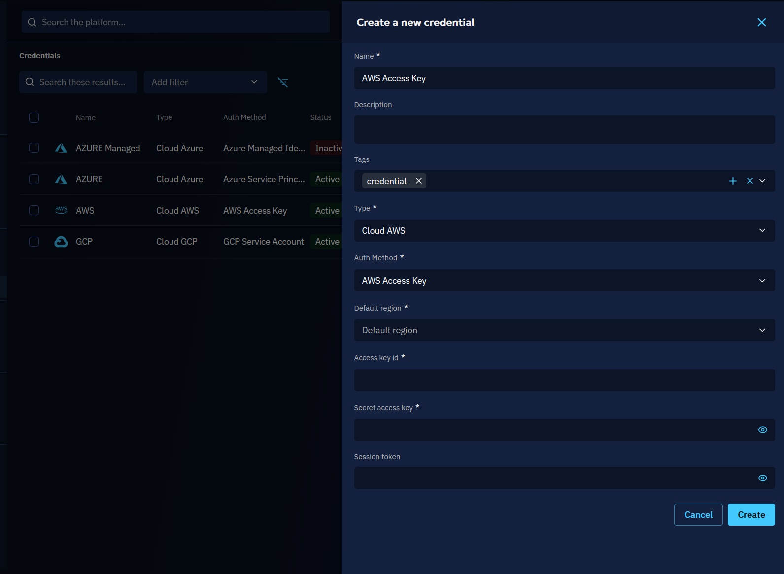
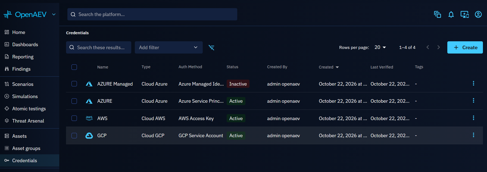
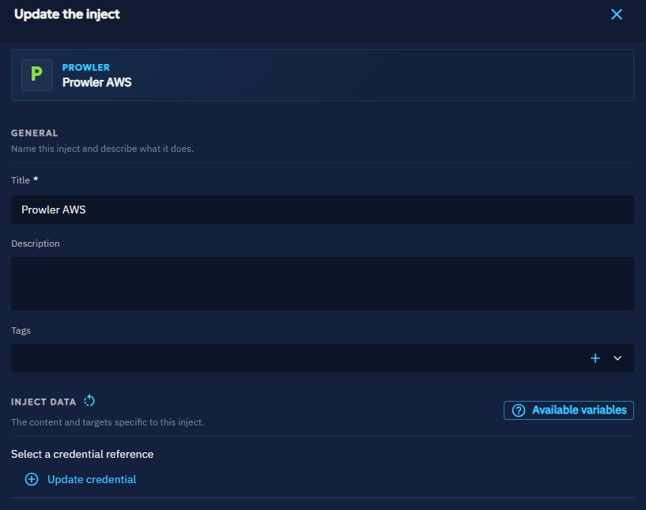
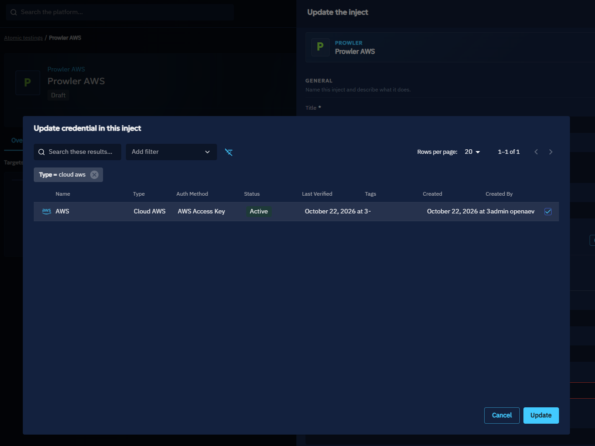

# Credentials

A Credential stores the secret an Inject needs to authenticate against its target, for example the access to a cloud
account. This page explains how to create Credentials and how to use them in your Injects.

!!! note "Preview feature"

    Credentials are a preview feature. They are only available when `CREDENTIAL_ASSET` is listed in
    `openaev.enabled-dev-features`. See [Configuration](../../reference/deployment/configuration.md).

## Why use Credentials?

Many Injects act on a target that requires authentication, such as a cloud attack technique that needs access to the
cloud account. With Credentials:

- **You store each secret once** and reuse it in as many Injects as you need.
- **Secrets never appear in the Inject**: the Inject only holds a reference to the Credential, and the Injector receives
  the secret only while the Inject runs.
- **You rotate a secret in one place**: every Inject that uses the Credential picks up the new value at its next
  execution.

Credentials belong to a Tenant: they are only visible and usable inside the Tenant where you created them.

## Supported types

OpenAEV currently supports the following Credential types and authentication methods:

| Type            | Supported authentication methods                    |
|:----------------|:----------------------------------------------------|
| **Cloud AWS**   | AWS access key, AWS assume role                     |
| **Cloud Azure** | Azure service principal, Azure managed identity     |
| **Cloud GCP**   | GCP service account, GCP OAuth 2.0                  |
| **Identity**    | Username and password, Hash                         |

Other authentication methods are not supported yet. When you create a Credential, the form shows the fields of the
method you select.

## How to create a Credential

1. Go to **Assets > Credentials**.
2. Click **Create**.
3. Enter a **Name**, then select the **Type** and the **Auth method**.
4. Fill in the fields of the authentication method.
5. Click **Create**.

Secret fields (passwords, keys, tokens) are write-only: once saved, they are never displayed again. To change one, type
a new value.

To update or delete a Credential, open its menu (**⋮**) and click **Update** or **Delete**.

!!! danger

    Deleting a Credential removes it from every Inject that uses it.

## Credential status

OpenAEV checks cloud Credentials against their provider when you create or update them, then once a day by default. The
**Status** column shows the result:

| Status       | Meaning                                                                         |
|:-------------|:--------------------------------------------------------------------------------|
| **Active**   | The provider accepted the Credential at the last check                          |
| **Inactive** | The last check failed. Hover over the status to see the reason                  |
| `-`          | The Credential is not checked. This is the case of Identity Credentials         |

You can tune the check schedule in
[Credential status validation](../../reference/deployment/configuration.md#credential-status-validation).

## Use a Credential in an Inject

The Inject form shows a Credential section only for the Injects whose Injector expects one, for example a cloud attack
technique.

1. Create or open an Inject in a Scenario, a Simulation or an Atomic Test.
2. In the Credential section, click **Update credential**.

    

3. Select the Credentials to use. When the Injector expects a given type, for example `Cloud AWS`, the list is filtered
   on this type.

    

4. Click **Update**, then save the Inject.

!!! note

    You can save an Inject without its mandatory Credential, but the Inject fails at execution while the Credential is
    missing.

At execution, the Injector retrieves the secret from OpenAEV for this run only. OpenAEV refuses to hand over an
**Inactive** Credential: fix or replace it, then run the Inject again.

## Permissions

Credentials have their own capabilities, set on roles in **Settings > Security > Roles**:

| Capability              | Allows                                                                                    |
|:------------------------|:------------------------------------------------------------------------------------------|
| `Access credentials`    | See Credentials and select them in an Inject                                              |
| `Manage credentials`    | Create and update Credentials                                                             |
| `Delete credentials`    | Delete Credentials                                                                        |
| `Resolve inject secret` | Retrieve the secret of a running Inject. Grant it only to the account of your Injectors   |

See [Users and RBAC](../../administration/users-and-rbac.md) for how to create roles.

## What's next?

- [Injects](../run-and-evaluate/injects/inject-overview.md) -- Create and configure Injects
- [Assets](assets.md) -- Manage the Endpoints and Asset groups targeted by your Injects
- [Injector development](../../development/injectors.md#credentials) -- Use Credentials in your own Injector
