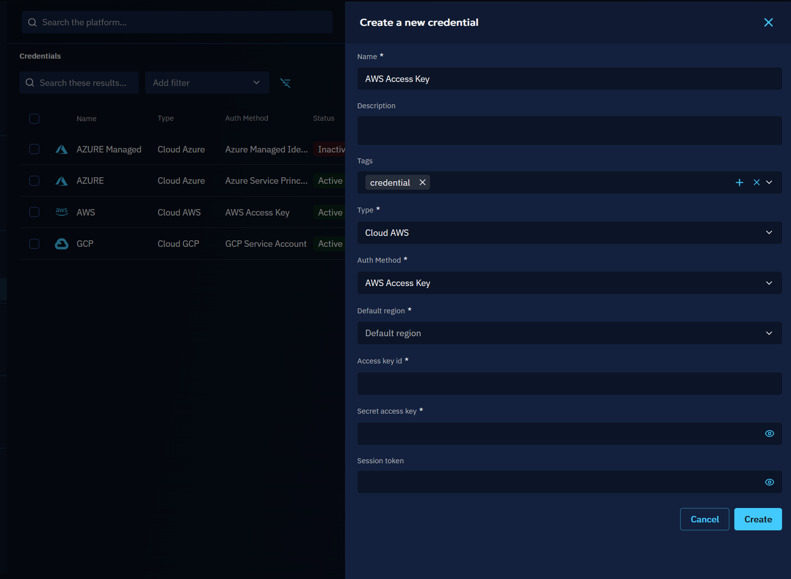
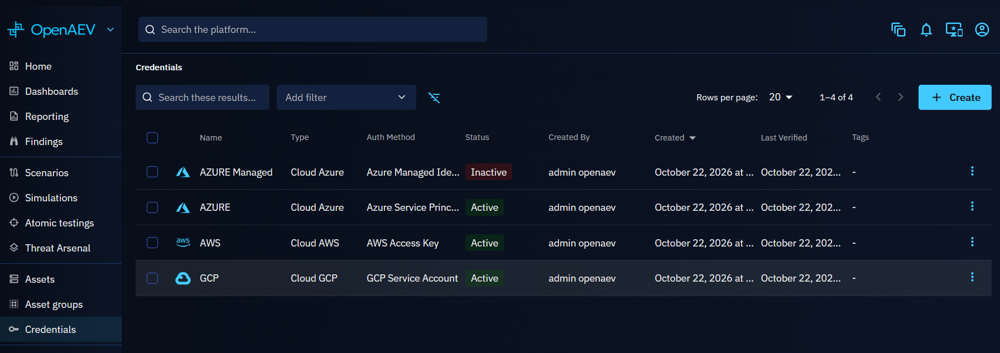
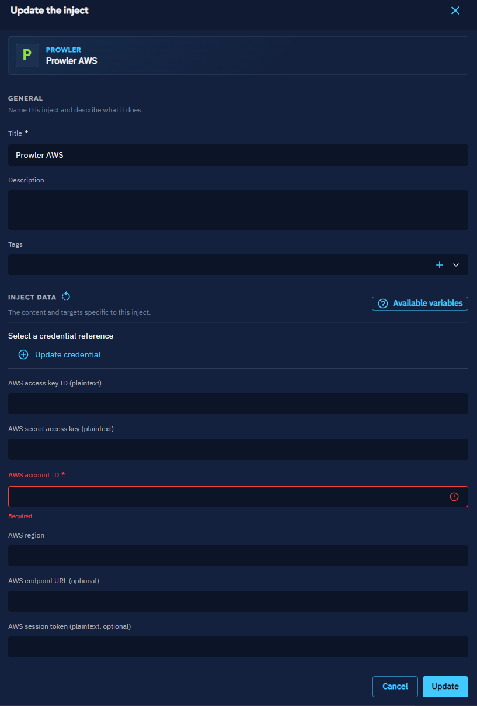
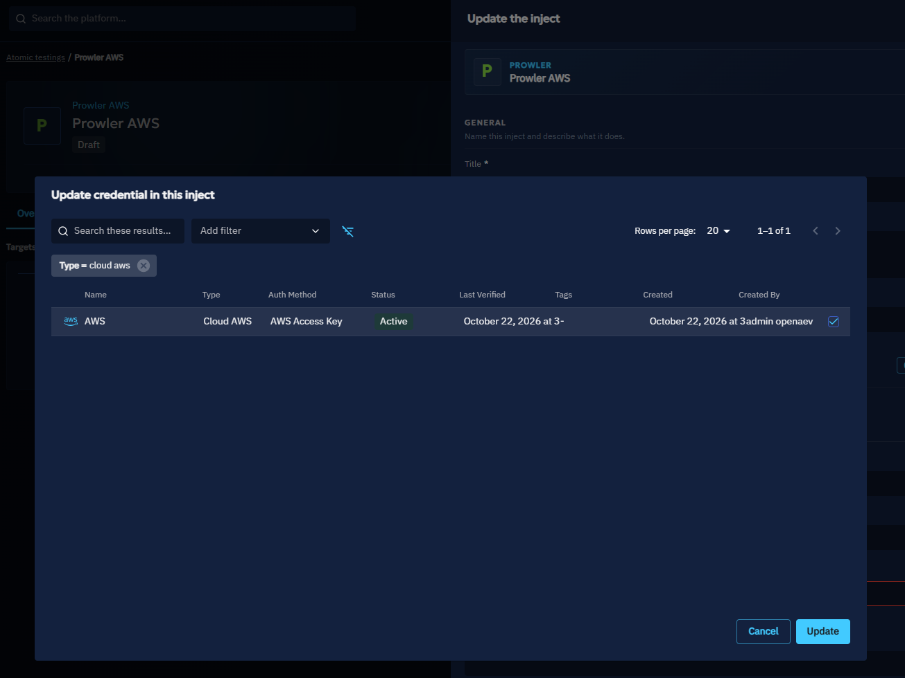

# Credentials

A Credential stores the secret an Inject needs to authenticate against its target, for example the access to a cloud
account. This page explains how to create Credentials and how to use them in your Injects.

## Why use Credentials?

Many Injects act on a target that requires authentication, such as a cloud attack technique that needs access to the
cloud account. With Credentials:

- **You store each secret once** and reuse it in as many Injects as you need.
- **Secrets never appear in the Inject**: the Inject only holds a reference to the Credential, and the Injector receives
  the secret only while the Inject runs.
- **You rotate a secret in one place**: every Inject that uses the Credential picks up the new value at its next
  execution.

Credentials belong to a Tenant: they are only visible and usable inside the Tenant where you created them.

## Supported types

OpenAEV currently supports the following Credential types and authentication methods:

| Type            | Supported authentication methods                    |
|:----------------|:----------------------------------------------------|
| **Cloud AWS**   | AWS access key, AWS assume role                     |
| **Cloud Azure** | Azure service principal, Azure managed identity     |
| **Cloud GCP**   | GCP service account, GCP OAuth 2.0                  |
| **Identity**    | Username and password, Hash                         |

Other authentication methods are not supported yet. When you create a Credential, the form shows the fields of the
method you select.

## How to create a Credential

1. Go to **Credentials** in the left menu.
2. Click **Create**.
3. Enter a **Name** (and optionally a **Description** and **Tags**), then select the **Type** and the **Auth Method**.
4. Fill in the fields of the authentication method.
5. Click **Create**.

Secret fields (passwords, keys, tokens) are write-only: once saved, they are never displayed again. To change one, type
a new value.

To update or delete a Credential, open its menu (**⋮**) and click **Update** or **Delete**.

!!! danger

    Deleting a Credential removes it from every Inject that uses it, even while it is in use: when the Credential is
    mandatory, these Injects are no longer ready to run until you select another one.

## Credential status

OpenAEV checks cloud Credentials against their provider when you create or update them, then once a day by default. The
**Status** column shows the result:

| Status       | Meaning                                                                                                                                                                                                 |
|:-------------|:--------------------------------------------------------------------------------------------------------------------------------------------------------------------------------------------------------|
| **Active**   | The provider accepted the Credential at the last check                                                                                                                                                  |
| **Inactive** | The last check failed. Hover over the status to see the reason                                                                                                                                          |
| `-`          | A cloud Credential shows `-` until OpenAEV completes its first check, for example while it cannot retrieve the stored secret. OpenAEV checks it again at the next scheduled check. Identity Credentials are never checked |

You can find more information about the check schedule in
[Credential status validation](../../reference/deployment/configuration.md#credential-status-validation).

## Use a Credential in an Inject

The Inject form shows a Credential field, in **Inject data**, only for the Injects whose Injector expects one, for
example a cloud attack technique.

1. In the **Injects** tab of a Scenario or a Simulation, open the three-dot menu of the cloud Inject to edit, then select
   **Update**.
2. Scroll down to **Update credential** and click it.

    

3. Select the Credentials to use. When the Injector expects a given type, for example `Cloud AWS`, the list is filtered
   on this type.

    

4. Click **Update**, then save the Inject.

!!! note

    You can save an Inject without its mandatory Credential, but the Inject fails at execution while the Credential is
    missing.

At execution, the Injector retrieves the secret from OpenAEV for this run only. OpenAEV refuses to hand over an
**Inactive** Credential: fix or replace it, then run the Inject again.

## Permissions

Credentials have their own capabilities, set on roles in **Settings > Security > This tenant > Roles** (platform roles
do not have them):

| Capability              | Levels                 | Allows                                                                                  |
|:------------------------|:-----------------------|:----------------------------------------------------------------------------------------|
| `Access credentials`    | Access, Manage, Delete | See Credentials and select them in an Inject; create and update them; delete them       |
| `Resolve inject secret` | --                     | Retrieve the secret of a running Inject. Grant it only to the account of your Injectors |

Each level includes the permissions of the preceding levels: selecting **Delete** automatically grants **Manage** and
**Access** as well.

See [Users and RBAC](../../administration/users-and-rbac.md) for how to create roles.

## What's next?

- [Injects](../run-and-evaluate/injects/inject-overview.md) -- Create and configure Injects
- [Assets](assets.md) -- Manage the Endpoints and Asset groups targeted by your Injects
- [Injector development](../../development/injectors.md#credentials) -- Use Credentials in your own Injector
