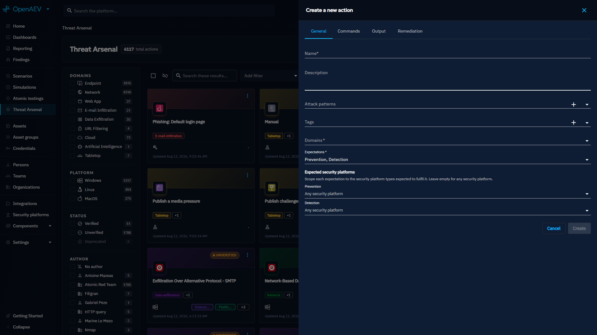
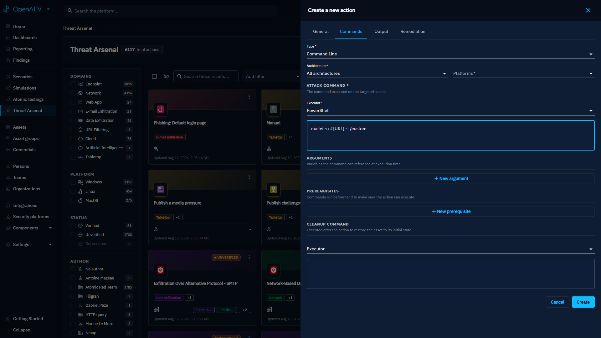
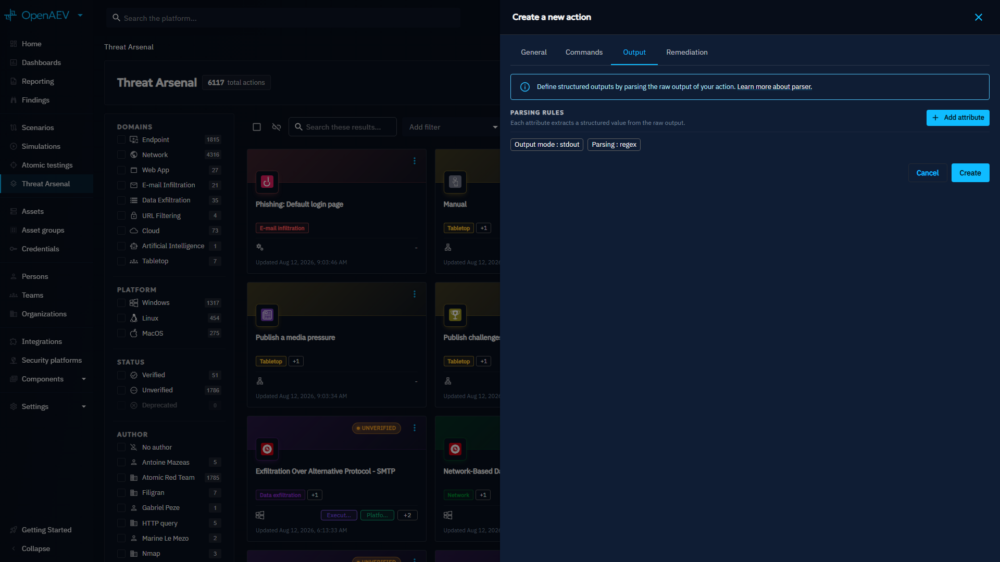
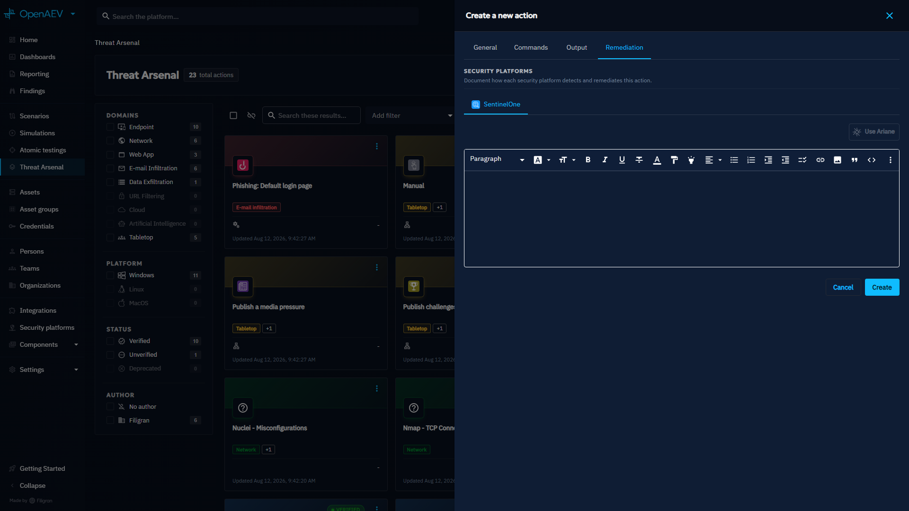
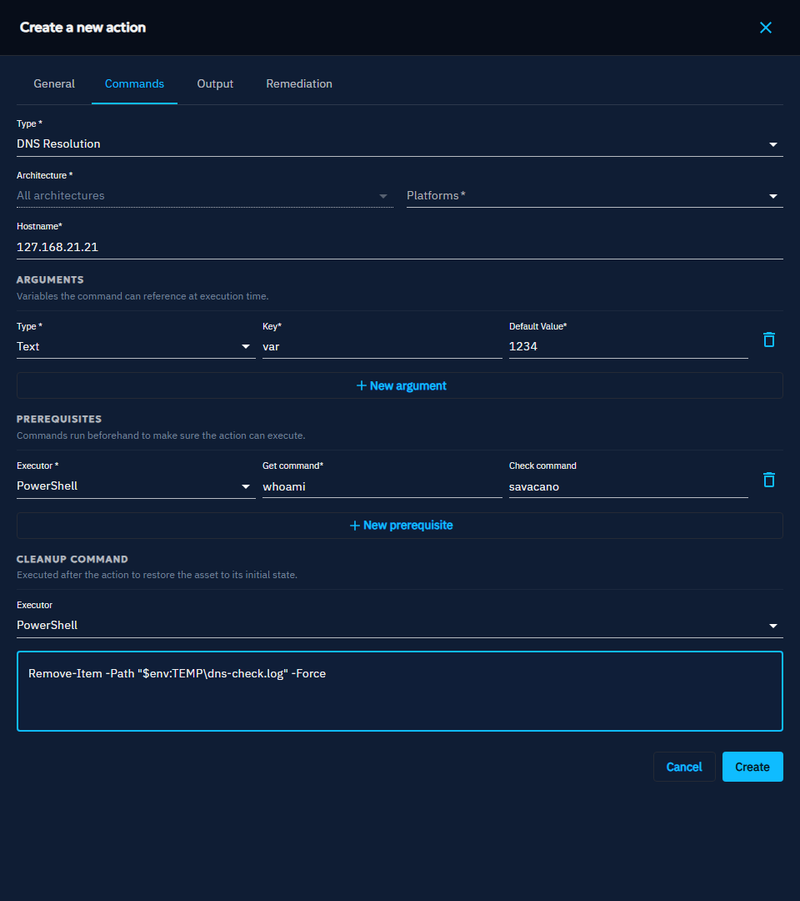
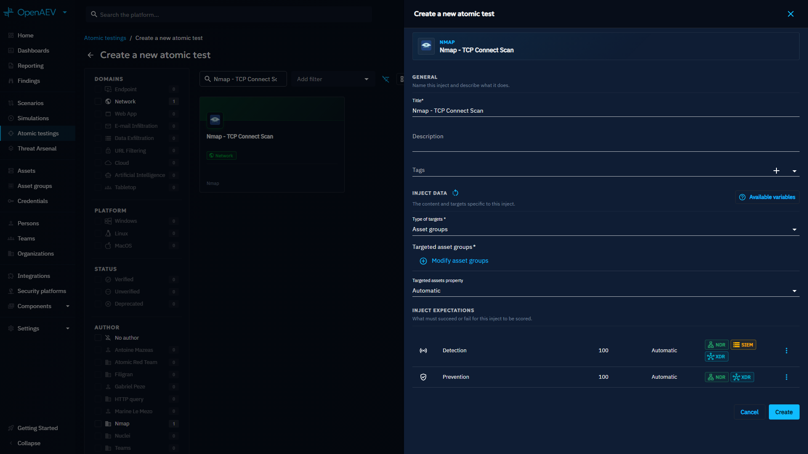
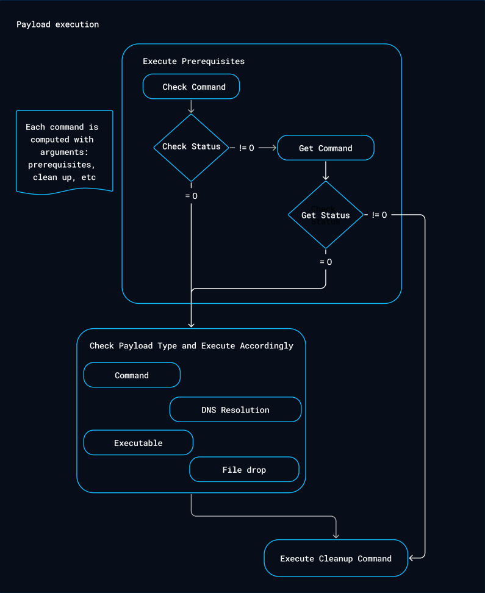

# Threat Arsenal

The **Threat Arsenal** is the section in OpenAEV where you manage all the Actions available for building Injects.

An **Action** defines what happens when an Inject executes on a target: a shell command, an executable, a file drop, or
a DNS resolution. Actions unify what were previously known as **Payloads** and **Injector Contracts** into a single,
simplified interface.

Depending on their source, Actions fall into three categories:

| Source                  | Description                                                                                                            | What you can edit               |
|-------------------------|------------------------------------------------------------------------------------------------------------------------|---------------------------------|
| **User-created**        | Built from scratch through the Threat Arsenal interface, and supported by the OpenAEV Implant Injector.                | Every property                  |
| **Injector-provided**   | Inserted automatically by Injectors integrated into the platform, such as Nuclei.                                      | Domains, attack patterns, tags  |
| **Collector-provided**  | Inserted by Collectors, such as Atomic Red Team. The Collector manages them entirely.                                  | Nothing -- these are read-only  |

Filigran also publishes ready-to-use Actions in a catalog, with fixed versions. See
[Filigran catalog and versions](filigran-catalog.md).

## Why use the Threat Arsenal?

- Build custom attack Actions tailored to your environment and threat landscape.
- Leverage community and vendor-provided Actions from Injectors and Collectors.
- Attach output parsers to automatically generate Findings from execution results.
- Define detection and remediation rules to validate Collector coverage.

## Action list view

The Threat Arsenal view displays every Action available in the platform. Each entry in the list includes the following
columns:

| Column       | Description                                                                                                     |
|--------------|-----------------------------------------------------------------------------------------------------------------|
| **Type**     | The Injector type that supports the Action. User-created Actions rely on the OpenAEV Implant Injector.          |
| **Name**     | The name assigned to the Action.                                                                                |
| **Domains**  | The domains the Action operates on, such as Endpoint, Network, Web App, or E-mail infiltration.                 |
| **Platform** | The platforms the Action supports, such as Windows, Linux, or macOS.                                            |
| **Tags**     | Tags that help you categorize and search for Actions.                                                           |
| **Status**   | The reliability or lifecycle state of the Action. See [Action status logic](#action-status-logic).              |
| **Approval** | Whether the payload content is trusted. See [Approval of payloads](#approval-of-payloads).                      |
| **Updated**  | The date of the last modification.                                                                              |

### Action status logic

| Status          | Description                                                                                                     |
|-----------------|-----------------------------------------------------------------------------------------------------------------|
| **Verified**    | OpenAEV has tested the Action and confirmed that it works as expected.                                          |
| **Unverified**  | OpenAEV has not tested the Action. It may or may not work.                                                      |
| **Deprecated**  | The original source marked the Action as deprecated. It remains available for reference, but OpenAEV does not guarantee that it still works. |

## Approval of payloads

Each version of a payload-based Action carries an **approval status** that tells whether its content is trusted. A version never changes once created (see [Filigran catalog and versions](filigran-catalog.md#versions-of-an-action)), so its approval covers exactly what it runs. Only users whose role holds the **Approve content** capability (*Threat Arsenal → Access threat arsenal → Approve content*) can approve or reject a version.

| Approval       | Meaning                                                                                              |
|----------------|------------------------------------------------------------------------------------------------------|
| **Pending**    | The version waits for an approver: it was created or saved by someone who cannot approve it. |
| **Approved**   | The content is trusted: Injects can run this version. |
| **Rejected**   | An approver refused the version, with a reason. Its author can save a new version. |
| **Superseded** | A newer version of the same Action was saved before anyone decided on this one: it can no longer be approved. |

How the status of a new version is set:

* **Filigran catalog versions are approved on arrival**: they are verified by Filigran (see [Filigran catalog and versions](filigran-catalog.md)). The approval history records them as *Verified by Filigran*.
* Creating, saving, duplicating, customizing or importing an Action is **auto-approved** when you hold *Approve content*; the approval history records it as an automatic approval by its author. Otherwise the new version is **Pending**.
* Saving a change to what an Action contains adds a new version; changing only its tags or domains keeps the version and its status.
* Versions synchronized by a collector are **Pending**: collectors bring scripts written by third parties, which is what an approver must review.
* Payloads the platform generates itself are **Approved** automatically, recorded as a *System* approval in the history: for example the file drop created for a security coverage.
* Payloads that existed before approval was introduced are **Approved**.
* Built-in Actions without a payload need no approval.

**Who approves by default.** When payload approval is introduced, every tenant role that can manage threat arsenal actions also receives *Approve content*, and so does the default *Manager* role of new tenants. Their authors' versions stay approved, so nothing changes for them. Maker-checker is **opt-in**: remove *Approve content* from the roles of the authors who must be checked, and their new versions become **Pending** until someone else approves them.

To approve or reject, open the Action (the list shows its latest version), then use **Approve** or **Reject** in its *Approval* section. A rejection requires a reason. The *History* tab shows what the version changes compared with the previous one. The *Approval* section also shows the latest decision (who approved or rejected it, when, with the comment) and, as information, where the Action is used (*Used in*: Atomic Tests, Scenarios and Simulations still to run, with links for users who can open them). The list can be filtered by approval status, and the *Versions* tab shows the status of every version.

### Notifications

Approvers and authors are notified in the [Notification Center](../../run-and-evaluate/notifications/notification-center.md#payload-approval-notifications), without any Trigger to configure:

* users whose role in the Tenant explicitly holds *Approve content* are told when a Payload, or a new version of an approved Payload, waits for approval (never about their own edits, and not again for each newer version while one already waits);
* authors are told when their version is approved, rejected (with the reason), or superseded by someone else's newer version.

Notifications are batched every minute and link to the version's Action. Each user chooses in-app and email delivery in the Notification Center's **Preferences** tab (in-app on, email off by default).

Scenario owners are told that a new version of an Action they use is available only once that version is approved.

### Versions and approval

A new version never changes what already runs: each Inject keeps the version it uses until someone moves it, in Atomic Tests, Scenarios and chaining workflows. Simulations already created keep their version.

* **Saved by an author without *Approve content*.** The new version is **Pending**. The author is told that Injects keep running their current version until an approver approves it; nobody is asked to move them yet.
* **Approved by an approver.** When the approved version replaces an approved version still used by Injects, the approver is asked: *N scenario injects, atomic tests or chained steps use vX. Move them to vY*, checked by default. Only the Injects and chained steps the approver can edit move; the others stay on their version and are reported. Unchecked, every Inject stays where it is.
* **Saved by an approver.** The version is approved at once, so the person saving it gets the same question.
* **Rejected or superseded.** The Injects stay on their version. The author of a superseded version is told.
* **Moving later.** From the *Versions* tab, anyone who can edit an Inject can move it to another **approved** version. A version that is not approved cannot be a target.
* **Picking an Action.** Pickers and automatic selection offer each Action in its latest **approved** version, so a newer version waiting for approval does not hide the one that can run.

### Only approved payloads can run

* **Picking an action.** When you add an Action to an Atomic Test, a Scenario, a Simulation or a chaining workflow, the picker lists only Actions with an **Approved** version, plus built-in Actions without a payload; its filter counts (domains, platforms, kill chain, status, authors) count exactly what it lists. In the inject form, the version selector only offers approved versions. Adding a non-approved version through the API is refused too.
* **Launch buttons.** When an Atomic Test, a Scenario or a Simulation uses a payload version that is not approved (*Pending*, *Rejected* or *Superseded*, for example after an import), its **Launch**, **Launch now**, **Relaunch now** and **Start now** buttons are disabled; hovering them tells why, for example *Can't launch: TEST-A is pending approval* (up to three Actions, then "+N"). The server refuses such launches on every path (including the API and scheduled runs) and writes the refusal to the audit log.
* **Indicators.** An inject whose payload version is not approved shows a compact **Pending**, **Rejected** or **Superseded** chip (the full text is in its tooltip). In the Atomic Tests list and on an Atomic Test page, a blocked Atomic Test shows **Draft**; its last results stay visible. In a Simulation's results, an inject that has not run yet shows the chip in its status; one that already ran keeps its execution status.
* **Scheduled runs.** Saving a new version never pauses a schedule or moves a Simulation back to *Draft*: Injects keep running their version. Scheduled runs that use a version that is not approved are refused, like manual launches. A schedule is paused only when an inject changes what it runs or targets (see [Scenarios](../scenario/scenario.md) and [Atomic Tests](../../run-and-evaluate/atomic-testing/atomic-testing.md)).
* **Actions picked by the platform.** Wherever the platform picks Actions on its own, it follows the same rule as the picker: only approved versions, plus built-in Actions without a payload.
    * The inject assistant (injects generated from attack patterns) and the security coverage generation (from attack patterns, vulnerabilities, indicators and files) never pick a non-approved Action. When no approved Action matches, they create the usual manual placeholder inject.
    * **Add to scenario(s)** from a selection of Actions adds only the approved ones and tells you how many were skipped.
    * The AI orchestrator is only offered approved Actions, and a chaining step using a non-approved Action is refused.
    * Imports are unchanged: a spreadsheet import (with an import mapper) and a Scenario, Simulation or Atomic Test file import keep their injects. An inject whose payload version is not approved shows its approval chip, and its launch stays blocked until the version is approved.
* **Last check before running.** Right before an inject runs, the platform checks its payload version again: if it is not approved, the inject ends in error instead of running.

## Create an Action

To create a new Action, follow these steps:

1. Click the **Create** button at the top right of the list.

2. In the **General** tab, fill in the required details. Assign a name to the Action, then provide general details
    such as its description, attack patterns, and tags.

    

3. In the **Commands** tab, choose an Action type:

    - **Command Line** -- Executes a command through an Executor, such as PowerShell or Bash.
    - **Executable** -- Runs an executable file on an Asset.
    - **File Drop** -- Drops a file onto an Asset.
    - **DNS Resolution** -- Resolves a hostname into IP addresses.

    Specify the platform, then provide the command details such as arguments and prerequisites. Add a cleanup Executor
    and a cleanup command to remove any remnants that the execution leaves on the Asset.

    

4. In the **Output** tab, add [output parsers](output-parsers.md) to process the raw output of the execution, and
    specify whether to generate [Findings](../../run-and-evaluate/findings/findings.md) from that output. This step is
    optional.

    

5. In the **Remediation** tab, define detection rules that identify Actions which existing security systems did not
    block or detect. The platform displays a dedicated tab for each security platform it integrates. This step is
    optional. See [Detection remediation properties](action-properties.md#detection-remediation-properties).

    

Once you complete these steps, the new Action appears in the Action list.

For the complete list of the fields available in each tab, see [Action properties](action-properties.md).

## Use an Action

After you create an Action, a new Inject type appears automatically in the Inject types list, provided that the implant
you use supports it. The OpenAEV Implant does.

The following diagram shows how an Action executes on a target:

## Update an Action

As described in the [Action list view](#action-list-view) section, you can create Actions yourself, or the platform can
insert them through Injectors or Collectors. The update process depends on the source of the Action:

- **User-created Actions** -- Update them directly from the Threat Arsenal view. Click the Action and modify any of its
  properties.
- **Actions inserted through Injectors** -- Update only the domains, attack patterns, and tags linked to the Action.
- **Actions inserted through Collectors**, such as Atomic Red Team -- You cannot update them from the platform, because
  the Collector manages them.

## Delete an Action

The deletion process also depends on the source of the Action:

- **User-created Actions** -- Delete them directly from the Threat Arsenal view. Click the Action, then select the
  delete option.
- **Actions inserted through Injectors or Collectors** -- You cannot delete them from the platform.

## Bulk operations

The Action list view supports bulk operations, so you can act on several Actions at once.

### How to use

1. Select one or more Actions using the checkboxes on the left side of the list.
2. A bulk action toolbar appears at the top of the list with the available operations.
3. Choose the operation you need.

### Available bulk operations

| Operation      | Description                                                                                                     |
|----------------|-----------------------------------------------------------------------------------------------------------------|
| **Delete**     | Deletes several user-created Actions at once. You cannot delete Actions that come from Injectors or Collectors. |
| **Export**     | Exports the selected Actions as a JSON ZIP archive, in [JSON:API](https://jsonapi.org/) format.                 |
| **Tag**        | Adds or removes tags on several Actions simultaneously.                                                         |
| **Run a Test** | Launches a Scenario or an Atomic Test directly from the selected Actions.                                        |

### Run a test from bulk selection

When you click **Run a Test** in the bulk toolbar, a drawer opens with three execution options. The same drawer opens
from the **Run a test** button of a card or of the Action details, for that single Action:

| Option                       | Description                                                                          | Availability                 |
|------------------------------|----------------------------------------------------------------------------------------|------------------------------|
| **Create a new scenario**    | Builds a fully customized Scenario. The selected Actions are prefilled as Scenario steps. | One or more Actions selected |
| **Add to existing scenario** | Inserts the selected Actions as new steps into one or more existing Scenarios.        | One or more Actions selected |
| **Run atomic test**          | Executes the selected Action immediately as a one-off Simulation.                     | **Single Action only**       |

#### Create a new scenario

1. Select one or more Actions, then click **Run a Test**.
2. Choose **Create a new scenario**.
3. The standard Scenario creation funnel opens in the drawer.
4. Click **Create**. OpenAEV creates the Scenario with the selected Actions prefilled as Inject steps.

#### Add to existing scenario

1. Select one or more Actions, then click **Run a Test**.
2. Choose **Add to existing scenario**.
3. Select one or more target Scenarios from the dropdown list. Multi-selection is supported.
4. Click **Create**. OpenAEV adds the selected Actions as Inject steps to all the chosen Scenarios.

#### Run atomic test

1. Select exactly one Action, then click **Run a Test**.
2. Choose **Run atomic test**.
3. The standard Atomic Test execution funnel opens with the Action prefilled.
4. The Simulation executes as a one-off run.

## Import and export Actions

OpenAEV supports importing and exporting Actions using the [JSON:API](https://jsonapi.org/) specification, so you can
share Actions across instances or within the community.

There are two ways to export Actions:

- **CSV export** -- Filter or search the Action list, then export the current view as a **CSV (Comma-Separated
  Values)** file. The exported file
  contains the same information that the Threat Arsenal page displays. This export works for every type of Action.
- **JSON ZIP export** -- Pair this export with the import feature: you export to reimport elsewhere. It works only for
  user-created Actions, because it contains all the details of the Action -- the command, arguments, output parsers,
  and more -- which you cannot edit on Actions that come from Injectors or Collectors.

Use these exports to share complex Actions with teammates or the community, and to move Actions across your
development, test, and production environments.

## What's next?

- [Filigran catalog and versions](filigran-catalog.md) -- Install, version, customize and revoke Filigran Actions
- [Action properties](action-properties.md) -- Reference of every field of the Action form
- [Output parsers](output-parsers.md) -- Extract structured data from execution output
- [Domains](domains.md) -- Understand how Domains classify Actions by security control
- [Injects](../../run-and-evaluate/injects/inject-overview.md) -- Use Actions in Injects
- [Atomic testing](../../run-and-evaluate/atomic-testing/atomic-testing.md) -- Run individual Actions as Atomic Tests
- [Findings](../../run-and-evaluate/findings/findings.md) -- View parsed output from Action executions
