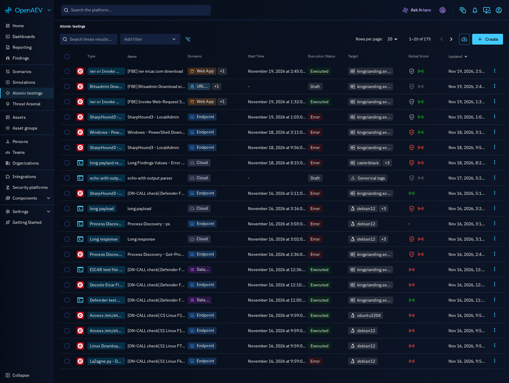
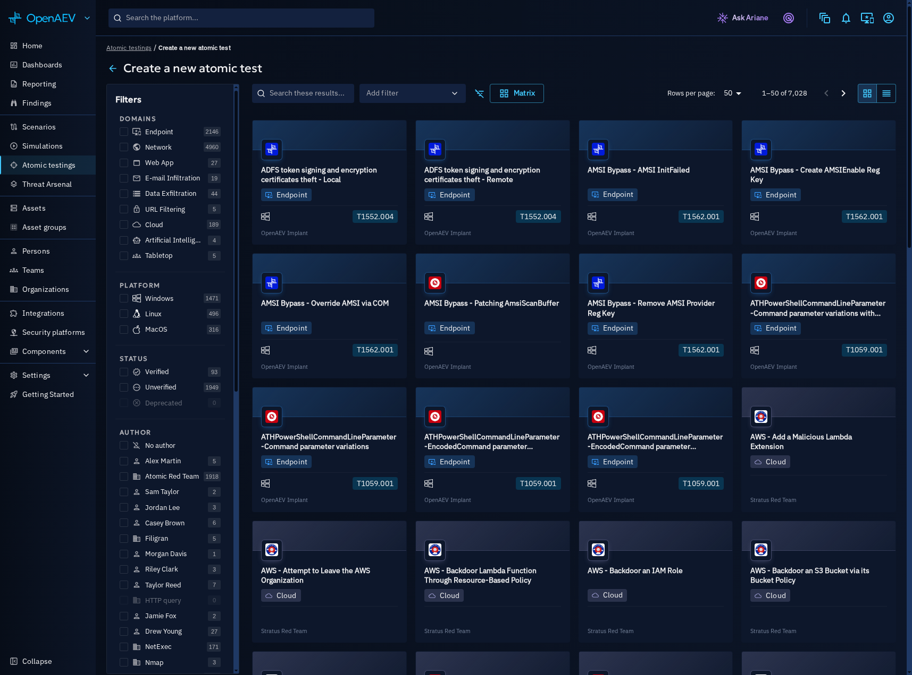
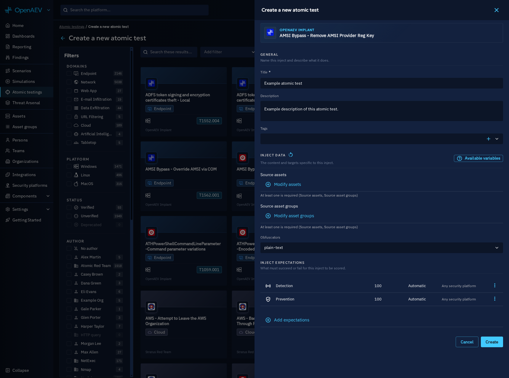
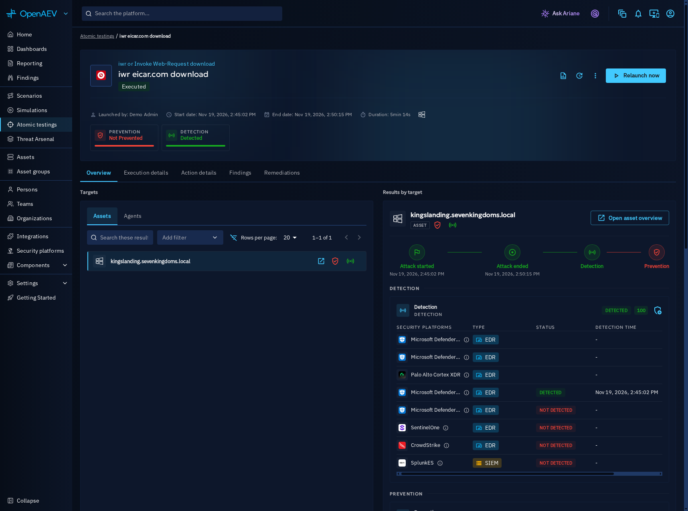

# Atomic testing

Atomic testing lets you execute a single attack technique in isolation and immediately measure your ability to prevent and detect it. Unlike Simulations that run a full Scenario, Atomic Tests focus on one Inject at a time for rapid, targeted validation.

## Why use Atomic Tests?

- Quickly validate whether a specific MITRE ATT&CK technique is detected or prevented.
- Isolate and troubleshoot individual defensive controls without running a full Scenario.
- Onboard new Threat Arsenal Actions by testing them before adding them to Scenarios.

## Atomic testing list

Navigate to **Atomic testing** in the left menu to see all Atomic Tests launched on the platform. The list shows the global score for each test, allowing you to quickly identify which techniques your security stack handles well and which need attention.

Use the search bar and filters to narrow results.

## Create an Atomic Test

1. Click the **Create** button at the top right of the Atomic testing list. The **Create a new atomic test** page opens.
2. Browse the Threat Arsenal Actions, shown as cards. Use the search bar, or the **Filters** panel on the left to narrow them by domain, platform, status, author, MITRE ATT&CK tactic or MITRE ATLAS tactic.
3. Click an Action card. The **Create a new atomic test** drawer opens.

4. Fill in the drawer:
    - **General**: title (prefilled with the Action name), description and tags.
    - **Inject data**: the targets of the Action (for example Assets or Asset groups) and the configuration it requires.
    - **Inject expectations**: the Expectations used to score the test.

5. Click **Create**.

## Schedule a recurring Atomic Test

Recurring Atomic Tests are the simplest way to continuously validate that a prevention or detection capability keeps working over time. The same technique is replayed automatically and each run produces fresh results.

1. Open the Atomic Test and click the scheduling action in the header.
2. Choose a frequency: **once**, **hourly**, **daily**, **weekly**, or **monthly**, with the execution time and day.
3. Define the start date and optionally an end date.
4. Save. The next planned execution is displayed on the Atomic Test.

The platform checks for due recurring Atomic Tests every minute and launches them automatically. Each execution archives previous results and creates new Expectations for all targets.

!!! note

    Scheduling requires the permission to launch the Atomic Test. The recurrence can be updated or removed at any time from the same dialog.

## Stop a running Atomic Test

While an Atomic Test is queuing, executing or pending, its header shows **Stop execution**.

1. Click **Stop execution**.
2. Confirm in the dialog.

The agents no longer receive the jobs they have not picked up yet, and the Atomic Test ends in **Error** with an execution trace naming who stopped it. Commands an agent already started are not interrupted on the endpoint. The same action is available on the API: `POST /api/atomic-testings/{atomicTestingId}/stop`.

!!! note

    Stopping requires the permission to launch the Atomic Test. An Atomic Test that is not running cannot be stopped.

## Atomic Test detail

The detail page has three parts:

- **Header**: title, status tooltip (tags, description), pie charts summarizing results, and actions (launch, stop, update, delete, export)
- **Overview**: quick summary of test results across all targets with posture gauges
- **Execution details**: Inject Expectations and detailed execution traces

The result tabs (Overview, Findings, Execution details, Threat Arsenal Action info, Remediations) follow the same layout as any Inject result. See [Inject result](../injects/inject-result.md) for details on each tab.

## What's next?

- [Inject result](../injects/inject-result.md) -- Understand result breakdown and remediation
- [Inject overview](../injects/inject-overview.md) -- How Injects work
- [Threat Arsenal](../../build/threat-arsenals/threat-arsenals.md) -- Browse and create Actions
- [Simulation](../simulation/simulation.md) -- Run full Scenario-based Simulations
