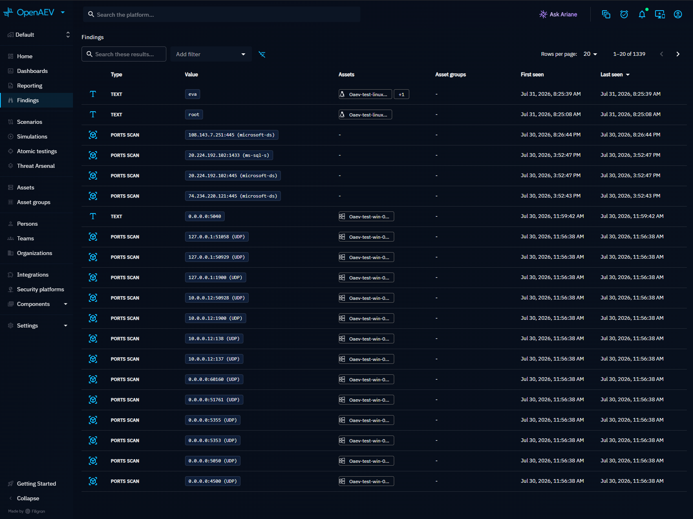
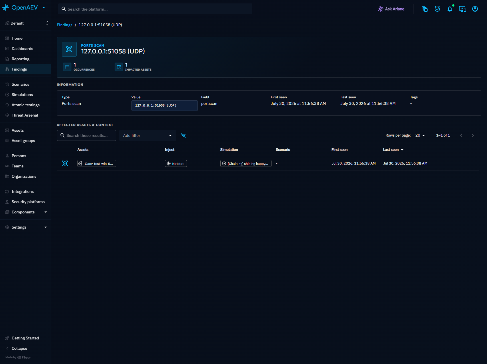
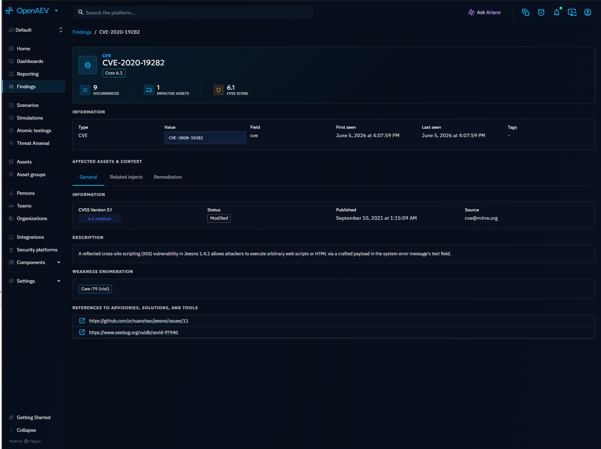

# Findings

Findings are structured security insights automatically extracted from Inject execution results. They surface discovered vulnerabilities, exposed credentials, open ports, IP addresses, and other actionable data produced by Injectors during Simulations and Atomic Tests.

## Why use Findings?

Findings transform raw execution output into searchable, categorized technical indicators. They help you:

- **Identify exposure**: see which CVEs, open ports, and credentials were discovered across your infrastructure
- **Track remediation**: monitor whether previously detected issues reappear in subsequent Simulations
- **Correlate with Assets**: understand which endpoints are affected by each Finding
- **Prioritize action**: CVE-type Findings include CVSS scores and enrichment data from [Taxonomies](../../../administration/taxonomies.md)

## How Findings are created

Findings are created automatically during Inject execution. When an Inject produces structured output (e.g., a port scan result, a CVE detection, or extracted credentials), OpenAEV parses the output and creates one Finding per discovered indicator.

Each Finding is deduplicated by its combination of value, type, and field. If the same Finding is detected again in a later execution, the existing record is updated with a new "last seen" timestamp rather than creating a duplicate.

## Finding types

| Type | Description |
|---|---|
| CVE | Known vulnerabilities (e.g., CVE-2021-44228) with optional CVSS enrichment |
| Credentials | Extracted username/password pairs |
| IPv4 / IPv6 | Discovered IP addresses |
| Port | Open ports detected on an endpoint |
| PortScan | Structured port scan results |
| Text | Free-form textual indicators |
| Number | Numeric indicators |
| File / Share | Discovered files or network shares |
| Username | Discovered usernames and accounts |

Additional types exist for Active Directory findings (SID, delegation, Kerberoastable accounts, ASREPRoastable accounts, etc.).

## Sensitive Findings

Some Finding types carry secret material: their value is masked everywhere the platform returns it
(list, detail, Simulation, Scenario, Endpoint and Inject views), as well as in Dashboards, Widgets
and the reports generated from them.

| Sensitive type | Value shape | Masked as |
| --- | --- | --- |
| Credentials | `admin:motdepasse` | `admin:mo******` |

Sensitivity is **derived from the Finding type**: a type is sensitive as soon as its value is made of
a password, a hash or a key. No setting or flag marks a Finding as sensitive.

Masking is applied **segment by segment**. The platform knows how each Finding value is composed, so
it masks only the segments that are actually secret: a credential is returned as `admin:mo******`,
keeping the account name - which tells you *which* account is compromised, and is not itself a
secret - and masking only the password or the hash.

A masked segment keeps its first two characters, so you can still tell which secret was discovered
when you already know it, without the platform ever disclosing it. A segment too short to keep a
fragment safely is masked entirely (`admin:abcd` becomes `admin:******`), and the mask has a fixed
width, so the length of the secret is not leaked either.

When the composition of a value is unknown, or when a value does not match the expected shape, every
segment is masked instead: an omission can only ever hide too much, never disclose a secret.

**Password policy** Findings are an explicit exception and are never masked: their `key` is the name
of a policy setting (`MinimumPasswordLength`...), not a secret.

Kerberoastable and ASREPRoastable account Findings are not masked either, and need no exception to
be so: their value is the account name alone. The hash their type declares never reaches the value,
so segment-level masking leaves them untouched on its own.

### Searching sensitive Findings

The platform stores the masked form of each Finding value next to its full value, and every feature
that reads or matches a value uses the masked form only:

- the search bar, the filters and the sort of every Findings list (the **Findings** menu and the
  Simulation, Scenario, Inject and Endpoint views);
- the **Filters** of a notification [Trigger](../notifications/triggers.md) on the Finding Resource
  type;
- Dashboards, Widgets and the reports generated from them.

Search, filters and Triggers therefore match **only the characters that are displayed**. A filter
cannot be used to guess the hidden part of a secret:

| Search or filter on `admin:motdepasse`, displayed as `admin:mo******` | Result |
| --- | --- |
| `admin` | The Finding is found |
| `mo` (the displayed fragment) | The Finding is found |
| `mot`, `motdepasse` | Nothing is found |
| **Equals** `admin:mo******` | The Finding is found |
| **Equals** `admin:motdepasse` | Nothing is found |

Sorting by value uses the masked form too, so the position of a Finding in the list tells nothing
about its hidden part.

As a consequence, different secrets that share the same masked form (for example `admin:mo******`
for two different passwords starting with `mo`) appear as a single row in the Findings list, with
the occurrences and Assets of both, and as a single entry in Widgets that group by Finding value.

!!! note "Saved filters and Triggers on a full secret"

    A saved filter or a Trigger written against the full value of a sensitive Finding, such as
    **Value contains** `motdepasse`, no longer matches anything. Rewrite it on the displayed part of
    the value, such as the account name `admin`.

!!! warning "The secret is not deleted"

    The full value is still stored in the database, next to its masked form, because deduplication,
    correlation and attack path computation rely on it. Masking applies to the representation the
    platform displays and matches: it does not encrypt the stored value.

    Reports generated before your platform masked Findings in Dashboards keep the values they were
    generated with. Generate them again to get the masked values.

## Findings list

Navigate to **Findings** in the left menu to see all Findings in an aggregated view. The list groups Findings by unique value and type, merging Assets from all occurrences into a single row. Sensitive Findings are grouped by their masked value (see [Searching sensitive Findings](#searching-sensitive-findings)).

Each row displays:

| Column | Description |
|---|---|
| Type | The Finding category (CVE, Port, Credentials, etc.) |
| Value | The technical value (monospace display), masked for sensitive Findings |
| Assets | Endpoints where the Finding was detected |
| Asset groups | Asset groups containing affected endpoints |
| First seen | When the Finding was first detected |
| Last seen | When the Finding was most recently detected (default sort) |

Use the search bar and filters to narrow results by type, value, date range, Assets, or Asset groups. On sensitive Findings, they match the displayed characters only.

## Finding detail

Click on a Finding to open its detail view. The **Overview** presents the Finding at a glance:

- **Finding type and value** with occurrence count and impacted Asset count
- **Information**: type, value, field, first seen, last seen, tags
- **Occurrences**: every Inject execution that produced this Finding, shown both as a list and as a timeline, with links to the parent Simulation and Scenario
- **Vulnerability panel**: for CVE-type Findings, a summary of the vulnerability enrichment surfaced directly in the Overview

The Overview loads a lightweight Finding summary so counts and enrichment appear without fetching every occurrence up front.

### CVE enrichment

For CVE-type Findings, additional tabs appear:

- **General tab**: vulnerability description, CVSS v3.1 score, CISA exploitability data (KEV catalog), CWE classifications, and reference URLs. This data is sourced from the [Taxonomies](../../../administration/taxonomies.md) configured on the platform.

!!! tip "Enterprise Edition"

    The **Remediation tab** displays actionable remediation recommendations for CVE-type Findings. This tab is available with a valid Enterprise Edition license.

## Where Findings appear

Findings are accessible from multiple locations in the platform:

| Location | Description |
|---|---|
| **Findings** (left menu) | Global aggregated view across all Simulations |
| **Simulation detail** | Findings produced by Injects in that Simulation |
| **Scenario detail** | Findings aggregated across all Simulations of the Scenario |
| **Inject execution results** | Findings produced by a specific Inject |
| **Endpoint detail** | All Findings linked to a specific Asset |

## What's next?

- [Inject results](../injects/inject-result.md) -- Understand Inject execution results
- [Assets](../../build/assets.md) -- Manage endpoints and Asset groups
- [Taxonomies](../../../administration/taxonomies.md) -- Configure CVE and attack pattern data
- [Reporting](../reporting/reporting.md) -- Generate reports that include Findings
